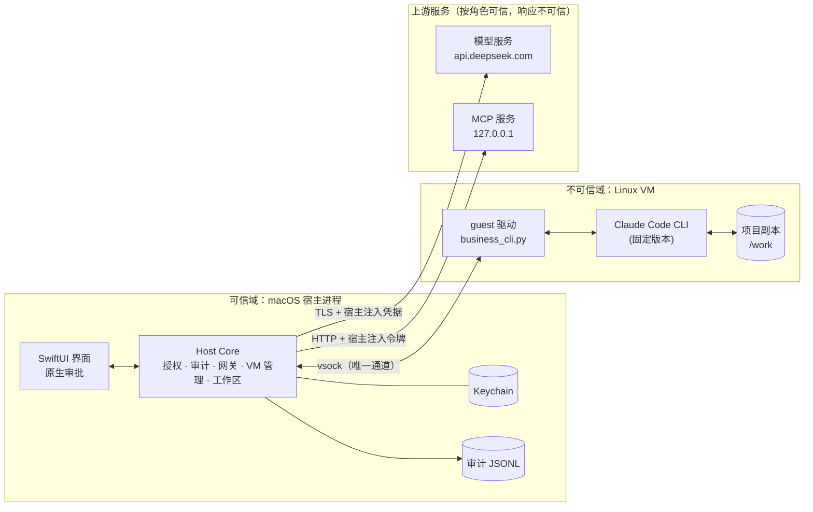
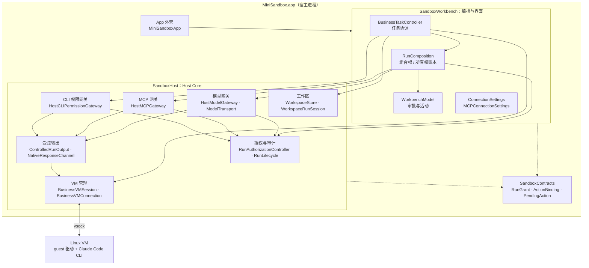
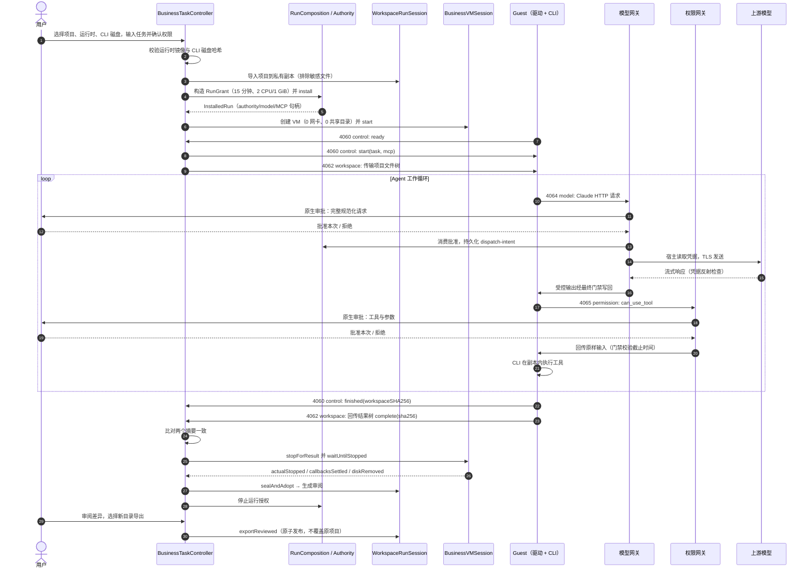
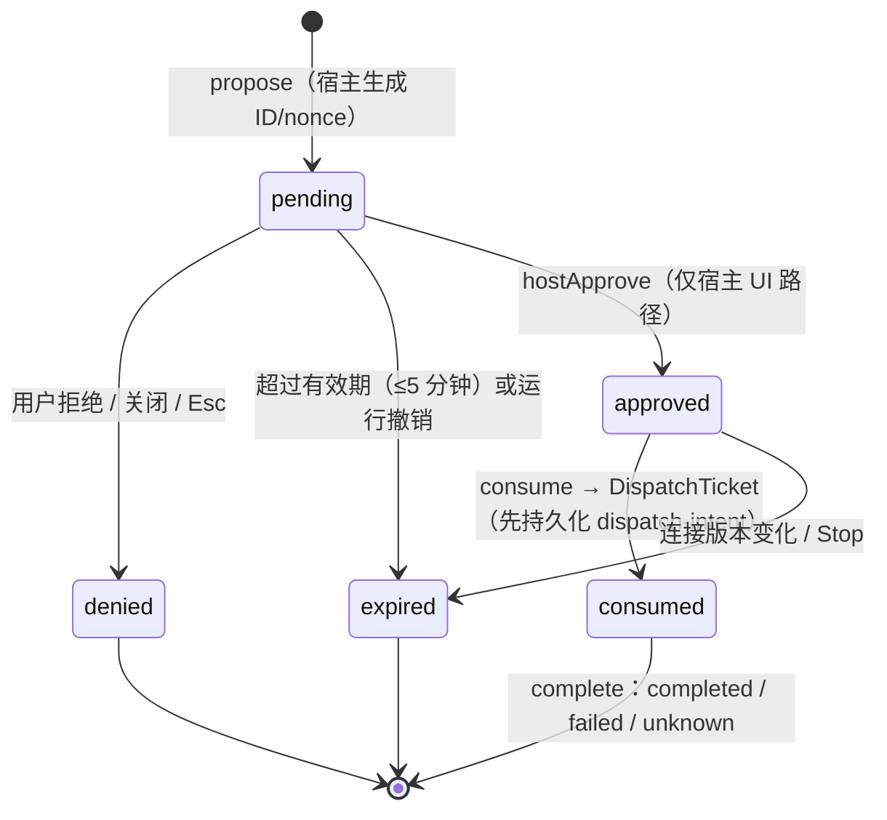
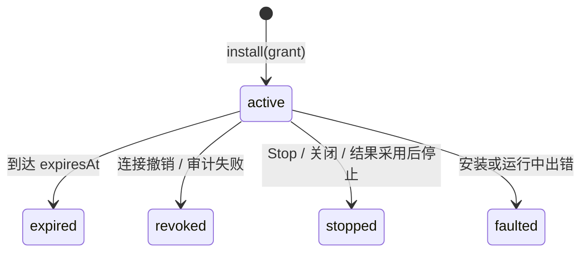

# mini-sandbox 架构设计

> **适用范围**：`main` 分支当前代码（2026-10-26）。
> **规格基线**：[最终实施方案 v2（FINAL_SPEC）](prd/desktop-sandbox/implementation-v2/FINAL_SPEC.md)。本文说明**已经实现**的架构、模块划分与职责分工；规格与实现不一致处在[第 13 节](#13-与规格的差异)单独列出。
> **读者**：新加入的开发者、评审者、需要理解系统边界的使用者。

## 目录

1. [概述](#1-概述)
2. [信任边界](#2-信任边界)
3. [总体架构](#3-总体架构)
4. [模块规格](#4-模块规格)
5. [关键流程](#5-关键流程)
6. [授权模型](#6-授权模型)
7. [数据面：vsock 端口与协议](#7-数据面vsock-端口与协议)
8. [资源与容量上限](#8-资源与容量上限)
9. [数据与持久化](#9-数据与持久化)
10. [构建产物与外部依赖](#10-构建产物与外部依赖)
11. [分工](#11-分工)
12. [实现现状与已知限制](#12-实现现状与已知限制)
13. [与规格的差异](#13-与规格的差异)
14. [延伸阅读](#14-延伸阅读)

---

## 1. 概述

### 1.1 要解决的问题

在 Mac 上运行已有的 AI 编程 Agent（当前为 Claude Code CLI），同时满足：

- Agent 只能看到用户导入的**项目副本**，看不到宿主其他文件；
- 模型 API key、MCP 令牌等**长期凭据只留在宿主**，从不进入 Agent 所在的 VM；
- 每一次模型请求、外部工具调用和本地工具权限都必须由宿主**逐次审批**；
- 任务结果经用户**审阅后导出到新目录**，从不覆盖原项目；
- **Stop** 后旧授权立即失效，不能再产生新的外部效果。

### 1.2 设计目标

| 目标 | 实现手段 |
|---|---|
| 执行隔离 | Apple Virtualization.framework 启动 Linux arm64 VM；**无通用网卡、无宿主共享目录**；仅通过 virtio-socket（vsock）与宿主通信 |
| 凭据不出宿主 | 凭据存 macOS Keychain，只在宿主网关发送上游请求的瞬间读取；guest 只拿到公开占位值 |
| 授权与身份绑定 | 身份来自宿主创建的对象（`HostRunHandle`、实际 VZ 监听器/连接），**不信任消息里自报的 runId** |
| 一次批准只做一件事 | 审批绑定规范化请求的完整字节；批准后原子消费，执行时从被消费的字节重建请求 |
| 最终效果门禁 | 网络 `resume()`、socket `send`、文件写入前，在同一把生命周期锁内重新采样可信时钟并校验运行状态 |
| 可追溯 | 宿主执行点产生 `SecurityEvent`，同步写入 append-only JSONL 审计文件；guest 输出只作诊断 |
| Fail closed | 审计写失败、解析失败、超限、超时都拒绝并撤销；不回退到宿主裸跑或放开网络 |

**非目标**（首版）：云端/K8s 投递、Windows/Linux 桌面端、多 Agent 并发、预热池与持久 VM、任意互联网访问、任意包安装、自动覆盖原项目。

### 1.3 术语表

| 术语 | 含义 |
|---|---|
| **Host / 宿主** | macOS App 进程，可信域。包含 UI、授权、网关、VM 管理、工作区 |
| **Guest** | Linux VM 内的一切（内核、guest 驱动脚本、Agent CLI），不可信域 |
| **F03 / Authority** | `RunAuthorizationController`，宿主唯一的授权账本（名称来自早期里程碑编号） |
| **Run** | 一次任务运行。由宿主创建，对应一个 `RunGrant`、一个 `HostRunHandle`、一个 VM |
| **RunGrant** | 本次运行不可变的授权快照：镜像摘要、工作区快照、连接与资源范围、显式拒绝、资源上限、有效期 |
| **Epoch** | 运行代数；Stop/撤销会推进，旧 epoch 的请求一律无效 |
| **ResourceScope** | `(service, resource, operation)` 三元组，例如 `(model, deepseek-flash, stream)`；不支持通配 |
| **PendingAction** | 待审批动作，绑定规范化请求字节、nonce、有效期（≤5 分钟） |
| **ApprovedAction** | 宿主审批后得到的一次性批准，只能由宿主 UI 路径产生 |
| **DispatchTicket** | 消费批准后得到的派发意图；签发前必须先持久化 `dispatch-intent` 审计事件 |
| **RunLifecycle** | 所有组件共享的运行生命周期：`active → expired / revoked / stopped / faulted`（不可逆） |
| **Final-effect gate** | 最终效果门禁：真正发生副作用的系统调用前的最后一次时钟与状态检查 |
| **Owner** | 由实际 VZ 监听器创建的连接所有者（`BusinessVMConnection`），绑定 run/epoch/runtime/service |

---

## 2. 信任边界



| 域 | 包含 | 信任假设 |
|---|---|---|
| 宿主 | macOS、Virtualization.framework、本 App 进程及其代码 | 可信。同进程内不宣称 UI 与 Keychain 在 OS 权限上隔离 |
| Guest | Linux 内核、guest 驱动、Agent CLI、项目副本 | **完全不可信**。即使 guest root 被控制，也只能使用本次运行已授予的能力 |
| 上游 | 绑定的模型服务、MCP 服务 | 按其角色可信；**响应内容、工具描述、模型输出均按不可信数据处理** |

**安全保证**：不读取未导入的宿主文件；不向 guest 投递原始长期凭据；外部请求只能经过宿主受控执行点；未批准的操作不转发；Stop 后不再获得新授权；导出不越界。

**不保证**：抵抗已被攻陷的宿主或同 UID 进程；全部虚拟化漏洞与侧信道；通过已批准模型通道外发的数据；远端服务滥用其已有权限；撤回已交给 OS 或远端的字节与副作用。

---

## 3. 总体架构

### 3.1 运行时视图



### 3.2 代码分层与依赖

SwiftPM 包 `MiniSandbox`（`Package.swift`，macOS 14+，Swift tools 6.0）由四个产品 target 组成，依赖严格单向：

```text
MiniSandboxApp (可执行, SwiftUI 入口)
   └─▶ SandboxWorkbench (编排 + 视图)
          └─▶ SandboxHost (Host Core, 链接 Virtualization.framework)
                 └─▶ SandboxContracts (纯数据契约, 无依赖)
```

| Target | 类型 | 可见性约定 |
|---|---|---|
| `SandboxContracts` | library | `public`：只含数据结构与纯检查，可被外部编译 |
| `SandboxHost` | library | 大部分为 `package`/internal；`SecurityEvent` 构造器仅模块内可用，外部无法伪造宿主事件 |
| `SandboxWorkbench` | target | `package`：只供本包内 App 与检查程序使用 |
| `MiniSandboxApp` | executable | 产品入口 `MiniSandbox` |

此外，`Package.swift` 在 `Tests/` 下声明了 14 个可执行检查 target（不使用 XCTest，见 [M12](#m12-测试与-ci)），另有 `PresentationChecks` 由覆盖率脚本单独链接；`Tools/VMProbe` 为独立诊断可执行程序。

### 3.3 仓库目录映射

| 路径 | 对应模块 |
|---|---|
| `Sources/SandboxContracts/` | M1 契约层 |
| `Sources/SandboxHost/` | M2–M8 Host Core |
| `Sources/SandboxWorkbench/` | M9 工作台与编排 |
| `Sources/MiniSandboxApp/` | M10 App 外壳 |
| `Tools/` | M11 Guest 运行时与镜像工具 |
| `Tests/`、`scripts/`、`.github/` | M12 测试、构建与 CI |
| `docs/prd/` | 产品规格 |
| `docs/engineering/` | 各模块工程说明与验证证据 |

---

## 4. 模块规格

每个模块按统一格式描述：**职责、关键源码、对外接口、依赖、关键约束、不负责、验证入口、详细文档**。

### M1 契约层

| 项 | 内容 |
|---|---|
| 职责 | 定义运行授权快照、资源范围、待审批动作等**语言无关的数据契约**及纯检查函数 |
| 关键源码 | `Sources/SandboxContracts/Contracts.swift` |
| 对外接口 | `RunGrant`、`ConnectionGrant`、`ResourceScope`、`ResourceLimits`、`ActionBinding`、`PendingAction`、`RunGrant.decision(for:connectionID:at:)` |
| 依赖 | 无（仅 Foundation） |
| 关键约束 | 构造与 `Codable` 解码都做字段校验；有效期必填；不支持通配资源；`ActionBinding` 输入 ≤ 64 KiB；`PendingAction` **不提供 Decodable**，guest JSON 无法构造已批准对象 |
| 不负责 | 运行时授权、JSON 规范化、资源解析、原子消费 |
| 验证 | `swift run ContractChecks`；`python3 -m unittest discover -s Tests/APITests`（外部构造/解码应编译失败） |
| 详细文档 | [contracts.md](engineering/contracts.md) |

### M2 授权、生命周期与审计

| 项 | 内容 |
|---|---|
| 职责 | 宿主唯一授权账本：安装 grant、生成待审批动作、宿主审批、原子消费签发派发意图、记录完成结果、撤销；维护所有组件共享的运行生命周期与可信时钟；写审计 |
| 关键源码 | `AuthorizationController.swift`（`RunAuthorizationController`、`HostRunHandle`、`ApprovedAction`、`DispatchTicket`、`JSONLAuditSink`）、`RunLifecycle.swift`、`RunClock.swift`、`SecurityEvent.swift` |
| 对外接口 | `install(grant:)` → `HostRunHandle`；`propose` → `PendingAction`；`hostApprove` → `ApprovedAction`；`consume` → `DispatchTicket`；`complete`；`deny`；`stop`/`close`；`RunLifecycle.observeAndReduce`/`terminate` |
| 依赖 | M1 |
| 关键约束 | Actor 串行化，并发消费只有一个赢家；签发 ticket 前 `dispatch-intent` 必须持久化成功，否则撤销运行；每个运行待审批 + 已批准 ≤ 32；生命周期终态不可逆；锁内不调用审计、文件系统或回调 |
| 不负责 | 实际外部派发（由网关负责）；资源解析与请求规范化（由适配器负责）；审计文件轮转 |
| 验证 | `AuthorizationChecks`、`SharedAuthorityChecks`、`ExecutionBoundaryChecks --final-effect-clock` |
| 详细文档 | [authorization.md](engineering/authorization.md) · [shared-run-authority.md](engineering/shared-run-authority.md) · [final-effect-clock.md](engineering/final-effect-clock.md) |

### M3 模型网关

| 项 | 内容 |
|---|---|
| 职责 | 将 guest 发来的 Claude CLI HTTP 请求严格解析、规范化为宿主请求，提交审批；批准后读取宿主凭据，向**固定上游**发送；解码流式响应并做凭据反射检查，再交给受控输出 |
| 关键源码 | `HostModelGateway.swift`、`ModelTransport.swift`、`ModelCredentials.swift`、`ModelCredentialReflection.swift`、`BusinessHTTPIngress.swift`、`AnthropicNativeRequest.swift`、`AnthropicStreamDecoder.swift`、`ClaudeModelAdmission.swift`、`ClaudeRequestSelectors.swift`、`ModelJSON.swift`、`ModelStructured.swift`、`ModelTools.swift`、`BusinessModelActivation.swift` |
| 对外接口 | `HostModelGateway.install`、`proposeVMClaude`、`hostApprove`/`hostDeny`、`makeVMNativeOutput`、`execute`、`revokeConnection` |
| 依赖 | M1、M2、M6 |
| 关键约束 | 上游固定为 `api.deepseek.com`（Anthropic / OpenAI 兼容端点），模型固定 `deepseek-flash`；请求不能指定 URL、认证头、协议或模型；拒绝重定向；单运行并发 ≤ min(grant, 4)；同一次凭据读取同时用于 `x-api-key` 与该请求私有的反射 guard；业务出口由编译期常量 `BusinessModelActivation.credentialEgressEnabled` 控制，自 2026-10-26 起为 `true`，运行时任何设置都不能改变 |
| 不负责 | 通用 DLP；任意模型/供应商；凭据录入 UI（M9） |
| 验证 | `ModelTransportChecks --offline`、`HostIntegrationChecks`、`StructuredModelChecks`、`BusinessIngressChecks`、`ExecutionBoundaryChecks --native-response` |
| 详细文档 | [model-transport.md](engineering/model-transport.md) · [host-model-integration.md](engineering/host-model-integration.md) · [claude-business-ingress.md](engineering/claude-business-ingress.md) · [anthropic-native-requests.md](engineering/anthropic-native-requests.md) · [structured-model-tools.md](engineering/structured-model-tools.md) · [model-credential-reflection.md](engineering/model-credential-reflection.md) |

### M4 MCP 网关

| 项 | 内容 |
|---|---|
| 职责 | 解析 CLI 发出的 MCP JSON-RPC 请求，绑定资源范围（仓库 A 读/写）与目录指纹后提交审批；批准后注入宿主令牌，调用固定的本机 MCP 服务 |
| 关键源码 | `HostMCPGateway.swift`、`MCPTransport.swift`、`MCPProtocol.swift`、`MCPCredentials.swift`、`MCPRepositoryAdapter.swift`、`MCPModelHandoff.swift`、`ClaudeMCPIngress.swift` |
| 对外接口 | `HostMCPGateway.install`、`propose*`、`hostApprove`/`hostDeny`、`execute`、`revokeConnection` |
| 依赖 | M1、M2、M6 |
| 关键约束 | 端点仅限字面量 `127.0.0.1` + 宿主选择的端口 + `POST /mcp`；工具目录区分 `unknown / knownEmpty / knownReady`；`readOnlyHint` 等服务端注解**不能**授予写权限；写操作需要单独授予并逐次审批；单运行并发 ≤ 2；无重定向、Cookie、代理、重试 |
| 不负责 | 远端 MCP、OAuth 登录、stdio 连接器（规格目标，尚未实现） |
| 验证 | `MCPGatewayChecks`（无驱动输入时自动调用 `Tests/MCPIntegrationTests/test_loopback.py`）、`ExecutionBoundaryChecks --mcp*` |
| 详细文档 | [host-mcp-integration.md](engineering/host-mcp-integration.md) · [claude-mcp-client.md](engineering/claude-mcp-client.md) · [business-cli-mcp-evidence.md](engineering/business-cli-mcp-evidence.md) |

### M5 CLI 工具权限网关

| 项 | 内容 |
|---|---|
| 职责 | 接收 CLI `can_use_tool` 权限请求（读文件、改文件、执行命令、MCP 工具），映射到工作区/MCP 资源范围，提交审批并回传**未修改的**输入 |
| 关键源码 | `HostCLIPermissionGateway.swift` |
| 对外接口 | `HostCLIPermissionGateway(authority:handle:grant:connectionID:mcpConnectionID:)`、请求解析与审批回复 |
| 依赖 | M1、M2、M7 |
| 关键约束 | 回复带有不可变的 not-before / 动作截止时间，在最终时钟门禁处校验（含部分写重试）；宿主从不替 CLI 执行工具或伪造 `tool_result` |
| 不负责 | 工具实际执行（发生在 guest 内） |
| 验证 | `Tests/BusinessVMSecurityChecks/PermissionClockProbe.swift`（经 `build_host.py permission-clock` 构建，需真实 VM） |
| 详细文档 | [cli-permission-clock.md](engineering/cli-permission-clock.md) |

### M6 受控输出

| 项 | 内容 |
|---|---|
| 职责 | 所有回写给 guest 或投影到 UI 的字节的**最终消费者**：先持有 writer/owner，再进入生命周期门禁，然后做一次有界非阻塞 `send` |
| 关键源码 | `ControlledRunOutput.swift`、`NativeResponseChannel.swift`、`NativeResponseSerializer.swift`、`BusinessDisplayOutput.swift` |
| 对外接口 | `acceptNext()`、`cancel()`、进度与字节计数 |
| 依赖 | M2 |
| 关键约束 | 每次部分写 / `EAGAIN` / `EINTR` 重试都重新进入门禁；不是可转移的预发许可；UI 只读取已接受的不可变历史 |
| 不负责 | 内容生成、协议解析 |
| 验证 | `ExecutionBoundaryChecks --native-response`、`--native-repairs`、`WorkbenchChecks --composition-native-close-only` |
| 详细文档 | [controlled-execution-output.md](engineering/controlled-execution-output.md) · [native-response-consumer.md](engineering/native-response-consumer.md) |

### M7 VM 管理

| 项 | 内容 |
|---|---|
| 职责 | 校验运行时镜像与 CLI 磁盘，创建并独占一台新的 VZ 虚拟机，管理 vsock 监听器与连接所有权，执行停止与清理并报告真实停止状态 |
| 关键源码 | 业务：`BusinessVMSession.swift`、`BusinessVMConnection.swift`、`BusinessVMEffects.swift`、`BusinessRuntimeBundle.swift`；诊断：`HeadlessVMProbe.swift`、`VMProtocol.swift`、`VMVerifiedBundle.swift`、`VMDiagnosticSession.swift`、`AgentRuntimeProbe.swift`、`RuntimeJSON.swift` |
| 对外接口 | `BusinessVMSession(authority:handle:grant:bundle:sessionDirectory:)`、`start()`、`incoming`（连接流）、`events`、`makeFrameOutput`、`stopForResult()`、`cancel()`、`waitUntilStopped()` → `BusinessVMStopReport` |
| 依赖 | M1、M2、Virtualization.framework |
| 关键约束 | 2 vCPU / 1 GiB / 新建 64 MiB 会话盘 / 只读 CLI 磁盘；**0 网卡、0 共享目录**；连接只能由实际监听器创建，run/epoch/service 来自宿主；停止报告分别给出 `actualStopped`、`callbacksSettled`、`diskRemoved`，超时不伪造“已停止” |
| 不负责 | 任务语义、审批、文件审阅 |
| 验证 | `VMChecks`、`RuntimeReceiveChecks`；真实 VM：`Tests/VMChecks/live_lifecycle.py --live`、`build_host.py business-probe` |
| 详细文档 | [business-vm-owner.md](engineering/business-vm-owner.md) · [business-vm-evidence.md](engineering/business-vm-evidence.md) · [headless-vm.md](engineering/headless-vm.md) · [agent-runtime.md](engineering/agent-runtime.md) |

### M8 工作区

| 项 | 内容 |
|---|---|
| 职责 | 把用户选择的目录导入为私有基线 + 可写副本；与 VM 双向传输文件树；VM 停止后校验并采用结果；生成增删改审阅；导出到新目录 |
| 关键源码 | `WorkspaceCopy.swift`（`WorkspaceStore`）、`WorkspaceRunSession.swift`、`WorkspaceTransfer.swift`、`WorkspaceEffects.swift`、`WorkspaceGrantQuota.swift` |
| 对外接口 | `WorkspaceStore.importTree`/`review`/`exportReviewed`；`WorkspaceRunSession.bind`/`prepareTransfer`/`receive`/`sealAndAdopt(after:)`/`cancel` |
| 依赖 | M1、M2 |
| 关键约束 | 逐级 no-follow 描述符遍历；拒绝符号链接、硬链接、FIFO、设备；默认排除 `.git`、`.ssh`、`.env*`、密钥类文件；导入 ≤ 16 MiB / 1,000 项 / 单文件 4 MiB / 深度 16；导出用 `renameatx_np(RENAME_EXCL)` 原子发布，**从不覆盖原目录**；采用结果前必须拿到真实 VM 停止报告 |
| 不负责 | 秘密内容检测（只按文件名排除）；执行项目代码（宿主从不执行导入内容） |
| 验证 | `WorkspaceChecks`、`WorkspaceTransferChecks` |
| 详细文档 | [workspace-copy.md](engineering/workspace-copy.md) · [workspace-transfer.md](engineering/workspace-transfer.md) · [workspace-final-effects.md](engineering/workspace-final-effects.md) · [workspace-directory-search.md](engineering/workspace-directory-search.md) |

### M9 工作台与编排

| 项 | 内容 |
|---|---|
| 职责 | App 的组合根：创建唯一的 Authority 和审计文件，装配模型/MCP 网关与工作台；协调一次任务的完整生命周期；管理连接设置；提供 SwiftUI 视图 |
| 关键源码 | `RunComposition.swift`、`BusinessTaskController.swift`、`BusinessTaskView.swift`、`WorkbenchModel.swift`、`WorkbenchView.swift`、`ConnectionSettings.swift`、`ConnectionSettingsView.swift`、`MCPConnectionSettings.swift`、`MCPConnectionSettingsView.swift`、`KeychainCanarySelfCheck.swift`、`LocalBusinessNoCredentialStore.swift` |
| 对外接口 | `RunComposition.application()`、`install(_:)` → `InstalledRun`、`beginClose()`/`close()`；`BusinessTaskController.start()`/`stop`/导出；`WorkbenchModel.approveOnce`/`deny`/`stop` |
| 依赖 | M1–M8 |
| 关键约束 | 所有权账本最多 32 个待处理预留、32 个保留运行；关闭时先同步封存账本再异步清理；连接配置变更为 **next-run-only**：先终止旧运行、撤销旧网关，再改存储；凭据输入框不预填、不发布到可观察状态 |
| 不负责 | 授权判定本身（委托 M2）、协议解析（委托 M3–M5） |
| 验证 | `WorkbenchChecks`（含 `--composition-*` 选择器）、`SharedAuthorityChecks`、`Tests/PresentationTests`（屏幕外渲染真实视图） |
| 详细文档 | [native-workbench.md](engineering/native-workbench.md) · [business-app-task.md](engineering/business-app-task.md) · [shared-run-authority.md](engineering/shared-run-authority.md) |

### M10 App 外壳

| 项 | 内容 |
|---|---|
| 职责 | 进程入口；命令行诊断模式；窗口与标签页（Tasks / Workbench / Environment）；把退出与关窗统一路由到等待清理的终止握手 |
| 关键源码 | `Sources/MiniSandboxApp/MiniSandboxApp.swift`、`Sources/SandboxHost/EnvironmentInspector.swift` |
| 对外接口 | `--diagnostics-json`、`--keychain-canary-selfcheck`；测试构建另有 `--local-business-fixture-*` |
| 依赖 | M9 |
| 关键约束 | 组合根创建失败时进入“授权不可用”模式而不是降级运行；有未导出结果时退出前提示；`applicationShouldTerminate` 返回 `.terminateLater`，清理完成后才回复 |
| 验证 | `Tests/DiagnosticsTests/check_diagnostics.py`、`Tests/PackagingTests` |
| 详细文档 | [foundation-validation.md](engineering/foundation-validation.md) · [app-virtualization-signing.md](engineering/app-virtualization-signing.md) · [app-fixture-launch.md](engineering/app-fixture-launch.md) |

### M11 Guest 运行时与镜像工具

在宿主上**只构建、从不执行** guest 二进制。

| 子模块 | 语言 | 职责 | 详细文档 |
|---|---|---|---|
| `Tools/GuestFixture` | Go + Python | 可复现的离线诊断 guest：从固定哈希的 Alpine 输入构建内核 + initramfs；Go 写的 vsock ping 探针 | [offline-diagnostic-guest.md](engineering/offline-diagnostic-guest.md) |
| `Tools/AgentRuntime` | Python（guest 内运行）+ Swift 探针 | `fetch.py` 按锁文件下载 APK；`build.py` 离线构建运行时镜像（含 `--claude-business-runtime-v1` 业务配置）；`vendor_data.py` 生成固定 CLI 只读磁盘；`business_cli.py` 是 guest 内驱动：中继模型/MCP 回环端口、转发权限请求、回传文件树 | [agent-runtime.md](engineering/agent-runtime.md) · [business-runtime-profile.md](engineering/business-runtime-profile.md) · [runtime-distribution.md](engineering/runtime-distribution.md) |
| `Tools/AgentProtocolProbe` | Python + JSON 配置 | 固定版本 CLI 协议采集与客户端配置（受限 / 编码 / 业务三种 profile） | [agent-protocol-probe.md](engineering/agent-protocol-probe.md) · [pinned-cli-local-capture.md](engineering/pinned-cli-local-capture.md) |
| `Tools/WorkspaceTransfer` | Swift + Python | `build_host.py` 将真实 `SandboxHost` 源码与指定入口编译为独立宿主探针；工作区传输 fixture 与 VM 验证 | [workspace-transfer.md](engineering/workspace-transfer.md) |
| `Tools/VMProbe` | Swift | 独立的无界面诊断 VM 可执行程序（ping/pong 协议、拒绝计数、真实停止） | [headless-vm.md](engineering/headless-vm.md) |

### M12 测试与 CI

| 项 | 内容 |
|---|---|
| 职责 | 离线回归、回环集成测试、打包与签名验证、覆盖率统计与徽章发布 |
| 关键文件 | `Tests/*Checks/`（Swift 可执行检查）、`Tests/*Tests/`（Python/Go 单测与驱动）、`scripts/build-app.py`、`scripts/build-vm-probe.py`、`scripts/swift-coverage.py`、`.github/workflows/ci.yml` |
| 约定 | **不使用 `swift test`/XCTest**，每个检查是一个可执行 target，输出 `PASS/FAIL` 与汇总并以退出码表示结果；Python 按目录分别 `unittest discover`；需要真实 VM / 真实凭据的验证不在 CI 中运行 |
| 详细文档 | [ci.md](engineering/ci.md) · [coverage.md](engineering/coverage.md) |

检查 target 与所覆盖模块：

| 检查 | 覆盖模块 |
|---|---|
| `ContractChecks` | M1 |
| `AuthorizationChecks`、`SharedAuthorityChecks` | M2 |
| `ModelTransportChecks`、`HostIntegrationChecks`、`StructuredModelChecks`、`BusinessIngressChecks` | M3 |
| `MCPGatewayChecks` | M4 |
| `ExecutionBoundaryChecks` | M2 门禁、M3/M4 执行边界、M6 |
| `VMChecks`、`RuntimeReceiveChecks`、`VMProbe` | M7 |
| `WorkspaceChecks`、`WorkspaceTransferChecks` | M8 |
| `WorkbenchChecks`、`PresentationChecks` | M9、M10 视图 |

---

## 5. 关键流程

### 5.1 一次任务的端到端流程

以下对应 `BusinessTaskController.execute` 的实际顺序。



要点：

- **结果采用三个前提缺一不可**：guest `finished` 记录、完整且哈希一致的文件传输、真实 VM 停止报告（含私有磁盘已删除）。
- 运行授权在审阅之前就已停止，导出是一个独立的宿主动作。
- 任何阶段失败：取消 VM、工作区、显示输出，等待真实停止后再报告清理是否成功。

### 5.2 一次受控副作用的执行次序

对模型请求、MCP 调用、工具权限回复都适用：

```text
验证消息与身份（实际 VZ owner）
  → 严格解析与规范化（拒绝重复键、歧义资源）
  → 校验 RunGrant 范围
  → 生成不可变 PendingAction（绑定完整字节 + nonce + 有效期）
  → 原生审批（默认拒绝；关闭/Esc/超时即拒绝）
  → 原子重查 run/epoch/连接有效性并消费 → 持久化 dispatch-intent 审计
  → 准备（读取凭据、序列化）
  → 最终效果门禁：操作锁 → 生命周期锁 → 可信时钟采样 → 状态/范围/截止时间检查 → resume()/send()
  → 记录结果 completed / failed / unknown（unknown 不自动重试）
```

### 5.3 Stop 与关闭

1. `RunLifecycle.terminate` **同步**进入终态并推进代数——在第一个 `await` 之前完成，即使 Authority 正阻塞于审计写入；
2. 拒绝所有待审批动作，唤醒审批等待者（返回拒绝）；
3. 取消在途网络操作，退休所有 VM 连接，请求 VM 停止；
4. 等待 VZ 回调结算、真实 `.stopped`、私有磁盘删除；
5. App 退出时：`beginClose()` 同步封存所有权账本 → 等待任务清理 → 撤销全部运行 → 回复终止握手；任一清理失败则 `close()` 返回 `false`。

已经交给 OS 或远端的字节与副作用**不会被撤回**。

### 5.4 连接配置变更

模型与 MCP 连接配置是 **next-run-only**：

1. 清除路由可用性，同步终止绑定该连接的已安装运行；
2. 永久撤销旧网关的连接注册表，等待全部附着撤销完成；
3. 执行存储操作（保存/检查/删除）；失败则保持不可用，不恢复旧配置；
4. 仅在成功后发布新的连接配置与网关，账户/路由版本严格递增，旧 grant 无法再匹配。

---

## 6. 授权模型

### 6.1 权限关系

```text
实际可执行范围
  = 产品硬限制
    ∩ 受信适配器已实现且验证的范围
    ∩ 本次用户授予（RunGrant）
    ∩ 上游身份自身可用权限
    − 显式拒绝项
```

当前任务构造的 RunGrant（见 `BusinessTaskController.execute`）：

| 连接 | 授予的 ResourceScope |
|---|---|
| 模型 | `(model, deepseek-flash, stream)`、`(model, deepseek-flash, complete)` |
| 工作区 | `(workspace, workspace:<快照ID>, read / write / execute)` |
| MCP（可选） | `(mcp, control, server/discover)`、`(mcp, control, tools/list)`、`(mcp, A, read)`；勾选后另加 `(mcp, A, write)` |

资源 B 永远不授予，用于验证越权拒绝。

### 6.2 待审批动作状态机



> 图中 `approved` 表示宿主持有的一次性 `ApprovedAction` 对象；契约中的 `PendingActionState` 只有 `pending / denied / expired / consumed` 四个值。

### 6.3 运行生命周期



终态不可逆，代数只推进一次。VM 侧另有 `BusinessVMEvent`：`preparing → starting → running → stopping → stopped / failed`。

---

## 7. 数据面：vsock 端口与协议

guest 只能通过 vsock 连接宿主（CID 2）。每个端口的监听器绑定到**该 VM 自己的** `VZVirtioSocketDevice`，消息中的 ID 只用于核对。

| 端口 | 方向 | 用途 | 使用方 |
|---|---|---|---|
| 4050 / 4051 | guest → host | 诊断 ping/pong；4051 用于验证未注册端口被拒 | 诊断 guest + `VMProbe` |
| 4060 | guest → host | 任务控制：`ready` / `start` / `output` / `finished` | 业务运行时 |
| 4062 | guest ↔ host | 工作区文件树传输：`begin` / `file` / `chunk` / `end` / `complete` | 业务运行时 |
| 4064 | guest → host | 模型 HTTP（guest 内回环 `127.0.0.1:4061` 原样中继） | 业务运行时 |
| 4065 | guest → host | CLI 工具权限请求 `can_use_tool` | 业务运行时 |
| 4066 | guest → host | MCP HTTP（guest 内回环 `127.0.0.1:4063` 原样中继，仅选择 MCP 时） | 业务运行时 |

帧格式：控制与工作区通道为 **4 字节大端长度 + 严格 UTF-8 JSON**（单帧 ≤ 16 KiB，拒绝重复键、布尔/浮点冒充整数、未知字段、嵌套 > 8）。模型与 MCP 通道承载原始 HTTP 字节，由宿主严格解析。guest 内中继**没有**上游 URL、认证头或路径选择能力；`mini-sandbox-local-only` 只是公开占位值，不是凭据。

---

## 8. 资源与容量上限

| 类别 | 上限 |
|---|---|
| 任务 VM | 2 vCPU、1 GiB 内存、64 MiB 私有会话盘、0 网卡、0 共享目录 |
| 任务时长 | grant 有效期 900 秒；guest 命令墙钟 840 秒、guest 855 秒、宿主 900 秒；VM 停止 15 秒 |
| 任务文本 | ≤ 8,192 UTF-8 字节 |
| 项目导入 | ≤ 16 MiB 内容、1,000 项、单文件 4 MiB、深度 16、路径 1,024 字节 |
| 结果与导出 | 共享 16 MiB 任务磁盘预算 |
| 模型/权限请求 | 每任务 ≤ 64 次；请求 ≤ 81,920 字节（含头）；每连接响应 ≤ 8 MiB |
| guest 输出 | stdout + stderr 合计 ≤ 131,072 字节；单个 JSON 事件 ≤ 65,536 字节 |
| 授权账本 | 每运行待审批 + 已批准 ≤ 32；待完成 ticket ≤ 32；规范化请求 ≤ 64 KiB；展示快照 ≤ 4 KiB |
| 组合所有权 | 待处理预留 ≤ 32；保留运行 ≤ 32 |
| 运行时镜像 | 未压缩 ≤ 256 MiB、单文件 ≤ 64 MiB、≤ 20,000 项 |

具体数字以源码和对应模块文档为准。

---

## 9. 数据与持久化

| 数据 | 位置 | 说明 |
|---|---|---|
| 审计日志 | `~/Library/Application Support/MiniSandbox/Audit/<UUID>.jsonl` | 目录 0700，文件 0600，独占创建、append-only、逐条 fsync；启动时先写 `workbenchStarted` 记录，失败则授权不可用；**无轮转** |
| 任务数据 | `~/Library/Application Support/MiniSandbox/Tasks/<UUID>/{Workspace,VM}` | 私有基线、可写副本、VM 会话盘（停止后删除） |
| 模型凭据 | Keychain，service `dev.mini-sandbox.model`，account `deepseek` | 只在宿主网关发送请求时读取 |
| MCP 令牌 | 仅宿主内存 | 当前只支持本机 MCP fixture 的临时令牌 |
| 构建产物 | `.build/`、`dist/MiniSandbox.app`、`dist/VMProbe/`、`coverage-report/` | 均已在 `.gitignore` 中 |
| 运行时镜像 / CLI 磁盘 | 用户自选的私有目录（仓库外） | 第三方二进制不进入 Git |

---

## 10. 构建产物与外部依赖

| 产物 | 构建方式 | 来源与校验 |
|---|---|---|
| `MiniSandbox.app` | `scripts/build-app.py` | 本仓库源码；版本号来自根目录 `VERSION`；签名带 `com.apple.security.virtualization` 权利；默认 ad-hoc 签名 |
| `MiniSandboxFixture.app` | `scripts/build-app.py --test-fixtures` | 同一源码以 `SANDBOX_TEST_FIXTURES` 编译到 `.build/fixtures`；只连接本机脚本化 provider，不读 Keychain；仅供开发验证 |
| `VMProbe` | `scripts/build-vm-probe.py` | 本仓库源码；独立签名 |
| 诊断 guest bundle | `Tools/GuestFixture/build.py` | Alpine 3.24.3 minirootfs/netboot（SHA-256 固定）、PySquashfsImage 0.9.0 wheel、Go 1.26.5 |
| 业务运行时镜像 | `Tools/AgentRuntime/build.py ... --claude-business-runtime-v1` | 45 个锁定的 Alpine APK（Node 24、Python 3.14、Git 2.54、Bash 5.3 等），内核 Linux 6.18.58-0-virt |
| CLI 只读磁盘 | `Tools/AgentRuntime/vendor_data.py` | Claude Code 2.1.309 linux-arm64-musl，用户自行从上游获取，SHA-256 固定 |

完整的版本、哈希与许可说明见 [runtime-distribution.md](engineering/runtime-distribution.md)。

---

## 11. 分工

### 11.1 模块职责分工

系统按“**谁能决定、谁能执行、谁能写出**”拆分职责，任何一个模块都不能独自完成从 guest 请求到外部副作用的全过程。

| 能力 | 唯一负责模块 | 明确不允许的模块 |
|---|---|---|
| 创建运行与授权快照 | M9 `BusinessTaskController` 构造 grant，经 `RunComposition.install` 交给 M2 | guest、网关不能创建或扩大 grant |
| 生成待审批动作 | M3/M4/M5 适配器在规范化后调用 M2 `propose` | UI 不能直接构造 `PendingAction` |
| 批准 | 宿主原生 UI → M2 `hostApprove` | guest 消息（如 `approved: true`）无效；网关无自动批准路径 |
| 消费与派发意图 | M2 `consume`（先持久化审计） | 其他模块不能绕过账本 |
| 读取凭据并发出外部请求 | M3 / M4 网关 | guest、UI、工作区 |
| 回写 guest 字节 | M6 受控输出 | 网关、协调器不能直接写 socket |
| 写宿主文件 | M8 `WorkspaceStore`（仅新目录） | 其他模块；guest 路径从不直达宿主文件 API |
| VM 创建与停止 | M7 `BusinessVMSession` | 其他模块只能请求取消 |
| 判定运行是否仍有效 | M2 `RunLifecycle`（共享引用） | 各模块不维护第二套生命周期 |
| 安全计数 | M2 宿主执行点事件 | guest 诊断不计入 |

协作约定：

- **组合根唯一**：`RunComposition` 持有唯一 Authority 和审计 sink，所有网关共享同一 `HostRunHandle.lifecycle` 引用；
- **身份靠对象**：跨模块传递的是宿主对象引用（handle、owner），不是可伪造的 UUID；
- **快照不是许可**：状态读取只是观察，真正执行前必须在最终门禁重新检查；
- **新增能力的落点**：新 Agent 加在 M11 镜像 + M3 适配器 + M5 权限映射；新 MCP 服务加在 M4 适配器；新的 guest 端口须在 M7 注册并配套 M6 消费者。

### 11.2 团队分工

依据 `main` 分支提交记录整理（`git log`），反映各成员实际交付的主要领域：

| 成员 | 主要负责领域 | 对应模块 |
|---|---|---|
| [@mingmingtsao](https://github.com/mingmingtsao) | 项目负责人与集成：基础契约与原生 App 骨架、固定模型传输与凭据接口、模型网关与 Anthropic 原生请求、MCP 网关、Agent 协议探针、Claude 业务运行时与 VM 所有权、受控输出与最终门禁、App 任务集成、CI 与覆盖率、文档与集成合并 | M1、M3、M4、M6、M7（业务）、M9（任务）、M10、M11、M12 |
| jessie | 宿主授权生命周期与一次性审批、原生审批工作台、模型/MCP fixture 基线组合、共享终态生命周期与 Stop、工作台附着所有权、MCP 回归；设计稿归档与 PRD 评审 | M2、M9（工作台）、M4 回归 |
| [@q96456](https://github.com/q96456) | 离线诊断 guest、无界面诊断 VM 生命周期、隔离 Linux 工具链与 VM 控制、固定 CLI 在 VM 内运行、工作区副本/审阅/导出、任务配额与可取消传输；PR #31 人工审阅 | M7（诊断）、M8、M11 |

> 规格中的“具体人员安排”不属于产品规格（见 [ROADMAP](prd/desktop-sandbox/implementation-v2/ROADMAP.md)）；本表仅记录已发生的实际分工，后续以提交历史为准。

---

## 12. 实现现状与已知限制

| 项 | 状态 |
|---|---|
| 真实模型出口 | 自 2026-10-26 起正式构建**已启用**（维护者决定，见[启用记录](engineering/business-egress-review.md#启用记录)）；尚无覆盖当前 head 的独立真人复核结论，该记录中列出了待补充项 |
| Agent | 仅 Claude Code 2.1.309；Codex、DSH 在 UI 中显示为未实现 |
| 模型 | 仅 DeepSeek `deepseek-flash`（Anthropic 兼容协议） |
| MCP | 仅本机 `127.0.0.1` 固定仓库 profile；远端 HTTP、OAuth、stdio 连接器尚未实现 |
| 交互 | 无 PTY / 交互式终端；guest 输出以有界 stdout/stderr 呈现 |
| 生命周期 | 无重连/恢复、无持久 VM、无预热池；一次只运行一个任务 |
| 审计 | JSONL 无轮转与总大小上限；不抵抗同 UID 篡改 |
| 分发 | 仅本地 ad-hoc 签名；未做 Developer ID 签名与公证；第三方镜像与 CLI 不随仓库分发 |
| 测试 | CI 不启动 VM、不连接真实模型或外部 MCP；真实 VM 证据记录在各工程文档中，原始证据保存在维护者的私有证据目录（文档中记为 `$EVIDENCE_ROOT`），未纳入仓库 |

---

## 13. 与规格的差异

下表是规格目标中**尚未实现**的部分；实现与规格相矛盾之处已通过规格修订消除。

| 规格（FINAL_SPEC） | 当前实现 | 说明 |
|---|---|---|
| Claude Code、Codex、DSH 三个 Agent | 仅 Claude Code | 规格允许按顺序实现 |
| GitHub 类服务、OAuth 远端、stdio 连接器 | 仅本机 MCP fixture | 对应 ROADMAP V2-06/V2-07 后续工作 |
| 可选独立连接器 VM | 未实现 | — |
| 三类导航：工作台、服务连接、活动与结果 | Tasks / Workbench / Environment 三个标签页 | 连接设置内嵌于 Tasks 与 Workbench |

已消除的差异：

| 原规格 | 处理 |
|---|---|
| Go guest bridge | FINAL_SPEC [修订 R1](prd/desktop-sandbox/implementation-v2/FINAL_SPEC.md#修订记录)（2026-10-26）：业务运行时 bridge 为镜像内 Python（`business_cli.py`、`guest.py`），诊断探针保留 Go |

---

## 14. 延伸阅读

- [运行指南](getting-started.md)：环境准备、构建、运行、测试与排错
- [文档索引](README.md)：全部工程文档按模块分类
- [产品规格 FINAL_SPEC](prd/desktop-sandbox/implementation-v2/FINAL_SPEC.md) · [验收用例](prd/desktop-sandbox/implementation-v2/ACCEPTANCE.md) · [里程碑](prd/desktop-sandbox/implementation-v2/ROADMAP.md)
