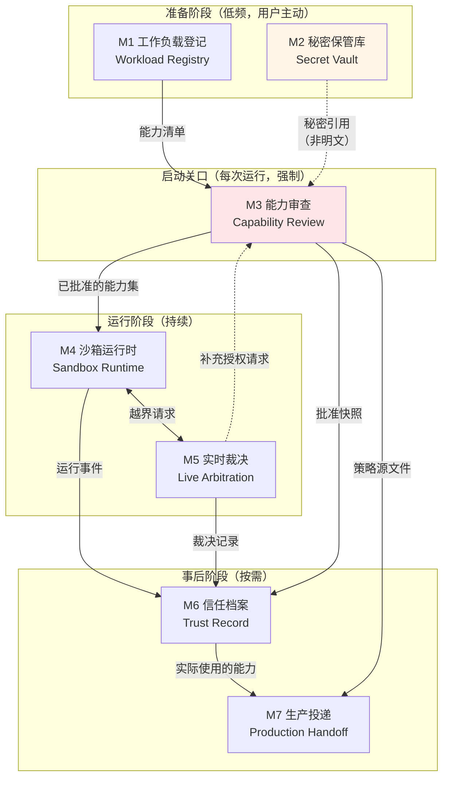
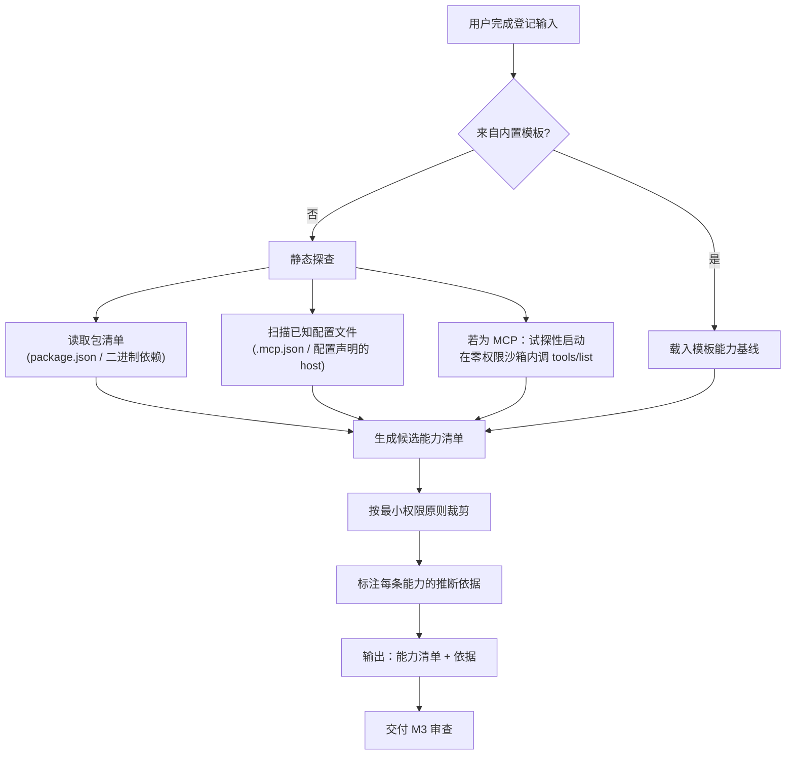
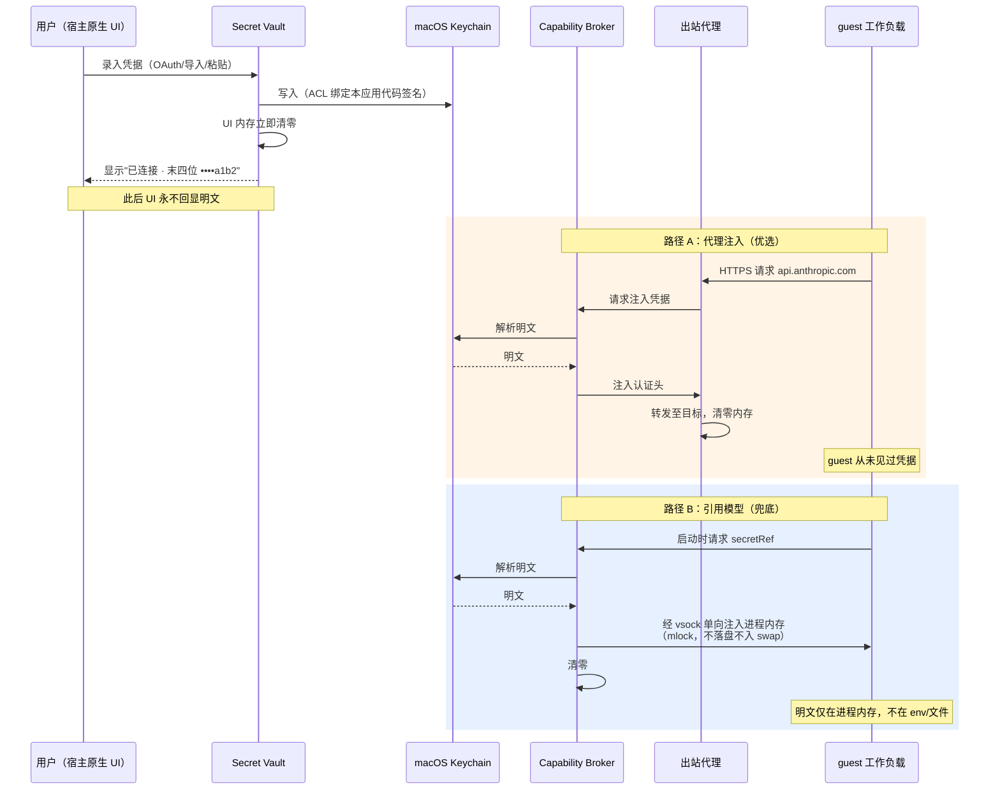
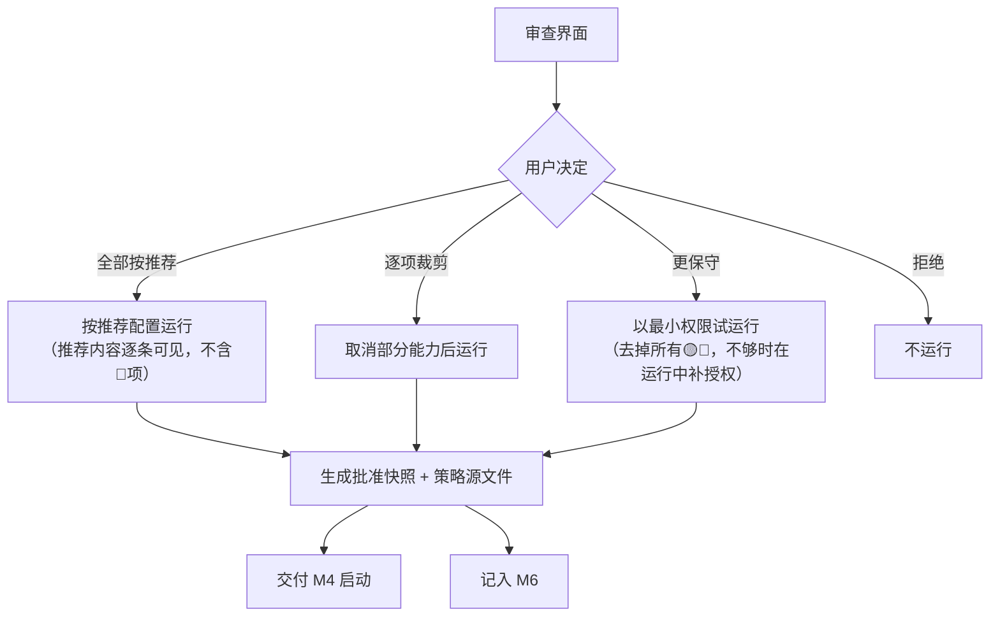
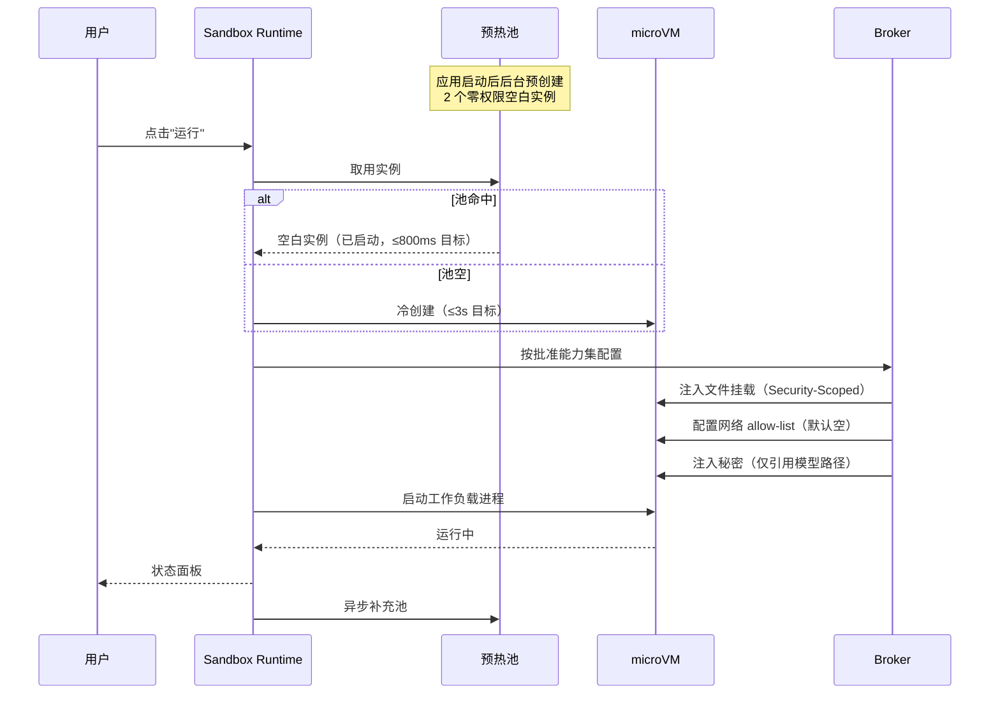
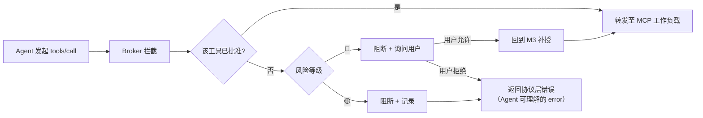

# 桌面级安全沙箱 — 产品设计文档（二）模块设计

> 本批内容：按用户心智任务边界划分的模块、每个模块的输入/输出/异常分支/权限需求、模块间的触发关系。
> 前置依赖：[01-产品定位与设计锚点.md](./01-产品定位与设计锚点.md) 中的 D1–D8 决策。
> 后续批次：03 接口契约 / 04 界面信息架构 / 05 计量计费与评审验收。

---

## 0. 模块划分的依据

**划分规则（来自 CLAUDE.md）**：按用户心智中的任务边界划分，不按技术分层划分。

划分的实际判据是三问：
1. **触发时机是否不同？** 秘密录入发生在"准备阶段"，能力审查发生在"启动瞬间"——时机不同，是两个模块。
2. **心智负担是否不同？** 审查要求用户做信任判断（高负担），运行监看只需用户感知状态（低负担）——负担不同，是两个模块。
3. **能否独立上线？** 一个模块若不能在其他模块缺位时提供可验收的用户价值，说明切错了。

**反例自查**——以下划分方式被明确拒绝：
- ❌ "前端 / 守护进程 / guest agent"——技术分层，用户心智中不存在
- ❌ "网络模块 / 文件模块 / 秘密模块"——按资源类型划分，但用户不是按资源类型思考的，用户是按"我现在要干什么"思考的
- ❌ "配置中心"——把秘密录入、策略编辑、偏好设置混成一个，三者心智负担差异巨大

---

## 1. 模块全景



| 模块 | 用户心智中的任务 | 触发频率 | 心智负担 | 可独立上线 |
|---|---|---|---|---|
| **M1 工作负载登记** | "我要让这个东西能在沙箱里跑" | 低（每个 Agent/MCP 一次） | 中 | ✅ 可（配合 M4 即构成 MVP） |
| **M2 秘密保管库** | "我要让它能用我的账号，但别拿到我的密码" | 低（每个服务一次） | 中 | ✅ 可（独立价值：安全的本地密钥存储） |
| **M3 能力审查** | "我要决定信不信它" | 每次运行 | **高** | ❌ 不可（依赖 M1 的能力清单） |
| **M4 沙箱运行时** | "跑起来，让我看着" | 每次运行 | 低 | ✅ 可（最小可用核心） |
| **M5 实时裁决** | "它想干件没说过的事，我现在决定" | 运行中偶发 | **高**（但被打断） | ❌ 不可（依赖 M4） |
| **M6 信任档案** | "它到底干了什么？" | 事后按需 | 低 | ✅ 可 |
| **M7 生产投递** | "本地验好了，上生产" | 低 | 中 | ✅ 可 |

**上线分期建议**：
- **P0（最小可验收）**：M1 + M4 + M3（简化版：仅文件与网络能力）
- **P1（核心价值完整）**：+ M2 + M5 + M6
- **P2（差异化与引流）**：+ M7 + MCP 工具级开关

---

## 2. M1 · 工作负载登记（Workload Registry）

### 2.1 模块职责

把"用户想跑的东西"转化为一份**声明式的工作负载描述**，并**推断出它需要的能力清单**。

这个模块的难点不是记录，是**推断**。用户不会写能力清单，用户只会说"我要跑 claude code"。能力清单必须由系统推断 + 用户确认，而不是由用户填写（锚点 2：零配置也能安全）。

### 2.2 输入

| 输入 | 来源 | 必填 | 说明 |
|---|---|---|---|
| 工作负载类型 | 用户选择 | ✅ | `agent` / `mcp-server` / `plain-code` |
| 启动方式 | 用户输入或模板 | ✅ | 内置模板（claude code / codex / dsh）或自定义命令 |
| 工作目录 | 用户通过系统 Picker 选择 | ○ | 宿主路径，默认无（空沙箱） |
| 目标服务 | 用户从 Provider 目录选择 | ○ | 如"Claude 官方服务"，用于推断网络与秘密需求 |
| 生命周期模式 | 用户选择 | ✅ | 默认"用完即焚"（D5） |
| 导入的工作负载包 | 文件 / URL | ○ | 他人分享的 `.sandboxpkg` |

**内置模板是本模块的主路径**。模板预置了该 Agent 的典型能力需求，用户只需补充"用哪个文件夹"和"用哪个账号"：

| 模板 | 预置能力需求 | 用户仍需提供 |
|---|---|---|
| claude code | 网络：Claude 官方服务；进程派生：允许；工作目录读写 | 工作目录、Claude 账号 |
| codex | 网络：OpenAI 服务；进程派生：允许；工作目录读写 | 工作目录、OpenAI 账号 |
| dsh | 网络：按配置；进程派生：允许 | 工作目录、相关账号 |
| MCP（通用） | 网络：无；文件：无；stdio 通道 | 目标主机、所需账号 |

### 2.3 能力推断逻辑



**关键设计：每条推断出的能力必须附带"依据"**。审查界面要能回答用户的"你怎么知道它要连这个？"——依据可以是"来自 claude code 官方模板"或"在它的配置文件第 12 行发现"。没有依据的能力条目不得进入审查界面。

**试探性启动（MCP 专用）**：在一个**零权限、无网络、无文件**的一次性沙箱内启动 MCP server，仅调用 `tools/list` 获取工具清单，然后销毁。这让我们能在用户授权**之前**就知道这个 MCP 暴露了什么工具。

`⚖️ 取舍`：试探性启动意味着未经用户审查就执行了第三方代码。这看似违反 D3（运行前审查）。我的判断是可接受，理由：该次启动的能力集为**严格空集**，沙箱为一次性，除了"消耗了一点 CPU"之外无任何可观测副作用。但必须在设计上标注：**试探沙箱不得挂载任何文件、不得有任何网络出口、不得访问秘密，且其产物只有 tools/list 的 JSON 结果**。

### 2.4 输出

| 输出 | 消费方 | 形态 |
|---|---|---|
| 工作负载描述 | M3、M4、M7 | `WorkloadSpec`（见 03 接口文档） |
| 能力清单 + 推断依据 | M3 | `CapabilityRequest[]` |
| 能力指纹 | M3、M6 | 能力集的规范化哈希，用于判断"是否需要重新审查" |
| 工具清单（仅 MCP） | M3 | `ToolDescriptor[]` |

**能力指纹的定义**：对能力集做规范化排序后哈希。指纹变化 = 需要重新审查。这是 D3"同指纹只审一次"的技术基础，也是防止"工作负载偷偷扩权"的检测点。

### 2.5 异常分支

| 异常 | 用户可见表现 | 系统行为 | 设计理由 |
|---|---|---|---|
| 静态探查失败（无法解析依赖） | "我没能看懂这个程序需要什么，你需要手动确认它的权限" | 降级为空能力集 + 引导手动逐项添加 | 探查失败时**不能**猜大范围权限，必须退回到零 |
| 试探性启动超时（>10s） | "这个 MCP 启动太慢或卡住了，我拿不到它的工具清单" | 销毁试探沙箱，工具清单标记为"未知"，审查界面显示警告 | 不阻断用户，但要让"未知"可见 |
| 试探性启动时 MCP 尝试越界 | 🔴 "⚠️ 这个 MCP 在还没拿到任何权限时就尝试访问网络" | 记录该行为并在审查界面置顶为高风险信号 | **这是重要的安全信号**，比工具清单更有价值 |
| 用户输入的命令中含疑似明文密钥 | 阻断 + "这看起来像一个密钥，请改用「账号与密钥」保管，不要写在命令里" | 拒绝保存，引导至 M2 | D1 否决条件的执行点 |
| 导入的工作负载包签名无效 | "这个分享包来源无法验证" | 默认拒绝导入；高级用户可强制导入但标记为"来源不明" | 供应链风险的最小防线 |
| 工作目录选择了敏感路径（`~/.ssh`、`~/Library/Keychains`、`/`） | 🔴 阻断 + 说明原因 | 硬拒绝，不提供"仍然继续"选项 | 这类路径没有任何合法的沙箱挂载场景 |
| 同名工作负载已存在 | "已有一个同名的，是要更新它还是新建一个？" | 用户选择；更新时对比能力指纹差异 | 扩权必须可见 |

### 2.6 权限需求

| 操作 | 所需宿主权限 | 获取方式 |
|---|---|---|
| 选择工作目录 | 文件系统读写（限定路径） | `NSOpenPanel` + Security-Scoped Bookmark（用户显式选择，不申请全盘权限） |
| 读取包清单做静态探查 | 同上（仅已授权路径内） | 复用上一步的 bookmark |
| 试探性启动 MCP | 创建 microVM | 应用自身权限，不涉及用户数据 |
| 保存工作负载描述 | 应用容器内写 | 应用沙箱内，无需额外授权 |
| 导入 `.sandboxpkg` | 文件读（单次） | `NSOpenPanel` |

**🚫 本模块不得申请**：全盘磁盘访问（Full Disk Access）、通讯录/日历/照片等隐私权限、辅助功能权限。若工程实现需要其中任何一项，必须回到设计评审——这会破坏"安全可被感知"的承诺（用户在系统设置里看到我们要全盘权限，信任直接归零）。

---

## 3. M2 · 秘密保管库（Secret Vault）

### 3.1 模块职责

让用户**一次性**地把"我的某个账号"交给系统保管，之后所有工作负载通过**引用**使用它，用户永不在沙箱内填写明文。

本模块的心智目标：**用户感觉自己在"连接账号"，而不是在"管理密钥"**。

### 3.2 输入

| 输入 | 来源 | 说明 |
|---|---|---|
| 目标服务 | Provider 目录选择 | 决定了走代理注入还是引用模型（D1 路由） |
| 凭据值 | 用户粘贴 / 从 Keychain 导入 / 从 1Password 导入 / OAuth 授权 | **唯一的明文入口，必须是宿主原生 UI** |
| 用途说明 | 用户输入（可选） | 如"我的个人 GitHub"，用于后续区分多个同类账号 |

**四种录入方式的优先级**（界面上的排序即引导）：

| 优先级 | 方式 | 用户动作 | 明文是否经过用户手 |
|---|---|---|---|
| 1 | **OAuth 授权** | 点击"连接"→ 浏览器授权 → 回调 | ❌ 否（最优） |
| 2 | **从 1Password / Keychain 导入** | 选择条目 → 授权一次 | ❌ 否 |
| 3 | 从云厂商 Secrets Manager 拉取 | 配置一次连接 → 选条目 | ❌ 否 |
| 4 | 手动粘贴 | 粘贴 → 保存 | ✅ 是（兜底，但要引导离开） |

`⚖️ 取舍`：优先 OAuth 意味着要为每个 Provider 做对接，成本高且受对方是否提供 OAuth 制约。但"用户零输入"的承诺(§1.2 验收条件)只有 OAuth 和导入两条路能真正做到。手动粘贴保留为兜底，但在界面上**不作为默认选项**，且粘贴后提示"下次可以直接用 xxx 登录，更安全"。

### 3.3 核心设计：明文的单向流动



**不变式（可作为测试断言）**：
1. Keychain 之外，明文在任何时刻最多存在于**一个**进程的内存中。
2. 明文的内存驻留时间 ≤ 单次使用所需，使用后立即清零。
3. 路径 B 下，明文不写入 `environ`、不写入文件、不入 swap、不入 core dump。
4. 任何日志、API 响应、UI、导出产物中，秘密只以 `引用名 + 末四位` 形态出现。

### 3.4 输出

| 输出 | 消费方 | 形态 |
|---|---|---|
| 秘密引用 | M1、M3、M4、M7 | `SecretRef`：`{ name, provider, mode: proxy\|inject, lastFour, createdAt }` —— **不含值** |
| Provider 能力映射 | M1 的推断逻辑 | 如"Claude 官方服务"→ 需 `api.anthropic.com`，注入 `x-api-key` 头 |
| 连接状态 | M6、界面 | `valid` / `expired` / `revoked` / `unverified` |

### 3.5 异常分支

| 异常 | 用户可见表现 | 系统行为 |
|---|---|---|
| Keychain 被锁（设备刚重启） | "需要解锁才能使用已保存的账号" | 触发系统解锁提示；不缓存明文绕过 |
| 凭据失效（401/403） | "你的 xxx 账号好像失效了，要重新连接吗？" | 标记 `expired`，暂停相关工作负载的该项能力，不中断整个沙箱 |
| OAuth 回调失败 | "授权没有完成" | 不写入任何部分状态，引导重试 |
| 用户粘贴的内容格式明显不符 | "这看起来不像 xxx 的密钥（通常以 sk- 开头）" | 警告但允许保存（格式可能变化），标记 `unverified` |
| 删除仍被引用的秘密 | "有 2 个工作负载在用它，删了它们就连不上了" | 列出引用方，确认后删除并把相关能力置为失效 |
| 1Password / Secrets Manager 不可达 | "暂时拿不到保管在 xxx 里的账号" | 该次运行相关能力失效；不降级为提示用户手输明文 |
| 检测到同一凭据被多个 Provider 使用 | 🟡 "这个密钥同时用在 A 和 B 上，确认无误吗？" | 提示，不阻断 |

**最后一条异常的处理原则值得单列**：凡是"外部秘密源不可达"的情况，**绝不降级为引导用户手工输入明文**。降级的方向只能是"这次跑不了"，不能是"那你手输一下吧"——后者会在用户最赶时间的时候打破 D1。

### 3.6 权限需求

| 操作 | 所需权限 | 说明 |
|---|---|---|
| 写入/删除 Keychain 条目 | Keychain Services，ACL 限定本应用代码签名 | 条目标记 `kSecAttrAccessibleWhenUnlocked` |
| 读取 Keychain 条目 | 同上，**仅 Broker 进程** | UI 进程无读取权限（见 01 §4.1 不变式） |
| OAuth 回调 | 自定义 URL Scheme / Universal Link | 回调校验 state 参数 |
| 访问 1Password | 其 CLI / 本地 API，用户授权一次 | 不存储 1Password 主密码 |
| 访问云 Secrets Manager | 用户提供的只读凭据（本身也存 Keychain） | 递归依赖，需在设计上标注为"信任根" |

---

## 4. M3 · 能力审查（Capability Review）

> **这是全产品最重要的模块。** 它是 D3 的全部，是锚点 1（安全可被非技术用户感知）的唯一落点。它失败，产品的差异化就不存在。

### 4.1 模块职责

在工作负载启动**之前**，把"它能碰到什么"翻译成用户能看懂的语言，让用户做出信任判断，并把判断结果固化为可复用的策略。

### 4.2 输入

| 输入 | 来源 |
|---|---|
| 能力清单 + 推断依据 | M1 |
| 能力指纹 | M1 |
| 工具清单（MCP） | M1 |
| 可用的秘密引用 | M2 |
| 历史批准记录 | M6 |
| 高风险信号（如试探时越界） | M1 |

### 4.3 核心设计：三件事决定成败

#### (1) 风险分级与"后果描述"

每条能力必须同时给出**能力描述**和**后果描述**。用户做判断靠的是后者。

| 等级 | 判定标准 | 界面处理 |
|---|---|---|
| 🟢 低 | 不涉及宿主数据与外网（如：沙箱内启动进程） | 折叠显示，默认已勾选 |
| 🟡 中 | 读宿主文件 / 访问特定已知主机 | 展开显示，默认已勾选，可取消 |
| 🔴 高 | 写宿主文件 / 任意主机出站 / 使用秘密 / 试探时有越界行为 | **置顶、展开、默认未勾选，需逐项主动勾选** |

**🚫 否决条件**：高风险项不得与低风险项合并为一次批量确认。用户必须对每一条高风险能力做独立动作。

#### (2) 术语翻译（执行 01 §D3 的对照表）

界面上**只允许出现右栏措辞**。任何工程实现若无法为某条能力给出右栏措辞，该能力**不得上线**——这是把"界面语言"变成硬约束的办法。

补充对照（01 已给出部分）：

| 技术事实 | ✅ 审查界面措辞 | 后果描述 |
|---|---|---|
| 工具级：`github.create_pr` | "能以你的身份创建 Pull Request" | "它可以在你的仓库里提交改动建议" |
| 工具级：`github.read_issue` | "能读取 issue 内容" | "它能看到你仓库里的 issue，包括私有仓库" |
| `mount: ~/code rw` | "能读取并修改「代码」文件夹里的所有内容" | "如果它出错或被人动过手脚，这个文件夹里的文件可能被改坏或删掉" |
| `mount: ~/code ro` | "能读取「代码」文件夹，但不能修改" | "它能看到里面所有文件的内容" |
| `clipboard: read` | "能读取你的剪贴板" | "你复制过的任何东西它都能看到，包括密码" |
| `spawn: allow` | "能在沙箱内启动其他程序" | "这是大多数开发工具的正常需求，不会影响沙箱外" |

#### (3) 四种批准形态



**"以最小权限试运行"是本设计的主推路径**。它把"事前精确判断"（用户做不到）转化为"事后按需补授"（用户能做到），同时让 M5 的打断成为一种**正常流程**而非异常。这是对"审查疲劳"（01 R6）的结构性缓解。

`⚖️ 取舍`：最小权限试运行会增加运行中的打断次数，对追求流畅的用户是负体验。但它让用户的默认选择从"我猜它需要这些"变成"不够了再说"，长期看能把授权范围压得更小。界面上这两个选项并列，不强推。

### 4.4 输出

| 输出 | 消费方 | 形态 |
|---|---|---|
| 已批准能力集 | M4 | `GrantedCapabilities` |
| 批准快照 | M6 | 含时间、指纹、用户选择、界面当时展示的措辞（**用于事后追溯"用户当时看到的是什么"**） |
| 策略源文件 | M7 | 平台无关的 policy 源（D6） |
| 拒绝记录 | M6 | 用户拒绝了什么，用于产品改进埋点 |

**批准快照要记录"用户当时看到的措辞"**，这一条容易被忽略但很重要：当日后发生安全事件时，需要能回答"用户是在什么描述下批准的"。如果我们改过文案，旧的批准记录必须保留旧文案。

### 4.5 异常分支

| 异常 | 用户可见表现 | 系统行为 |
|---|---|---|
| 能力指纹与历史批准不一致 | 🔴 "这个程序这次要的权限和上次不一样" + **差异对比视图** | 强制重新审查，差异项置顶高亮 |
| 能力清单为空（探查失败） | "我没看出它需要什么权限，将以完全隔离方式启动" | 以零权限启动，依赖 M5 补授 |
| 某条能力无对应的用户语言措辞 | —— | **该能力不得展示、不得批准**；记录为产品缺陷上报 |
| 请求的秘密引用不存在 | "它需要一个 xxx 账号，你还没连接过" | 内联引导至 M2，完成后返回审查 |
| 审查界面停留 >5 分钟未操作 | 超时关闭，不启动 | 避免误批准 |
| 用户关闭窗口 | 视为拒绝 | 默认拒绝，不默认允许 |
| 工具清单"未知"（MCP 试探失败） | 🟡 "我没能确认它提供哪些功能" | 允许继续，但该 MCP 的所有工具调用在运行中逐一经 M5 确认 |

### 4.6 权限需求

本模块**不直接操作任何资源**，它只生产"批准"这一数据。这是有意的设计——审查模块若同时持有执行权限，就无法在架构上保证"未经审查不得执行"。

| 操作 | 权限 |
|---|---|
| 读取能力清单、历史记录 | 应用容器内读 |
| 写入批准快照 | 应用容器内写（仅追加） |
| 请求 M2 确认秘密引用存在 | 只读查询（返回是否存在 + 末四位，**不返回值**） |

---

## 5. M4 · 沙箱运行时（Sandbox Runtime）

### 5.1 模块职责

按已批准的能力集创建沙箱、启动工作负载、呈现运行状态、管理生命周期。

### 5.2 输入

| 输入 | 来源 |
|---|---|
| 已批准能力集 | M3 |
| 工作负载描述 | M1 |
| 生命周期模式 | M1（用户选择） |
| 秘密引用（非值） | M2 |

### 5.3 核心设计：启动序列与预热池



**预热池能成立的前提是 D2 的零权限启动**：空白实例之间完全同质（没有任何残留授权），所以可以安全复用。若采用"继承权限后做减法"的模型，预热实例就携带了状态，复用即是污染——**这是 D2 反过来支撑 D5 的具体机制**。

### 5.4 运行状态的呈现（锚点 1 的持续体现）

安全不只在审查时可感知，运行中也要持续可感知。状态面板必须常驻呈现：

| 呈现项 | 形态 | 为什么必须有 |
|---|---|---|
| 当前隔离状态 | "运行在独立沙箱中 · 用完即焚" | 持续强化 D2 的硬隔离叙事 |
| 已授予能力摘要 | 折叠列表，随时可展开 | 用户可随时回答"它现在能干什么" |
| 实时活动 | "正在访问 Claude 官方服务"（带节流） | 让抽象的权限变成可见的行为 |
| 被阻断的尝试 | 🟡 计数 + 可展开详情 | **这是信任的核心来源**——用户看到"它试了但没成功" |
| 资源占用 | CPU / 内存 / 网络流量 | 常规可观测性 |
| 剩余生命周期 | "关闭窗口后自动销毁" | 让"用完即焚"可感知 |

**"被阻断的尝试"是整个产品中最有说服力的 UI 元素**。它把"我们保护了你"从承诺变成证据。设计上要确保它**即使为零也显示**（"目前没有任何越界尝试"），否则用户不知道这个指标存在。

### 5.5 输出

| 输出 | 消费方 |
|---|---|
| 运行状态流 | 界面、M6 |
| 越界请求 | M5 |
| 运行事件（启动/退出/资源） | M6 |
| 产物（用户标记要导出的文件） | 宿主文件系统（经确认） |
| 实际使用的能力统计 | M7（用于"实际用到的权限"收敛） |

### 5.6 异常分支

| 异常 | 用户可见表现 | 系统行为 |
|---|---|---|
| microVM 创建失败 | "沙箱没能启动起来" + 诊断建议 | 不降级为"直接在本机跑"——**绝不** |
| 预热池耗尽且冷创建超时 | "启动比平时慢，请稍候" | 继续等待，不放弃隔离 |
| 工作负载进程崩溃 | "程序意外退出了" + 退出码 + 最后输出 | 保留沙箱 30s 供查看，然后按生命周期模式处理 |
| guest 内存超限 | 🟡 "沙箱内存用满了" | 按策略：警告 / 限流 / 终止；默认警告后终止 |
| 宿主磁盘空间不足 | "磁盘空间不够创建沙箱" | 阻止启动，提示清理缓存层 |
| 文件挂载源在运行中被删除/移动 | "你挂载的文件夹不见了" | 挂载点置为不可用，不崩溃整个沙箱 |
| 产物导出时命中敏感模式（`.env`、`id_rsa`） | 🔴 "这些文件看起来含敏感信息，确认要导出吗？" | 逐项确认 |
| 用户强制退出应用 | —— | 所有非持久沙箱销毁；持久沙箱保存状态 |
| 缓存层校验和不匹配（01 R3） | 🔴 "依赖缓存可能被篡改" | 拒绝挂载该缓存层，退回纯净下载 |

**第一条异常的处理原则是产品底线**：沙箱启动失败时，**不得提供"不用沙箱直接运行"的逃生舱**。这种逃生舱是所有安全产品被绕过的标准路径。

### 5.7 权限需求

| 操作 | 权限 |
|---|---|
| 创建/管理 microVM | `com.apple.security.virtualization` entitlement |
| 挂载宿主目录 | Security-Scoped Bookmark（来自 M1 的用户授权） |
| 网络代理出站 | 应用自身网络权限；guest 无独立网络权限 |
| 向 guest 注入秘密 | 经 Broker，vsock 单向 |
| 导出产物 | 写入用户选择的目标路径（单次 Picker 授权） |

---

## 6. M5 · 实时裁决（Live Arbitration）

### 6.1 模块职责

工作负载在运行中请求**未经批准**的能力时，阻断该请求，并（按策略）询问用户。

### 6.2 设计难点：打断的时机与成本

这个模块的本质是"在用户心流中插入一个安全决策"。设计不好就是 macOS 早期权限弹窗的灾难。

**三种处理策略**（按能力风险等级自动选择，用户可在偏好中调整）：

| 风险 | 默认策略 | 用户体验 |
|---|---|---|
| 🟢 低 | **静默允许并记录** | 无打断，事后可在 M6 查看 |
| 🟡 中 | **静默阻断并记录**，在状态面板累计显示 | 无打断，用户主动查看时可补授 |
| 🔴 高 | **阻断并询问** | 打断 |

**关键设计：🟡 中风险默认"阻断而非询问"**。这与直觉相反——很多产品会选择询问。我选择阻断，理由：
- 阻断是安全的默认值；询问会训练用户无脑点允许（01 R6）
- 工作负载的"失败"本身是一种反馈，开发者看得懂
- 用户主动来补授时，心智状态是"我想让它干这个"，判断质量远高于被打断时

`⚖️ 取舍`：这会让部分工作负载在首次运行时频繁失败，对不熟悉的用户是挫败。缓解：状态面板的"被阻断的尝试"要做得极其显眼且**一键可补授**，把"失败→补授→重试"的循环压到 3 秒内。

### 6.3 输入 / 输出

| 输入 | 来源 |
|---|---|
| 越界请求（目标主机 / 文件路径 / 秘密 / MCP 工具调用） | M4 经 Broker 拦截 |
| 当前已批准能力集 | M3 |
| 用户偏好的打断策略 | 偏好设置 |

| 输出 | 消费方 |
|---|---|
| 裁决结果（allow / deny） | M4（实时） |
| 裁决记录 | M6 |
| 补充授权请求 | M3（走完整审查流程，不走捷径） |

**补充授权必须回到 M3 走完整审查**，不能在运行时弹窗里直接批准。这保证了"所有授权都有审查快照"这一不变式。

### 6.4 MCP 工具调用的拦截（D4 工具级开关的落点）



**返回给 Agent 的必须是协议层的合法错误**，而不是超时或连接中断。Agent 需要能理解"这个工具我用不了"并自行调整策略。这一条直接影响 Agent 的可用性，是 D4 从"隔离"升级到"好用的隔离"的关键。

### 6.5 异常分支

| 异常 | 处理 |
|---|---|
| 用户不在电脑前（弹窗无人应答，>60s） | 超时按**拒绝**处理，记录"因无人应答而拒绝" |
| 同一越界在短时间内重复（>5 次/分钟） | 聚合为一条，提示"它在反复尝试 xxx"，不重复弹窗 |
| 越界请求携带疑似敏感数据外发 | 🔴 提升为高风险，强制询问，并在询问中展示"它想发出去的数据摘要" |
| Broker 自身异常无法裁决 | **fail-closed**：拒绝所有请求，终止沙箱并告警 |

**最后一条是安全模块的基本要求**：裁决器失效时必须 fail-closed（默认拒绝），不能 fail-open。

### 6.6 权限需求

| 操作 | 权限 |
|---|---|
| 拦截 guest 出站流量 | Broker 持有代理，guest 无直连 |
| 拦截文件访问 | guest 仅见被挂载视图，越界在挂载层即失败 |
| 拦截 MCP 工具调用 | Broker 位于 Agent 与 MCP 之间的通道上 |
| 弹出询问 | 宿主原生 UI（**不得在 guest 内渲染询问界面**） |

**最后一条是安全关键**：询问界面若由 guest 渲染，不可信代码就能伪造授权对话框。所有涉及信任决策的 UI 必须在宿主侧原生渲染，且有明确的视觉归属标识。

---

## 7. M6 · 信任档案（Trust Record）

### 7.1 模块职责

记录"谁、在什么时候、被授予了什么、实际做了什么"，让用户能事后回答关于信任的问题。

### 7.2 记录内容

| 类别 | 记录项 | 保留期 |
|---|---|---|
| 批准记录 | 时间、工作负载、能力指纹、用户选择、**当时展示的措辞** | 永久（直到用户删除工作负载） |
| 裁决记录 | 越界请求、裁决结果、是否打断了用户 | 90 天（可配置） |
| 运行记录 | 启动/退出、时长、资源峰值 | 30 天 |
| 活动记录 | 访问过的主机、读写过的文件路径、调用过的 MCP 工具 | 30 天 |
| 能力使用统计 | 每条已授予能力的实际使用次数 | 随工作负载 |

**"能力使用统计"是 M7 的输入**，也是一个有价值的用户洞察：它能告诉用户"你授予了 8 项权限，它只用了 3 项"，从而引导收敛。这是把审计数据反向用于改善安全姿态，比单纯的日志查看有用得多。

### 7.3 输入 / 输出

| 输入 | 来源 | 输出 | 消费方 |
|---|---|---|---|
| 批准快照 | M3 | 时间线视图 | 界面 |
| 裁决记录 | M5 | 能力使用统计 | M7、界面 |
| 运行事件、活动 | M4 | 脱敏导出 | 用户（分享/合规） |
| | | 异常模式告警 | 界面 |

### 7.4 异常模式告警

不只是被动记录，要主动识别值得注意的模式：

| 模式 | 告警措辞 |
|---|---|
| 某工作负载的能力需求持续扩张 | 🟡 "这个程序最近几次更新一直在要更多权限" |
| 已授予但从未使用的高风险能力 | 🟢 "它有 3 项权限一次都没用过，要收回吗？" |
| 越界尝试突然增多 | 🟡 "它今天尝试了 12 次没被允许的操作，之前平均 0 次" |
| 访问了从未访问过的新主机 | 🟡 "它第一次访问 xxx" |

### 7.5 异常分支

| 异常 | 处理 |
|---|---|
| 日志写入失败（磁盘满） | 🔴 告警；按策略：暂停新沙箱启动（审计不可用时不接受新风险）或降级为仅记录高风险事件。默认前者 |
| 日志体积超限 | 按保留期自动轮转；轮转前提示 |
| 用户请求删除日志 | 允许，但批准记录单独保留（除非删除整个工作负载），并记录"用户于某时清除了日志" |
| 导出时含内网主机名/私有路径（01 R8） | 默认启用脱敏；明确告知脱敏了什么 |

### 7.6 权限需求

| 操作 | 权限 |
|---|---|
| 写日志 | 应用容器内，**仅追加**（append-only，防篡改） |
| 读日志 | UI 进程只读 |
| 导出 | 用户选择目标路径（单次授权） |

---

## 8. M7 · 生产投递（Production Handoff）

### 8.1 模块职责

把本地验证过的策略与工作负载，编译为可在生产环境使用的产物（D6 双轨）。

### 8.2 双轨产物

| 轨道 | 产物 | 适用 | 完整度 |
|---|---|---|---|
| **通用轨（主）** | OCI 镜像 + 可移植策略（NetworkPolicy、SecretRef 清单、只读挂载声明） | 任意 K8s / 容器平台 | 策略为"等价声明"，需目标平台支持 |
| **增强轨** | 云主机投递包（实例规格建议 + 安全组规则 + 秘密托管对接 + 启动脚本） | 自家云主机产品线 | 一键投递，秘密直通托管服务 |

**策略是源，两者都是编译产物**（D6）。这意味着：

```
policy.source（平台无关，本地审查产生）
   ├─compile→ 本地 microVM 配置
   ├─compile→ OCI + K8s NetworkPolicy/SecretRef
   └─compile→ 云主机安全组 + 秘密托管绑定
```

**漂移检测**：若用户在生产侧手工改了策略，再次投递时要能检测并提示差异。这是"本地边界延伸到生产"从一次性动作变成持续关系的关键。

### 8.3 核心设计：从"已授予"收敛到"实际用到"

投递时**不应该**直接把本地授予的能力集搬过去，而应该基于 M6 的使用统计做收敛建议：

| 本地状态 | 投递建议 |
|---|---|
| 授予了 `~/code` 读写，实际只读 | 建议生产侧挂载为只读 |
| 授予了 3 个主机，实际只访问 1 个 | 建议生产侧只开放 1 个 |
| 授予了某秘密，从未使用 | 建议不投递该秘密 |

这把"本地运行"变成了**生产策略的自动推导过程**——用户只要在本地跑过，生产策略就有了经验依据。这是本模块真正的产品价值，也是 D6 的最佳论证。

### 8.4 输入 / 输出

| 输入 | 来源 | 输出 | 去向 |
|---|---|---|---|
| 策略源文件 | M3 | OCI 镜像 + 策略清单 | 用户指定的 registry |
| 能力使用统计 | M6 | 云主机投递包 | 自家云产品线 |
| 工作负载描述 | M1 | 收敛建议报告 | 界面 |
| 秘密引用清单 | M2 | 秘密迁移清单（**仅引用，不含值**） | 目标环境的秘密托管 |

### 8.5 异常分支

| 异常 | 处理 |
|---|---|
| 本地能力在目标平台无等价表达 | 🟡 明确列出"这些限制在生产环境无法保证"，不静默丢弃 |
| 秘密在目标环境的托管服务中不存在 | 引导创建；**不提供"把明文打包进产物"的选项** |
| 用户从未实际运行过（无使用统计） | 🟡 "你还没跑过，我只能按你批准的范围投递，可能过宽" |
| 生产侧策略已被手工修改 | 展示三方差异（本地 / 上次投递 / 当前生产） |
| OCI 构建失败 | 保留中间产物与日志，提供诊断 |

### 8.6 权限需求

| 操作 | 权限 |
|---|---|
| 读策略、使用统计 | 应用容器内读 |
| 推送镜像 | 用户提供的 registry 凭据（存 M2） |
| 投递至云主机 | 用户的云账号凭据（存 M2，走 OAuth 优先） |
| 写入目标环境秘密托管 | 用户授权；**只写引用与元数据，明文由目标环境自身管理** |

---

## 9. 模块间契约摘要

| 契约 | 生产方 → 消费方 | 不变式 |
|---|---|---|
| `WorkloadSpec` | M1 → M3/M4/M7 | 不含任何明文秘密 |
| `CapabilityRequest[]` | M1 → M3 | 每条必须有推断依据与用户语言措辞 |
| `SecretRef` | M2 → M1/M3/M4/M7 | 永不含值 |
| `GrantedCapabilities` | M3 → M4 | M4 不得执行任何不在此集合内的能力 |
| `ApprovalSnapshot` | M3 → M6 | 含当时展示的措辞，不可变 |
| `ArbitrationRequest` | M4/M5 → M3 | 补授必须走完整审查 |
| `policy.source` | M3 → M7 | 平台无关，是唯一的策略真相来源 |

### 9.1 全局不变式（可作为架构测试）

1. **未经 M3 批准的能力，M4 不得执行。**（通过 M3 不持有执行权限、M4 不持有批准权限来结构性保证）
2. **明文秘密不经过 M1、M3、M6、M7。** 这四个模块只见 `SecretRef`。
3. **所有信任决策 UI 由宿主原生渲染**，不由 guest 渲染。
4. **裁决器失效时 fail-closed。**
5. **沙箱启动失败时无"绕过沙箱"的逃生舱。**
6. **审计不可用时，默认不接受新风险**（不启动新沙箱）。

---

**下一批（03）**：接口契约——用户可见接口（配置与命令）、模块间系统接口、外部协议接口（MCP、Workload spec、policy schema）。
