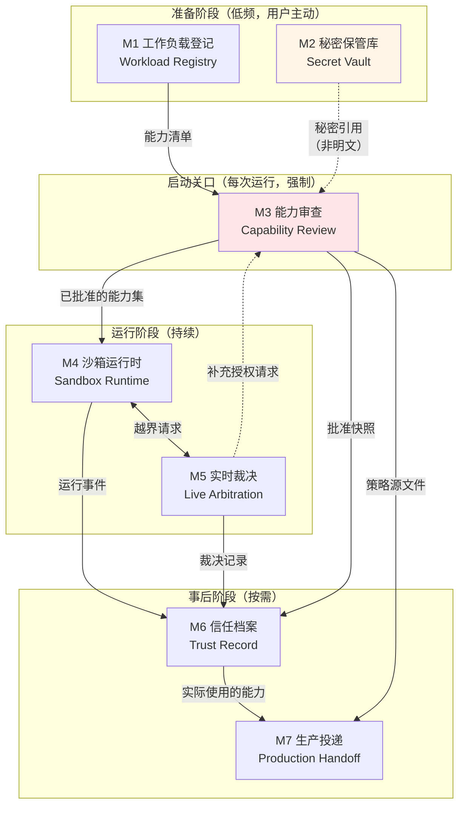
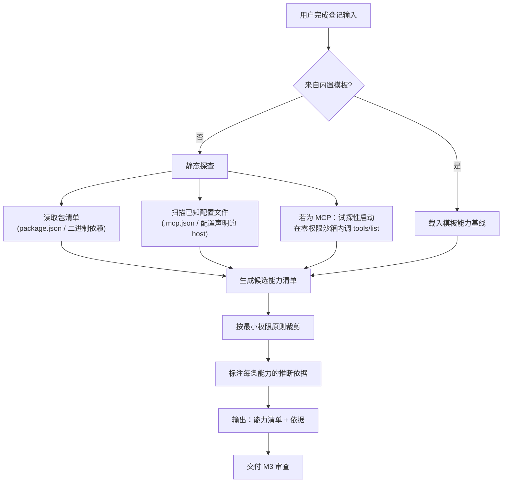
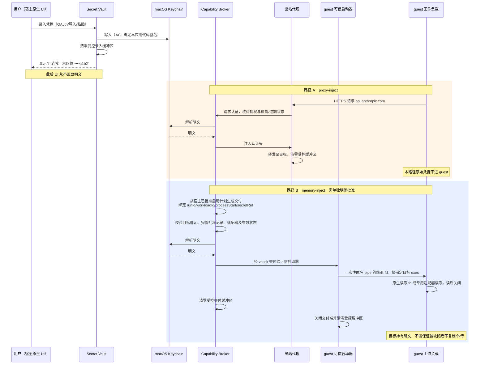
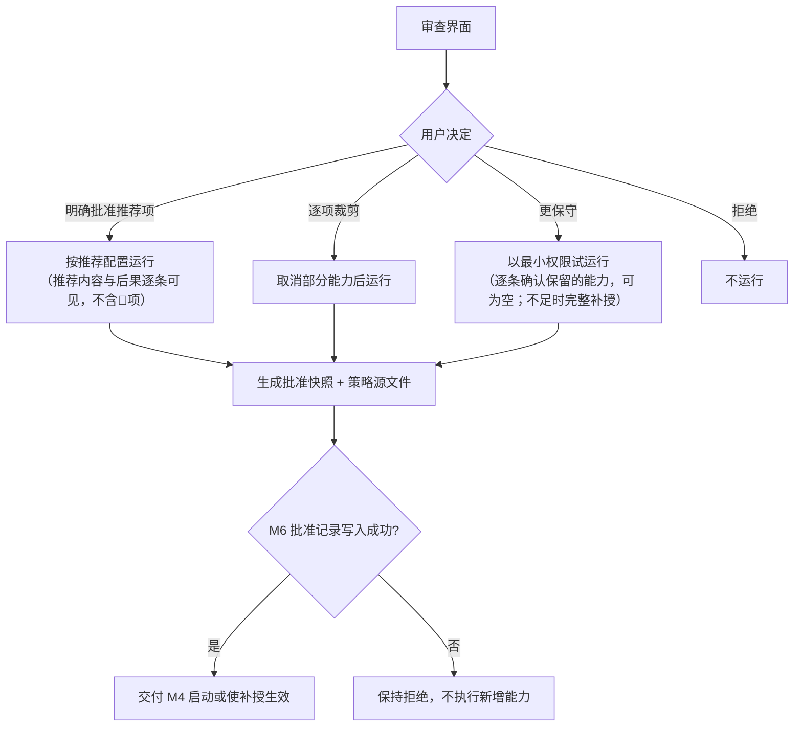
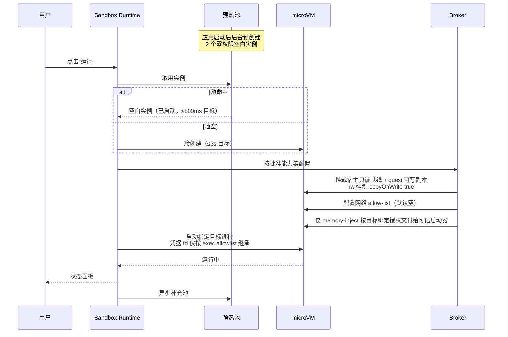
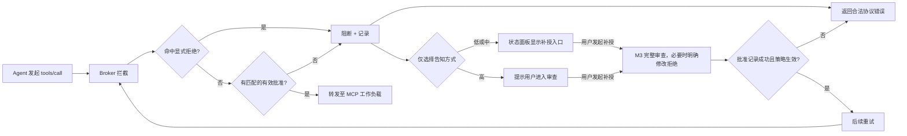

# 桌面级安全沙箱 — 产品设计文档（二）模块设计

> 本批内容：按用户心智任务边界划分的模块、每个模块的输入/输出/异常分支/权限需求、模块间的触发关系。
> 前置依赖：[01-产品定位与设计锚点.md](./01-产品定位与设计锚点.md) 中的 D1–D8 决策。
> 后续批次：03 接口契约 / 04 界面信息架构 / 05 计量计费与评审验收。

---

## 0. 模块划分的依据

**划分规则**：按用户心智中的任务边界划分，不按技术分层划分。

划分的实际判据是三问：
1. **触发时机是否不同？** 秘密录入发生在"准备阶段"，能力审查发生在"启动瞬间"——时机不同，是两个模块。
2. **心智负担是否不同？** 审查要求用户做信任判断（高负担），运行监看只需用户感知状态（低负担）——负担不同，是两个模块。
3. **能否独立上线？** 一个模块若不能在其他模块缺位时提供可验收的用户价值，说明切错了。

**反例自查**——以下划分方式被明确拒绝：
- ❌ "前端 / 守护进程 / guest agent"——技术分层，用户心智中不存在
- ❌ "网络模块 / 文件模块 / 秘密模块"——按资源类型划分，但用户不是按资源类型思考的，用户是按"我现在要干什么"思考的
- ❌ "配置中心"——把秘密录入、策略编辑、偏好设置混成一个，三者心智负担差异巨大

---

## 1. 模块全景



| 模块 | 用户心智中的任务 | 触发频率 | 心智负担 | 可独立上线 |
|---|---|---|---|---|
| **M1 工作负载登记** | "我要让这个东西能在沙箱里跑" | 低（每个 Agent/MCP 一次） | 中 | ✅ 可（配合 M4 即构成 MVP） |
| **M2 秘密保管库** | "我要连接账号，并决定是否把密钥交给这个程序" | 低（每个服务一次） | 中 | ✅ 可（独立价值：安全的本地密钥存储） |
| **M3 能力审查** | "我要决定信不信它" | 每次运行 | **高** | ❌ 不可（依赖 M1 的能力清单） |
| **M4 沙箱运行时** | "跑起来，让我看着" | 每次运行 | 低 | ✅ 可（最小可用核心） |
| **M5 实时裁决** | "它想干件没说过的事，我现在决定" | 运行中偶发 | **高**（但被打断） | ❌ 不可（依赖 M4） |
| **M6 信任档案** | "它到底干了什么？" | 事后按需 | 低 | ✅ 可 |
| **M7 生产投递** | "本地验好了，上生产" | 低 | 中 | ✅ 可 |

**上线分期建议**：
- **P0（最小可验收）**：M1 + M4 + M3（简化版：仅文件与网络能力）
- **P1（核心价值完整）**：+ M2 + M5 + M6
- **P2（差异化与引流）**：+ M7 + MCP 工具级开关

---

## 2. M1 · 工作负载登记（Workload Registry）

### 2.1 模块职责

把"用户想跑的东西"转化为一份**声明式的工作负载描述**，并**推断出它需要的能力清单**。

这个模块的难点不是记录，是**推断**。用户不会写能力清单，用户只会说"我要跑 claude code"。能力清单必须由系统推断 + 用户确认，而不是由用户填写（锚点 2：零配置也能安全）。

### 2.2 输入

| 输入 | 来源 | 必填 | 说明 |
|---|---|---|---|
| 工作负载类型 | 用户选择 | ✅ | `agent` / `mcp-server` / `plain-code` |
| 启动方式 | 用户输入或模板 | ✅ | 内置模板（claude code / codex / dsh）或自定义命令 |
| 工作目录 | 用户通过系统 Picker 选择 | ○ | 默认无（空沙箱）；选择后普通代码编辑默认 `rw` 且强制 `copyOnWrite: true`，宿主只读基础快照 + guest 可写副本 |
| 目标服务 | 用户从 Provider 目录选择 | ○ | 如"Claude 官方服务"，用于推断网络与秘密需求 |
| 生命周期模式 | 用户选择 | ✅ | 默认"用完即焚"（D5） |
| 导入的工作负载包 | 文件 / URL | ○ | 他人分享的 `.sandboxpkg` |

**内置模板是本模块的主路径**。模板预置了该 Agent 的典型能力需求，用户只需补充"用哪个文件夹"和"用哪个账号"：

| 模板 | 预置能力需求 | 用户仍需提供 |
|---|---|---|
| claude code | 网络：Claude 官方服务；进程派生：请求允许；工作目录副本读写（`rw` + `copyOnWrite: true`） | 工作目录、Claude 账号；凭据接入兼容性待实测 |
| codex | 网络：OpenAI 服务；进程派生：请求允许；工作目录副本读写（`rw` + `copyOnWrite: true`） | 工作目录、OpenAI 账号；凭据接入兼容性待实测 |
| dsh | 网络：按配置；进程派生：请求允许 | 工作目录、相关账号 |
| MCP（通用） | 网络：无；文件：无；stdio 通道 | 目标主机、所需账号 |

模板只生成候选能力，不授予权限。导入或自定义配置的 `rw` 工作目录同样强制 `copyOnWrite: true`；省略时规范化为 `true` 并纳入审查，显式 `false` 拒绝。`ro` 仅提供只读视图，不产生回写。宿主路径选择只确定可访问范围，不等于用户已批准任何回写。

### 2.3 能力推断逻辑



**关键设计：每条推断出的能力必须附带"依据"**。审查界面要能回答用户的"你怎么知道它要连这个？"——依据可以是"来自 claude code 官方模板"或"在它的配置文件第 12 行发现"。没有依据的能力条目不得进入审查界面。

**试探性启动（MCP 专用）**：在一个**零权限、无网络、无文件**的一次性沙箱内启动 MCP server，仅调用 `tools/list` 获取工具清单，然后销毁。这让我们能在用户授权**之前**就知道这个 MCP 暴露了什么工具。

`⚖️ 取舍`：试探性启动会在用户审查前执行第三方代码，因此仅用于一次性零权限探查，资源能力集为严格空集。试探沙箱不得挂载用户文件、不得有任何网络出口、不得访问秘密；越界默认拒绝，不在探查中补授，唯一允许返回的探查产物为 `tools/list` 的 JSON 结果。

### 2.4 输出

| 输出 | 消费方 | 形态 |
|---|---|---|
| 工作负载描述 | M3、M4、M7 | `WorkloadSpec`（见 03 接口文档） |
| 能力清单 + 推断依据 | M3 | `CapabilityRequest[]` |
| 能力指纹 | M3、M6 | 能力集的规范化哈希，用于判断"是否需要重新审查" |
| 工具清单（仅 MCP） | M3 | `ToolDescriptor[]` |

**能力指纹的定义**：对能力集做规范化排序后哈希。指纹变化须重新审查；同指纹仅可复用仍有效的批准，不能绕过撤销、过期或显式拒绝。秘密模式、目标适配器与工作目录 CoW 语义均纳入审查范围。

### 2.5 异常分支

| 异常 | 用户可见表现 | 系统行为 | 设计理由 |
|---|---|---|---|
| 静态探查失败（无法解析依赖） | "我没能看懂这个程序需要什么，你需要手动确认它的权限" | 降级为空能力集 + 引导手动逐项添加 | 探查失败时**不能**猜大范围权限，必须退回到零 |
| 试探性启动超时（>10s） | "这个 MCP 启动太慢或卡住了，我拿不到它的工具清单" | 销毁试探沙箱，工具清单标记为"未知"，审查界面显示警告 | 不阻断用户，但要让"未知"可见 |
| 试探性启动时 MCP 尝试越界 | 🔴 "⚠️ 这个 MCP 在还没拿到任何权限时就尝试访问网络" | 记录该行为并在审查界面置顶为高风险信号 | **这是重要的安全信号**，比工具清单更有价值 |
| 用户输入的命令中含疑似明文密钥 | 阻断 + "这看起来像一个密钥，请改用「账号与密钥」保管，不要写在命令里" | 拒绝保存，引导至 M2 | D1 否决条件的执行点 |
| 导入的工作负载包签名无效 | "这个分享包来源无法验证" | 默认拒绝导入；高级用户可强制导入但标记为"来源不明" | 供应链风险的最小防线 |
| 工作目录选择了敏感路径（`~/.ssh`、`~/Library/Keychains`、`/`） | 🔴 阻断 + 说明原因 | 硬拒绝，不提供"仍然继续"选项 | 这类路径没有任何合法的沙箱挂载场景 |
| 同名工作负载已存在 | "已有一个同名的，是要更新它还是新建一个？" | 用户选择；更新时对比能力指纹差异 | 扩权必须可见 |

### 2.6 权限需求

| 操作 | 所需宿主权限 | 获取方式 |
|---|---|---|
| 选择工作目录 | 文件系统读写（限定路径） | `NSOpenPanel` + Security-Scoped Bookmark；启动时仅读取基础快照，宿主写入另受 M4 回写确认约束，不向 guest 提供宿主直写 |
| 读取包清单做静态探查 | 同上（仅已授权路径内） | 复用上一步的 bookmark |
| 试探性启动 MCP | 创建 microVM | 应用自身权限，不涉及用户数据 |
| 保存工作负载描述 | 应用容器内写 | 应用沙箱内，无需额外授权 |
| 导入 `.sandboxpkg` | 文件读（单次） | `NSOpenPanel` |

**🚫 本模块不得申请**：全盘磁盘访问（Full Disk Access）、通讯录/日历/照片等隐私权限、辅助功能权限。若工程实现需要其中任何一项，必须回到设计评审——这会破坏"安全可被感知"的承诺（用户在系统设置里看到我们要全盘权限，信任直接归零）。

---

## 3. M2 · 秘密保管库（Secret Vault）

### 3.1 模块职责

让用户**一次性**地把"我的某个账号"交给系统保管，之后所有工作负载通过**引用**使用它，用户永不在沙箱内填写明文。

本模块的心智目标：**用户感觉自己在"连接账号"，而不是在"管理密钥"**。

### 3.2 输入

| 输入 | 来源 | 说明 |
|---|---|---|
| 目标服务与目标程序 | Provider 目录或已验证适配器目录选择 | 只展示有明确适配器的接入；显示 `proxy-inject` 或需单独批准的 `memory-inject`，不自动降级 |
| 凭据值 | 用户粘贴 / 从 Keychain 导入 / 从 1Password 导入 / OAuth 授权 | **唯一的明文入口，必须是宿主原生 UI** |
| 用途说明 | 用户输入（可选） | 如"我的个人 GitHub"，用于后续区分多个同类账号 |

**四种录入方式的优先级**（界面上的排序即引导）：

| 优先级 | 方式 | 用户动作 | 明文是否经过用户手 |
|---|---|---|---|
| 1 | **OAuth 授权** | 点击"连接"→ 浏览器授权 → 回调 | ❌ 否（最优） |
| 2 | **从 1Password / Keychain 导入** | 选择条目 → 授权一次 | ❌ 否 |
| 3 | 从云厂商 Secrets Manager 拉取 | 配置一次连接 → 选条目 | ❌ 否 |
| 4 | 手动粘贴 | 粘贴 → 保存 | ✅ 是（兜底，但要引导离开） |

`⚖️ 取舍`：OAuth 和导入可减少手工接触明文，但依赖具体 Provider 对接。手动粘贴只在宿主原生 UI 提供且不作为默认选项；这些录入方式不改变凭据交付模式，也不构成目标程序的使用授权。

### 3.3 核心设计：分模式交付与目标绑定



**接入与授权约束**：
1. `proxy-inject` 的原始凭据留在宿主，由已配置 Provider 的代理适配器注入认证头；每次认证前检查授权及撤销、过期状态。
2. `memory-inject` 须向用户明确告知目标进程会获得明文、被攻陷后可能复制或外传；完成单独审查并写入批准记录后，宿主按 `runId` + `workloadId` + `processStart`（含本次启动不可复用的 `launchId`）+ `secretRef` 授权下发，不接受仅凭 PID 或 guest 自报身份领取。
3. guest 可信启动器用一次性匿名 pipe/继承 fd 向指定目标交付。匿名 fd 不是文件路径；目标必须原生支持读 fd 或有已验证专用适配器。产品交付过程不得借助 env、argv 或磁盘文件，不承诺任意现成 CLI 无需改造。
4. fd 继承按本次 `exec` 的显式 allowlist 控制，其余 fd 设置 `close-on-exec`；目标读后关闭凭据 fd，非必要子进程不得继承。适配器无法满足时阻断启动，不改用其他交付方式。
5. `mlock`、禁 swap/core 和清零只约束产品受控缓冲区，不保证第三方程序取得明文后的内存、日志或产物不泄漏。跨进程交付期间的受控副本在用后清理。
6. M1/M3/M6/M7、普通 API 响应和产品日志只使用引用及元数据，不回显值；专用交付通道只服务本次获准目标。不得把第三方可能主动输出明文的风险写成已被消除。

**支持矩阵**：

| 目标 | 设计路径与准入 | 支持状态 |
|---|---|---|
| HTTP 认证头，已配置 Provider（如 Anthropic、OpenAI、GitHub API） | `proxy-inject`；按 Provider 的目标与头映射认证 | 设计路径，Provider 与客户端兼容性待实测 |
| 自定义服务 | 仅在存在已验证 fd 适配器时可选 `memory-inject`，另行明确授权 | 按目标程序及适配器验证，不因“自定义”自动支持 |
| 数据库连接串 / SSH / 任意 CLI | 不默认提供；仅满足对应模式准入后可接入 | 未验证或必须使用 env/argv/磁盘文件时阻断，不自动降级 |

**撤销与过期**：宿主检查到凭据被撤销、删除或过期后，停止后续代理认证和新的引用交付。已交付的引用凭据无法从目标进程收回，必须终止持有该凭据的相关运行，并提示必要的服务端轮换；终止不撤销已经外传的副本。

### 3.4 输出

| 输出 | 消费方 | 形态 |
|---|---|---|
| 秘密引用 | M1、M3、M4、M7 | `SecretRef`：`{ name, provider, mode: 'proxy-inject' \| 'memory-inject', lastFour, createdAt }`，不含值；目标适配器与授权须另行校验 |
| Provider 能力映射 | M1 的推断逻辑 | 如"Claude 官方服务"→ 需 `api.anthropic.com`，注入 `x-api-key` 头 |
| 连接状态 | M6、界面 | `valid` / `expired` / `revoked` / `unverified` |

### 3.5 异常分支

| 异常 | 用户可见表现 | 系统行为 |
|---|---|---|
| Keychain 被锁（设备刚重启） | "需要解锁才能使用已保存的账号" | 触发系统解锁提示；不缓存明文绕过 |
| 凭据失效（401/403） | "你的 xxx 账号好像失效了，要重新连接吗？" | 标记 `expired`，停止后续代理认证及新交付；若已通过 `memory-inject` 交付，终止相关运行并提示必要轮换 |
| OAuth 回调失败 | "授权没有完成" | 不写入任何部分状态，引导重试 |
| 用户粘贴的内容格式明显不符 | "这看起来不像 xxx 的密钥（通常以 sk- 开头）" | 警告但允许保存（格式可能变化），标记 `unverified` |
| 删除或撤销仍被引用的秘密 | 展示引用方；已交付明文的运行将终止，可能需要轮换凭据 | 使引用失效并停止后续认证/交付；终止已获明文的相关运行，不能宣称已回收凭据 |
| 接入未经验证或目标只支持 env/argv/文件 | "这个程序暂不支持当前密钥接入方式" | 阻断接入，不从 `proxy-inject` 自动切换 `memory-inject`，也不改用 env/argv/落盘 |
| 1Password / Secrets Manager 不可达 | "暂时拿不到保管在 xxx 里的账号" | 该次运行相关能力失效；不降级为提示用户手输明文 |
| 检测到同一凭据被多个 Provider 使用 | 🟡 "这个密钥同时用在 A 和 B 上，确认无误吗？" | 展示提示；各目标仍须独立满足有效授权和适配器准入 |

**外部秘密源不可达时**，阻断本次依赖该凭据的操作，不自动改为手工输入或更换交付模式。

### 3.6 权限需求

| 操作 | 所需权限 | 说明 |
|---|---|---|
| 写入/删除 Keychain 条目 | Keychain Services，ACL 限定本应用代码签名 | 条目标记 `kSecAttrAccessibleWhenUnlocked` |
| 读取 Keychain 条目 | 同上，**仅 Broker 进程** | UI 进程无读取权限（见 01 §4.1 不变式） |
| OAuth 回调 | 自定义 URL Scheme / Universal Link | 回调校验 state 参数 |
| 访问 1Password | 其 CLI / 本地 API，用户授权一次 | 不存储 1Password 主密码 |
| 访问云 Secrets Manager | 用户提供的只读凭据（本身也存 Keychain） | 递归依赖，需在设计上标注为"信任根" |

---

## 4. M3 · 能力审查（Capability Review）

> **这是全产品最重要的模块。** 它是 D3 的全部，是锚点 1（安全可被非技术用户感知）的唯一落点。它失败，产品的差异化就不存在。

### 4.1 模块职责

在工作负载启动**之前**，把"它能碰到什么"翻译成用户能看懂的语言，让用户做出信任判断，并把判断结果固化为可复用的策略。

### 4.2 输入

| 输入 | 来源 |
|---|---|
| 能力清单 + 推断依据 | M1 |
| 能力指纹 | M1 |
| 工具清单（MCP） | M1 |
| 可用的秘密引用 | M2 |
| 历史批准记录 | M6 |
| 高风险信号（如试探时越界） | M1 |

### 4.3 核心设计：三件事决定成败

#### (1) 风险分级与"后果描述"

每条能力必须同时给出**能力描述**和**后果描述**。用户做判断靠的是后者。

| 等级 | 判定标准 | 界面处理 |
|---|---|---|
| 🟢 低 | 不涉及宿主数据与外网（如：沙箱内启动进程） | 可折叠，显示后果摘要；未经批准保持未授予 |
| 🟡 中 | 读取宿主快照 / 修改 guest 副本 / 访问特定已知主机 | 展开显示后果；未经批准保持未授予 |
| 🔴 高 | 回写宿主文件 / 任意主机出站 / 使用秘密 / 试探时有越界行为 | 置顶、展开、默认未勾选，需逐项主动确认；回写另按 M4 审查本次差异 |

风险等级只决定告知和提示，不生成授权。所有能力执行前都必须有有效批准；未授权默认拒绝，显式拒绝优先于允许。推荐项或默认展示状态不构成批准，补授须完成本模块的完整用户审查并成功写入 M6 批准记录后生效；记录失败保持拒绝。

**🚫 否决条件**：高风险项不得与低风险项合并为一次批量确认。用户必须对每一条高风险能力做独立动作。

#### (2) 术语翻译（执行 01 §D3 的对照表）

界面上**只允许出现右栏措辞**。任何工程实现若无法为某条能力给出右栏措辞，该能力**不得上线**——这是把"界面语言"变成硬约束的办法。

补充对照（01 已给出部分）：

| 技术事实 | ✅ 审查界面措辞 | 后果描述 |
|---|---|---|
| 工具级：`github.create_pr` | "能以你的身份创建 Pull Request" | "它可以在你的仓库里提交改动建议" |
| 工具级：`github.read_issue` | "能读取 issue 内容" | "它能看到你仓库里的 issue，包括私有仓库" |
| `mount: ~/code rw` + `copyOnWrite: true` | "能读取并修改「代码」的沙箱副本；写回原文件前会请你确认" | "副本中的文件可能被改坏或删掉；只有你确认的本次差异才能写回原文件" |
| `mount: ~/code ro` | "能读取「代码」文件夹，但不能修改" | "它能看到里面所有文件的内容" |
| `secretRef` + `mode: proxy-inject` | "能通过代理使用你的账号，原始密钥不会交给程序" | "它仍能在你授予的范围内调用这个账号" |
| `secretRef` + `mode: memory-inject` | "这个程序会拿到密钥明文" | "如果被攻陷，可能复制或发出去；停止程序也不能收回已泄漏的密钥" |
| `clipboard: read` | "能读取你的剪贴板" | "你复制过的任何东西它都能看到，包括密码" |
| `spawn: allow` | "能在沙箱内启动其他程序" | "这是大多数开发工具的正常需求，不会影响沙箱外" |

#### (3) 四种批准形态



**"以最小权限试运行"**只批准用户已确认的最小集合，可以为空。未包含的能力在运行中继续拒绝；用户从 M5 发起补授，返回完整审查，不能把“试运行”或风险等级作为隐含允许。

`⚖️ 取舍`：最小权限试运行会增加运行中的打断次数，对追求流畅的用户是负体验。但它让用户的默认选择从"我猜它需要这些"变成"不够了再说"，长期看能把授权范围压得更小。界面上这两个选项并列，不强推。

### 4.4 输出

| 输出 | 消费方 | 形态 |
|---|---|---|
| 已批准能力集 | M4 | `GrantedCapabilities` |
| 批准快照 | M6 | 含时间、指纹、用户选择、界面当时展示的措辞（**用于事后追溯"用户当时看到的是什么"**） |
| 策略源文件 | M7 | 平台无关的 policy 源（D6） |
| 拒绝记录 | M6 | 用户拒绝了什么，用于产品改进埋点 |

**批准快照要记录"用户当时看到的措辞"**，这一条容易被忽略但很重要：当日后发生安全事件时，需要能回答"用户是在什么描述下批准的"。如果我们改过文案，旧的批准记录必须保留旧文案。

### 4.5 异常分支

| 异常 | 用户可见表现 | 系统行为 |
|---|---|---|
| 能力指纹与历史批准不一致 | 🔴 "这个程序这次要的权限和上次不一样" + **差异对比视图** | 强制重新审查，差异项置顶高亮 |
| 能力清单为空（探查失败） | "我没看出它需要什么权限，将以完全隔离方式启动" | 以零权限启动，依赖 M5 补授 |
| 某条能力无对应的用户语言措辞 | —— | **该能力不得展示、不得批准**；记录为产品缺陷上报 |
| 请求的秘密引用不存在 | "它需要一个 xxx 账号，你还没连接过" | 内联引导至 M2，完成后返回审查 |
| 审查界面停留 >5 分钟未操作 | 超时关闭，不启动 | 避免误批准 |
| 用户关闭窗口 | 视为拒绝 | 默认拒绝，不默认允许 |
| 工具清单"未知"（MCP 试探失败） | 🟡 "我没能确认它提供哪些功能" | 可按已批准能力启动；未批准工具调用均由 M5 阻断，补授须返回 M3 完整审查并记录 |
| 补授目标命中显式拒绝 | 展示原拒绝及本次拟变更范围 | 用户须明确修改相应拒绝并完成完整审查与记录；仍有匹配拒绝时继续阻断 |
| 批准记录写入失败 | "授权未生效，请恢复记录后重试" | 不启动依赖该批准的运行，也不执行新增能力 |

### 4.6 权限需求

本模块**不直接操作任何资源**，它只生产"批准"这一数据。这是有意的设计——审查模块若同时持有执行权限，就无法在架构上保证"未经审查不得执行"。

| 操作 | 权限 |
|---|---|
| 读取能力清单、历史记录 | 应用容器内读 |
| 写入批准快照 | 应用容器内写（仅追加） |
| 请求 M2 确认秘密引用存在 | 只读查询（返回是否存在 + 末四位，**不返回值**） |

---

## 5. M4 · 沙箱运行时（Sandbox Runtime）

### 5.1 模块职责

按已批准的能力集创建沙箱、启动工作负载、呈现运行状态、管理生命周期。

### 5.2 输入

| 输入 | 来源 |
|---|---|
| 已批准能力集 | M3 |
| 工作负载描述 | M1 |
| 生命周期模式 | M1（用户选择） |
| 秘密引用（非值） | M2 |

### 5.3 核心设计：启动序列与预热池



**预热池能成立的前提是 D2 的零权限启动**：空白实例之间完全同质（没有任何残留授权），所以可以安全复用。若采用"继承权限后做减法"的模型，预热实例就携带了状态，复用即是污染——**这是 D2 反过来支撑 D5 的具体机制**。

#### 工作目录副本与确认回写

普通代码编辑默认 `rw` 且强制 `copyOnWrite: true`。Broker 固定本次运行的宿主只读基础快照作为基线，guest 的修改进入独立可写副本；`ro` 不产生回写。不支持未确认的直接宿主写入，启动授权或目录 Picker 授权均不能替代回写确认。

| 阶段 | 必须执行的行为 |
|---|---|
| 生成预览 | 比较运行基线、当前 host、guest 修改三方 diff，并冻结本次待提交的 guest 内容；列出内容修改、添加、删除、重命名、二进制变化及目标路径。二进制也须展示操作与版本差异，不因无法文本合并而跳过确认；后续编辑不能替换冻结内容 |
| 选择批次 | 用户选择要回写的文件与操作；未选部分保持在副本中，不随批次写入 |
| 处理冲突 | 任一冲突阻断整个选定批次，不能先写“无冲突部分”。用户可取消，解决冲突后重新生成差异并审查，或明确确认覆盖当前预览中哪些选定文件与冲突；覆盖不沿用旧批准，范围或版本变化须重新预览确认 |
| 绑定同意 | 批准绑定所选文件与操作、本次 diff digest 及 host 版本；记录选择的覆盖范围。运行授权不能作为本次 diff 的同意 |
| 提交前复验 | 执行器在覆盖复验到实际写入的受控临界区重新校验 diff digest、host 版本和路径边界。本次待提交 guest 快照、diff 或 host 版本的任何再次变化都使确认失效，即使已有批准也停止提交并要求重审。须检测外部写入竞争，仅有产品内部锁不足；无法保证时不得提交 |
| 写入与报告 | 仅执行本次确认且复验通过的操作，禁止路径及符号链接逃逸始终阻断，用户选择覆盖也不能绕过。若执行中部分失败，停止余项并分别列出已成功、失败、未执行项，不显示“全部成功” |
| 保留与重试 | 保留基线与 guest 副本供取消后继续处理、冲突解决或失败重试；重试按当前 host 重新生成三方差异并确认，避免重复写入已成功项。用户明确丢弃或完成回写后才清理相应副本 |

运行环境销毁与未处理改动清理分开：所有生命周期模式在退出时都须保留待确认或回写失败的基线与副本，并展示入口；不能以“一次性沙箱退出即销毁”丢失这些改动。

### 5.4 运行状态的呈现（锚点 1 的持续体现）

安全不只在审查时可感知，运行中也要持续可感知。状态面板必须常驻呈现：

| 呈现项 | 形态 | 为什么必须有 |
|---|---|---|
| 当前隔离状态 | "运行在独立沙箱中 · 用完即焚" | 持续强化 D2 的硬隔离叙事 |
| 已授予能力摘要 | 折叠列表，随时可展开 | 用户可随时回答"它现在能干什么" |
| 实时活动 | "正在访问 Claude 官方服务"（带节流） | 让抽象的权限变成可见的行为 |
| 被阻断的尝试 | 🟡 计数 + 可展开详情 | **这是信任的核心来源**——用户看到"它试了但没成功" |
| 资源占用 | CPU / 内存 / 网络流量 | 常规可观测性 |
| 剩余生命周期 | "关闭窗口后销毁运行环境，未处理改动保留待确认" | 说明一次性环境与待回写副本的区别 |

**"被阻断的尝试"是整个产品中最有说服力的 UI 元素**。它把"我们保护了你"从承诺变成证据。设计上要确保它**即使为零也显示**（"目前没有任何越界尝试"），否则用户不知道这个指标存在。

### 5.5 输出

| 输出 | 消费方 |
|---|---|
| 运行状态流 | 界面、M6 |
| 越界请求 | M5 |
| 运行事件（启动/退出/资源） | M6 |
| 产物与回写结果 | 宿主文件系统；工作目录按三方 diff 确认及提交前复验回写，结果逐项记录 |
| 实际使用的能力统计 | M7（用于"实际用到的权限"收敛） |

### 5.6 异常分支

| 异常 | 用户可见表现 | 系统行为 |
|---|---|---|
| microVM 创建失败 | "沙箱没能启动起来" + 诊断建议 | 不降级为"直接在本机跑"——**绝不** |
| 预热池耗尽且冷创建超时 | "启动比平时慢，请稍候" | 继续等待，不放弃隔离 |
| 工作负载进程崩溃 | "程序意外退出了" + 退出码 + 最后输出 | 保留沙箱 30s 供查看，然后按生命周期模式处理 |
| guest 内存超限 | 🟡 "沙箱内存用满了" | 按策略：警告 / 限流 / 终止；默认警告后终止 |
| 宿主磁盘空间不足 | "磁盘空间不够创建沙箱" | 阻止启动，提示清理缓存层 |
| 工作目录源在运行中被删除/移动 | "原文件夹发生变化，写回前需要重新审查" | guest 可继续使用基线与副本；阻断原批次回写，重新确认目标范围并生成三方差异 |
| 回写发现冲突或批准后 host/待提交 guest 快照再次变化 | "文件已变化，请重新检查本次改动" | 冲突阻断整个选定批次；批准后变化使确认失效，保留副本，重新预览审查 |
| 回写批次部分失败 | 分别展示已成功、失败、未执行文件 | 不宣称全部成功；保留基线和副本，重试重新比较当前 host 并确认 |
| 产物导出时命中敏感模式（`.env`、`id_rsa`） | 🔴 "这些文件看起来含敏感信息，确认要导出吗？" | 逐项确认 |
| 用户强制退出应用 | 重启后展示未处理改动 | 非持久运行环境销毁、持久运行环境保存；待确认或失败回写的基线与副本保留 |
| 缓存层校验和不匹配（01 R3） | 🔴 "依赖缓存可能被篡改" | 拒绝挂载该缓存层，退回纯净下载 |

**第一条异常的处理原则是产品底线**：沙箱启动失败时，**不得提供"不用沙箱直接运行"的逃生舱**。这种逃生舱是所有安全产品被绕过的标准路径。

### 5.7 权限需求

| 操作 | 权限 |
|---|---|
| 创建/管理 microVM | `com.apple.security.virtualization` entitlement |
| 提供工作目录 | Security-Scoped Bookmark 读取基础快照；guest 仅写 CoW 副本；确认并复验后才允许 Broker 回写宿主 |
| 网络代理出站 | 应用自身网络权限；guest 无独立网络权限 |
| 向 guest 交付秘密 | 仅 `memory-inject`；按 M2 的目标绑定与明确批准，经 vsock 到可信启动器，再用匿名 fd 交付 |
| 导出产物 | 写入用户选择的目标路径（单次 Picker 授权） |

---

## 6. M5 · 实时裁决（Live Arbitration）

### 6.1 模块职责

按当前有效批准与拒绝规则裁决运行请求：显式拒绝优先；没有匹配有效批准时默认拒绝。未经批准的请求先阻断，再按告知策略呈现记录或补授入口。风险等级和提示偏好均不能产生授权。

### 6.2 设计难点：打断的时机与成本

这个模块的本质是"在用户心流中插入一个安全决策"。设计不好就是 macOS 早期权限弹窗的灾难。

**未授权请求的三种告知方式**（风险等级只影响提示；用户偏好只调整打断方式，不能改成自动允许）：

| 风险 | 默认策略 | 用户体验 |
|---|---|---|
| 🟢 低 | **静默阻断并记录** | 无弹窗，在状态面板与 M6 可查看并发起补授 |
| 🟡 中 | **静默阻断并记录**，在状态面板累计显示 | 无打断，用户主动查看时可补授 |
| 🔴 高 | **阻断、记录并提示审查入口** | 打断；提示不能直接批准，须进入 M3 |

**裁决顺序**：先检查显式拒绝，再检查有效批准；匹配拒绝或未获批准都返回拒绝，不按风险评分例外放行。已批准且未命中拒绝的请求才可执行。显式拒绝的提示可聚合，但不能因为降低风险等级或修改打断偏好而失效。

`⚖️ 取舍`：低、中风险不弹窗可减少打断，但请求仍失败。状态面板提供一键进入审查的入口；完成完整审查、记录和生效后才能重试，不以压缩审查时长为目标。

### 6.3 输入 / 输出

| 输入 | 来源 |
|---|---|
| 越界请求（目标主机 / 文件路径 / 秘密 / MCP 工具调用） | M4 经 Broker 拦截 |
| 当前已批准能力集 | M3 |
| 用户偏好的打断策略 | 偏好设置 |

| 输出 | 消费方 |
|---|---|
| 裁决结果（allow / deny） | M4（实时） |
| 裁决记录 | M6 |
| 补充授权请求 | M3（走完整审查流程，不走捷径） |

**补充授权必须回到 M3 走完整用户审查**，不能在运行时弹窗里直接批准。M3 展示新增能力、后果与已有显式拒绝；若需修改拒绝，用户必须明确确认该变更。只有批准记录成功写入 M6、策略生效且重新裁决通过后才可执行；关闭、取消、超时或记录失败均保持阻断。原被阻断调用返回错误，后续重试重新裁决，不因打开审查页或点击“申请补授”自动放行。

### 6.4 MCP 工具调用的拦截（D4 工具级开关的落点）



**返回给 Agent 的必须是协议层的合法错误**，而不是超时或连接中断。Agent 需要能理解"这个工具我用不了"并自行调整策略。这一条直接影响 Agent 的可用性，是 D4 从"隔离"升级到"好用的隔离"的关键。

### 6.5 异常分支

| 异常 | 处理 |
|---|---|
| 用户不在电脑前（弹窗无人应答，>60s） | 超时按**拒绝**处理，记录"因无人应答而拒绝" |
| 同一越界在短时间内重复（>5 次/分钟） | 聚合为一条，提示"它在反复尝试 xxx"，不重复弹窗 |
| 越界请求携带疑似敏感数据外发 | 保持阻断并记录，提升为高风险告知，展示脱敏摘要与 M3 审查入口；提示本身不授权 |
| Broker 自身异常无法裁决 | **fail-closed**：拒绝所有请求，终止沙箱并告警 |

**最后一条是安全模块的基本要求**：裁决器失效时必须 fail-closed（默认拒绝），不能 fail-open。

### 6.6 权限需求

| 操作 | 权限 |
|---|---|
| 拦截 guest 出站流量 | Broker 持有代理，guest 无直连 |
| 拦截文件访问 | guest 仅见被挂载视图，越界在挂载层即失败 |
| 拦截 MCP 工具调用 | Broker 位于 Agent 与 MCP 之间的通道上 |
| 弹出询问 | 宿主原生 UI（**不得在 guest 内渲染询问界面**） |

**最后一条是安全关键**：询问界面若由 guest 渲染，不可信代码就能伪造授权对话框。所有涉及信任决策的 UI 必须在宿主侧原生渲染，且有明确的视觉归属标识。

---

## 7. M6 · 信任档案（Trust Record）

### 7.1 模块职责

记录"谁、在什么时候、被授予了什么、实际做了什么"，让用户能事后回答关于信任的问题。

### 7.2 记录内容

| 类别 | 记录项 | 保留期 |
|---|---|---|
| 批准记录 | 时间、工作负载、能力指纹、用户选择、当时展示的措辞；补授及显式拒绝变更同样记录 | 永久（直到用户删除工作负载） |
| 回写记录 | 本次 diff digest、host 版本、选定操作及覆盖范围、确认与复验结果、逐项成功/失败/未执行状态 | 随对应批准记录 |
| 裁决记录 | 越界请求、裁决结果、是否打断了用户 | 90 天（可配置） |
| 运行记录 | 启动/退出、时长、资源峰值 | 30 天 |
| 活动记录 | 访问过的主机、读写过的文件路径、调用过的 MCP 工具 | 30 天 |
| 能力使用统计 | 每条已授予能力的实际使用次数 | 随工作负载 |

**"能力使用统计"是 M7 的输入**，也是一个有价值的用户洞察：它能告诉用户"你授予了 8 项权限，它只用了 3 项"，从而引导收敛。这是把审计数据反向用于改善安全姿态，比单纯的日志查看有用得多。

### 7.3 输入 / 输出

| 输入 | 来源 | 输出 | 消费方 |
|---|---|---|---|
| 批准快照 | M3 | 时间线视图 | 界面 |
| 裁决记录 | M5 | 能力使用统计 | M7、界面 |
| 运行事件、活动 | M4 | 脱敏导出 | 用户（分享/合规） |
| | | 异常模式告警 | 界面 |

### 7.4 异常模式告警

不只是被动记录，要主动识别值得注意的模式：

| 模式 | 告警措辞 |
|---|---|
| 某工作负载的能力需求持续扩张 | 🟡 "这个程序最近几次更新一直在要更多权限" |
| 已授予但从未使用的高风险能力 | 🟢 "它有 3 项权限一次都没用过，要收回吗？" |
| 越界尝试突然增多 | 🟡 "它今天尝试了 12 次没被允许的操作，之前平均 0 次" |
| 访问了从未访问过的新主机 | 🟡 "它第一次访问 xxx" |

### 7.5 异常分支

| 异常 | 处理 |
|---|---|
| 日志写入失败（磁盘满） | 🔴 告警，默认暂停新沙箱启动；批准记录失败时，任何等级的新增授权与补授均不生效，不得以仅记录高风险事件代替完整批准记录 |
| 日志体积超限 | 按保留期自动轮转；轮转前提示 |
| 用户请求删除日志 | 允许，但批准记录单独保留（除非删除整个工作负载），并记录"用户于某时清除了日志" |
| 导出时含内网主机名/私有路径（01 R8） | 默认启用脱敏；明确告知脱敏了什么 |

### 7.6 权限需求

| 操作 | 权限 |
|---|---|
| 写日志 | 应用容器内，**仅追加**（append-only，防篡改） |
| 读日志 | UI 进程只读 |
| 导出 | 用户选择目标路径（单次授权） |

---

## 8. M7 · 生产投递（Production Handoff）

### 8.1 模块职责

把本地验证过的策略与工作负载，编译为可在生产环境使用的产物（D6 双轨）。

### 8.2 双轨产物

| 轨道 | 产物 | 适用 | 完整度 |
|---|---|---|---|
| **通用轨（主）** | OCI 镜像 + 可移植策略（NetworkPolicy、SecretRef 清单、只读挂载声明） | 任意 K8s / 容器平台 | 策略为"等价声明"，需目标平台支持 |
| **增强轨** | 云主机投递包（实例规格建议 + 安全组规则 + 秘密托管对接 + 启动脚本） | 自家云主机产品线 | 一键投递，秘密直通托管服务 |

**策略是源，两者都是编译产物**（D6）。这意味着：

```
policy.source（平台无关，本地审查产生）
   ├─compile→ 本地 microVM 配置
   ├─compile→ OCI + K8s NetworkPolicy/SecretRef
   └─compile→ 云主机安全组 + 秘密托管绑定
```

**漂移检测**：若用户在生产侧手工改了策略，再次投递时要能检测并提示差异。这是"本地边界延伸到生产"从一次性动作变成持续关系的关键。

### 8.3 核心设计：从"已授予"收敛到"实际用到"

投递时**不应该**直接把本地授予的能力集搬过去，而应该基于 M6 的使用统计做收敛建议：

| 本地状态 | 投递建议 |
|---|---|
| 授予了 `~/code` 副本读写，实际只读 | 建议生产侧挂载为只读；本地 CoW 授权不等于生产侧直接写入授权 |
| 授予了 3 个主机，实际只访问 1 个 | 建议生产侧只开放 1 个 |
| 授予了某秘密，从未使用 | 建议不投递该秘密 |

这把"本地运行"变成了**生产策略的自动推导过程**——用户只要在本地跑过，生产策略就有了经验依据。这是本模块真正的产品价值，也是 D6 的最佳论证。

### 8.4 输入 / 输出

| 输入 | 来源 | 输出 | 去向 |
|---|---|---|---|
| 策略源文件 | M3 | OCI 镜像 + 策略清单 | 用户指定的 registry |
| 能力使用统计 | M6 | 云主机投递包 | 自家云产品线 |
| 工作负载描述 | M1 | 收敛建议报告 | 界面 |
| 秘密引用清单 | M2 | 秘密迁移清单（**仅引用，不含值**） | 目标环境的秘密托管 |

### 8.5 异常分支

| 异常 | 处理 |
|---|---|
| 本地能力在目标平台无等价表达 | 列出差异；秘密模式无已验证适配器、或无法维持 CoW 与确认回写边界时阻止投递，不以提示替代准入，也不自动降级为明文交付或宿主直写 |
| 秘密在目标环境的托管服务中不存在 | 引导创建；**不提供"把明文打包进产物"的选项** |
| 用户从未实际运行过（无使用统计） | 🟡 "你还没跑过，我只能按你批准的范围投递，可能过宽" |
| 生产侧策略已被手工修改 | 展示三方差异（本地 / 上次投递 / 当前生产） |
| OCI 构建失败 | 保留中间产物与日志，提供诊断 |

### 8.6 权限需求

| 操作 | 权限 |
|---|---|
| 读策略、使用统计 | 应用容器内读 |
| 推送镜像 | 用户提供的 registry 凭据（存 M2） |
| 投递至云主机 | 用户的云账号凭据（存 M2，走 OAuth 优先） |
| 写入目标环境秘密托管 | 用户授权；**只写引用与元数据，明文由目标环境自身管理** |

---

## 9. 模块间契约摘要

| 契约 | 生产方 → 消费方 | 不变式 |
|---|---|---|
| `WorkloadSpec` | M1 → M3/M4/M7 | 不含任何明文秘密 |
| `CapabilityRequest[]` | M1 → M3 | 每条必须有推断依据与用户语言措辞 |
| `SecretRef` | M2 → M1/M3/M4/M7 | 永不含值 |
| `GrantedCapabilities` | M3 → M4 | 仅包含完成审查和记录的有效批准；显式拒绝优先，M4 不得执行未授权能力 |
| `ApprovalSnapshot` | M3 → M6 | 含当时展示的措辞，不可变 |
| `ArbitrationRequest` | M4/M5 → M3 | 补授完成完整用户审查、写入记录并生效后方可重试；风险等级不授予能力 |
| `policy.source` | M3 → M7 | 平台无关，是唯一的策略真相来源 |

### 9.1 全局不变式（可作为架构测试）

1. **未授权默认拒绝，显式拒绝优先；未经 M3 完整审查并写入批准记录的能力，M4 不得执行。** 风险等级只影响告知和提示，补授同样遵守此规则。
2. **明文秘密不经过 M1、M3、M6、M7。** 这四个模块只见 `SecretRef`。
3. **所有信任决策 UI 由宿主原生渲染**，不由 guest 渲染。
4. **裁决器失效时 fail-closed。**
5. **沙箱启动失败时无"绕过沙箱"的逃生舱。**
6. **审计不可用时，默认不接受新风险**（不启动新沙箱）。
7. **`proxy-inject` 原始凭据不进 guest；`memory-inject` 是单独授权且有已验证 fd 适配器的例外。** 按运行、工作负载、进程启动标识和秘密引用绑定交付；取得明文的第三方进程仍可能复制或外传，撤销后终止相关运行并提示必要轮换。
8. **工作目录 `rw` 强制 `copyOnWrite: true`，guest 只写副本。** 回写须按三方 diff 审查，冲突阻断整个选定批次；同意绑定 diff digest 与 host 版本，受控临界区复验失败即失效，路径与符号链接逃逸不能被覆盖授权绕过；部分失败逐项报告并保留副本。

---

**下一批（03）**：接口契约——用户可见接口（配置与命令）、模块间系统接口、外部协议接口（MCP、Workload spec、policy schema）。
