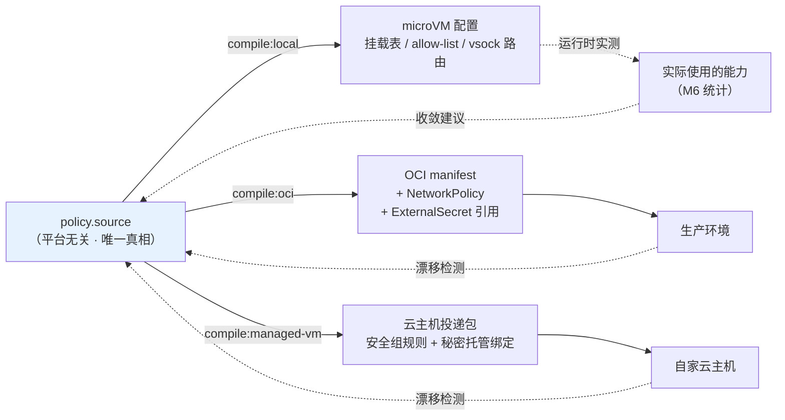
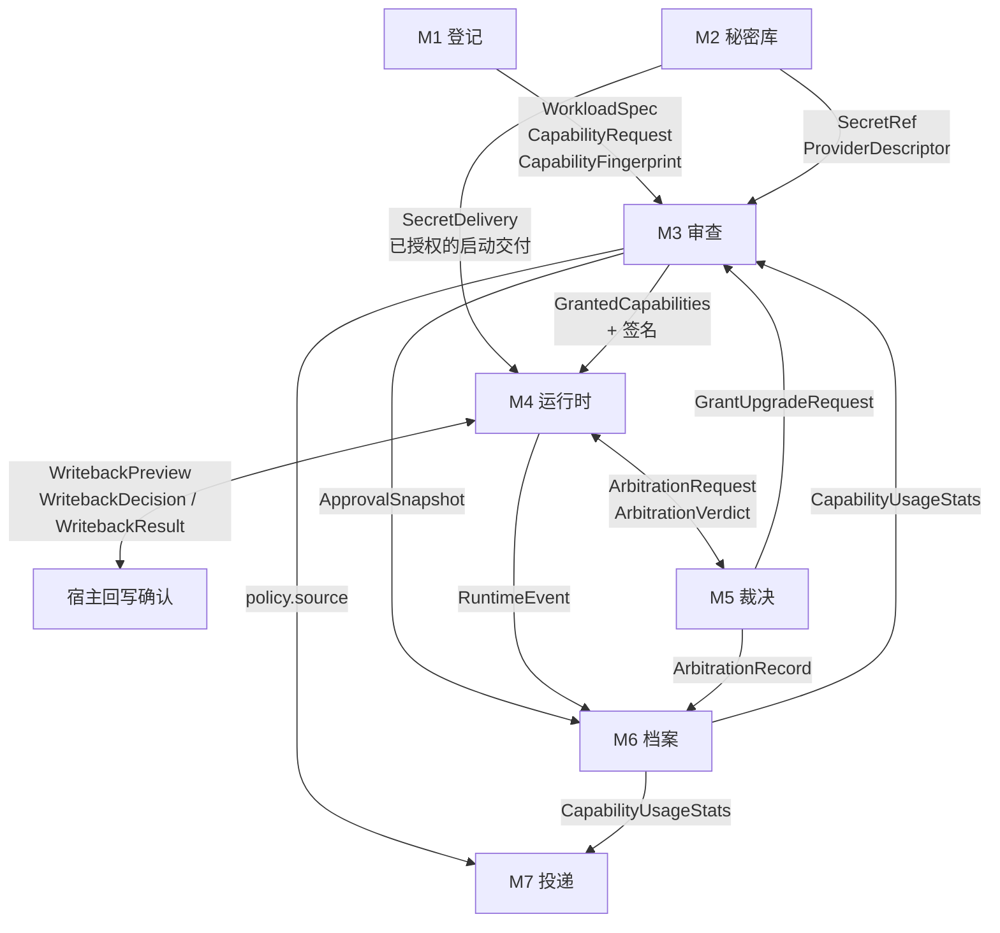

# 桌面级安全沙箱 — 产品设计文档（三）接口契约

> 本批内容：三类接口的完整契约。A 用户可见接口（配置与命令）/ B 系统间接口（模块契约）/ C 外部协议接口（MCP、Workload spec、policy schema）。
> 前置依赖：[01-产品定位与设计锚点.md](./01-产品定位与设计锚点.md) 的 D1–D8、[02-模块设计.md](./02-模块设计.md) 的 M1–M7。
> 后续批次：04 界面信息架构 / 05 计量计费与评审验收。

---

## 0. 接口设计的三条总则

1. **配置与控制接口只接受秘密引用**（D1 的执行点）。schema 不提供明文字段并拒绝未知字段；运行时另行执行授权、交付与适配器检查。代理模式不向 guest 交付原始秘密；引用模式是明确批准并确认风险后，向指定目标进程交付明文的例外，不能沿用代理模式的保护承诺。
2. **策略是源，不是导出**（D6）。`policy.source` 是唯一真相，本地配置与生产产物都是它的编译结果。不存在"从运行时反向生成策略"的路径。
3. **接口措辞与界面措辞分离**。接口用技术术语（工程师读），界面用用户语言（02 §4.3 的对照表）。两者的映射关系由**措辞表**显式维护，不是散落在代码里的字符串。

---

# A. 用户可见的接口

## A.1 配置文件：Workload Spec

用户**通常不需要手写**这个文件——它由 M1 的登记流程生成。但它必须可读、可 diff、可版本控制、可分享。这是开发者用户的基本期待。

### A.1.1 完整示例（claude code）

以下为设计配置示例，不代表该第三方 CLI 的启动参数、代理认证或秘密读取适配已完成实际验证；运行准入以 B.2.2.1 的适配器验证记录为准。

```yaml
# ~/Library/Application Support/<App>/workloads/claude-code-myrepo.yaml
apiVersion: sandbox/v1
kind: Workload

metadata:
  name: claude-code-myrepo
  displayName: "Claude Code · 我的代码/myrepo"
  type: agent                      # agent | mcp-server | plain-code
  template: claude-code            # 来源模板，用于能力推断的依据追溯
  createdAt: "2026-10-23T14:30:00+08:00"

runtime:
  command: ["claude"]
  args: ["--project", "/workspace"]
  workdir: /workspace
  lifecycle: ephemeral             # ephemeral | session | persistent（D5，默认 ephemeral）

capabilities:
  # ── 文件系统 ──
  filesystem:
    - hostPath: ~/code/myrepo      # 实际存储为 Security-Scoped Bookmark，此处仅为可读展示
      guestPath: /workspace
      mode: rw                     # ro | rw；普通工作区默认 rw，仍需有效授权
      copyOnWrite: true            # rw 时默认且必须为 true；按 B.2.7 预览并确认后回写
      exclude:                     # 即使在挂载范围内也不可见
        - ".env*"
        - "**/id_rsa*"
        - ".git/config"

  # ── 网络 ──
  network:
    egress:
      default: deny                # 🚫 不可改为 allow（schema 层面 enum 仅含 deny）
      allow:
        - host: api.anthropic.com
          port: 443
          via: proxy               # proxy | direct；direct 仅用于无需凭据注入的场景
          reason: "template:claude-code"   # 推断依据

  # ── 秘密（D1：只有引用，没有值）──
  secrets:
    - ref: anthropic-personal      # 指向 Secret Vault 中的条目
      mode: proxy-inject           # proxy-inject | memory-inject
      # ⚠️ schema 中不存在 value / env / file 字段

  # ── 进程 ──
  process:
    spawn: allow                   # allow | deny
    maxProcesses: 256

  # ── 资源 ──
  resources:
    cpu: 2
    memory: 2Gi
    diskEphemeral: 8Gi

  # ── 缓存层（D5 的摩擦缓解，01 R3 的风险点）──
  cache:
    - kind: npm
      mode: ro                     # 🚫 schema 层面仅允许 ro
      verify: checksum             # 必填，无默认值——强迫显式声明校验方式

# 审查状态（由 M3 写入，用户不手填）
review:
  fingerprint: "sha256:7f3a...b219"
  approvedAt: "2026-10-23T14:31:12+08:00"
  approvedBy: local-user
  mode: minimal                    # recommended | custom | minimal
```

### A.1.2 schema 层面的否决性约束

这些约束由封闭 schema、条件约束与运行时校验共同执行；不允许未知字段、用户编辑或编译目标绕过检查。未获授权的配置声明不会形成可执行能力。

| 约束 | 实现方式 | 对应决策 |
|---|---|---|
| 秘密不得有明文 | `secrets[]` 项只有 `ref` / `mode`，**无 value/env/file 字段** | D1 |
| 普通可写挂载必须使用 CoW | `filesystem[].mode` 默认 `rw`；`rw` 时 `copyOnWrite` 默认且仅允许 `true`，显式 `false` 拒绝；规范化后必须写入 `true` 并纳入审查指纹；`ro` 不产生回写 | D3 / B.2.7 |
| 秘密模式不得自动降级 | `mode` 仅接受 `proxy-inject` / `memory-inject`；后者须有明确风险确认与已验证适配器，缺失即拒绝 | D1 / B.2.2.1 |
| 出站不得默认放行 | `network.egress.default` 的 enum 仅含 `deny` 一个值 | D2 |
| 不得通配主机 | `host` 的 pattern 拒绝 `*`、空值、裸 IP 段 | D2 |
| 缓存层不得可写 | `cache[].mode` enum 仅含 `ro` | 01 R3 |
| 缓存层必须声明校验 | `cache[].verify` 必填无默认 | 01 R3 |
| 持久模式不得为默认 | `lifecycle` 的 default 为 `ephemeral` | D5 |
| 审查状态不可由用户伪造 | `review` 块由 M3 签名；签名不符视为未审查 | D3 |

**`network.egress.default` 只有一个合法值是故意的**。保留这个字段而不是删掉它，是为了让读 YAML 的人**看见**"默认拒绝"这件事——它是一句写给人看的声明，不是一个可调的开关。

`⚖️ 取舍`：把约束做进 schema 意味着某些真实场景无法表达（例如"我就是要访问任意主机的爬虫"）。我接受——这类场景应该走"明确标记为高风险的特殊工作负载类型"，而不是放宽通用 schema。给通用 schema 开口子，等于给所有工作负载开口子。

### A.1.3 MCP 工作负载的差异（D4）

```yaml
apiVersion: sandbox/v1
kind: Workload
metadata:
  name: github-mcp
  type: mcp-server

runtime:
  command: ["npx", "-y", "@modelcontextprotocol/server-github"]
  lifecycle: ephemeral

capabilities:
  filesystem: []                   # 默认空
  network:
    egress:
      default: deny
      allow:
        - host: api.github.com
          port: 443
          via: proxy
          reason: "probe:config-declared"
  secrets:
    - ref: github-personal
      mode: proxy-inject

# ── MCP 专属：工具级开关（D4 的差异点）──
mcp:
  probedAt: "2026-10-23T14:20:00+08:00"
  toolPolicy:
    default: deny                  # 🚫 enum 仅含 deny
    allow:
      - name: get_issue
        risk: low
      - name: list_repos
        risk: low
      - name: create_pull_request
        risk: high
        confirmEachCall: false     # true 时每次调用都要确认
    # search_code、delete_* 等未列出的工具 → 默认拒绝
  exposedTools:                    # 探查结果，只读，用于检测"工具集变化"
    - get_issue
    - list_repos
    - create_pull_request
    - search_code
    - create_issue
  toolsetFingerprint: "sha256:2a91...ff03"

# 哪些 Agent 可以调用这个 MCP（D4：Agent 与 MCP 互不默认可见）
consumers:
  - workload: claude-code-myrepo
```

**`exposedTools` 与 `toolPolicy.allow` 分离**是有意设计：前者是“它声称能做什么”（探查所得），后者须经 M3 审查并纳入有效签名授权才表示“我允许它做什么”。两者的差集展示为未授权功能，其中显式拒绝与尚未申请须分别标明；即使列入 allow，命中有效 deny 仍拒绝。`toolsetFingerprint` 变化 → 暂停并强制重新审查，不能把新增工具按风险自动放行。

---

## A.2 策略源文件：policy.source（D6 的核心）

工作负载描述回答"跑什么"，策略源回答"允许什么"。**分离的理由**：同一份策略可应用于多个工作负载，且策略是要带到生产的那一份。

```yaml
# policies/agent-baseline.policy.yaml
apiVersion: sandbox/v1
kind: Policy
metadata:
  name: agent-baseline
  displayName: "Agent 基线策略"
  portable: true                   # 声明本策略不含平台特定内容

spec:
  filesystem:
    defaultMode: none              # 未匹配授权的路径仍拒绝；普通 workspace 规则默认 rw + CoW
    rules:
      - selector: { label: workspace }
        mode: rw
        copyOnWrite: true
        denyPatterns: [".env*", "**/*_rsa", "**/.aws/**", "**/.kube/**"]

  network:
    defaultEgress: deny
    rules:
      - selector: { label: llm-api }
        allow:
          - { host: api.anthropic.com, port: 443, via: proxy }

  secrets:
    allowedModes: [proxy-inject]    # 可显式加入 memory-inject，但仍须逐项审查、风险确认与适配验证
    denyPlaintextInEnv: true        # 恒为 true，列出是为了可读

  mcp:
    toolPolicy: { default: deny }
    requireProbeBeforeRun: true

  audit:
    retentionDays: 90
    failClosed: true                # 审计不可用时拒绝新沙箱（02 §7.5）

# ── 编译目标声明（D6 双轨）──
targets:
  local:
    engine: macos-virtualization
  oci:
    networkPolicyFormat: kubernetes-v1
    secretBackend: external-secrets
  managed-vm:
    productLine: ecs
    securityGroupMode: strict
```

### A.2.1 编译关系



**两条虚线是本设计的关键**，也是 D6 从口号变成机制的地方：
- **收敛回路**：M6 的实际使用统计反馈给策略源，生成"可以收紧"的建议（02 §8.3）
- **漂移检测**：生产侧手工改动能被检出并提示三方差异

### A.2.2 编译的"不可表达"处理

| 本地能力 | OCI 轨 | 云主机轨 | 不可表达时的行为 |
|---|---|---|---|
| 文件 copy-on-write 与确认回写 | ⚠️ 尚无已验证等价实现 | ⚠️ 尚无已验证等价实现 | 可生成差异报告；无法保留 B.2.7 语义时阻止可写挂载投递，不改成直接写宿主 |
| 主机级 allow-list | ✅ NetworkPolicy + egress FQDN | ✅ 安全组 + 域名解析 | — |
| 秘密代理注入 | ⚠️ 需已验证 sidecar | ⚠️ 需已验证托管代理适配 | 无等价且已验证的代理时阻止投递；不得自动切换到 memory-inject |
| MCP 工具级开关 | ⚠️ 需本产品 sidecar | ⚠️ 同左 | 明确标注"生产侧无 MCP 工具过滤" |
| 一次性沙箱 | ✅ Pod restartPolicy | ✅ 实例回收策略 | — |

**🚫 否决条件**：编译器遇到不可表达的限制时，不得静默降级。必须在产物与报告中显式列出"这些保护在生产环境不生效"。静默降级是"本地到生产"承诺最容易崩塌的地方。

秘密交付与普通 `rw` 的 CoW 回写另有强制准入：报告提示不能替代批准或放宽安全保证。若用户改选 `memory-inject`，必须修改策略与工作负载、确认明文交付风险、通过目标适配验证，重新完成 M3 审查、签名与记录后才能投递；目标只支持 env/文件或无法验证时返回 `unsupported-adapter`，阻止投递。

---

## A.3 命令行接口

GUI 是主界面，CLI 是**给已经信任产品的用户的加速器**，不是平行入口。设计原则：**CLI 不得绕过审查**。

```bash
# 工作负载
sandbox run <workload>              # 启动；未审查或指纹变更时自动唤起 GUI 审查
sandbox run <workload> --minimal    # 以最小权限试运行（M3 主推路径）
sandbox ls                          # 列出工作负载及审查状态
sandbox inspect <workload>          # 查看能力清单 + 推断依据
sandbox stop <workload>

# 登记
sandbox init --template claude-code --workdir ./myrepo
sandbox import <file.sandboxpkg>    # 签名无效时拒绝

# MCP
sandbox mcp probe <command>         # 零权限试探，输出工具清单
sandbox mcp tools <workload>        # 查看工具开关状态

# 秘密（🚫 没有任何接受明文值的参数）
sandbox secret ls                   # 仅列出引用名 + 末四位
sandbox secret connect <provider>   # 唤起 GUI 完成 OAuth/导入
sandbox secret rm <ref>
# ❌ 不存在：sandbox secret set <name> <value>

# 档案
sandbox log <workload> [--since 24h] [--redact]
sandbox usage <workload>            # 能力实际使用统计

# 投递
sandbox policy compile <policy> --target oci|managed-vm
sandbox policy diff <policy> --against production
sandbox handoff <workload> --target managed-vm --dry-run
```

### A.3.1 CLI 的三条硬约束

| 约束 | 理由 |
|---|---|
| **无 `secret set <value>`** | 明文会进 shell history、进 CI 日志、进 `ps` 输出。D1 的否决条件在 CLI 上的体现 |
| **无 `--yes` / `--force` 批准审查** | 任何新增或扩大的能力都须经宿主原生界面完成明确审查。CLI 仅能复用指纹一致、签名有效、未过期且未撤销的既有授权；风险等级不能替代审查 |
| **无 `--no-sandbox`** | 02 §5.6 的产品底线，CLI 侧同样不提供逃生舱 |

`⚖️ 取舍`：没有 `--yes` 会让 CI 场景无法全自动。解法是"**预先在 GUI 审查并导出已签名的策略**，CI 中引用该策略"——审查动作前置到人的时间，而不是取消。这是我认为正确的权衡：自动化的是执行，不是信任。

---

# B. 系统间接口（模块契约）

## B.1 契约总览



## B.2 核心数据契约

### B.2.1 `CapabilityRequest`（M1 → M3）

```typescript
interface CapabilityRequest {
  id: string;
  kind: 'filesystem' | 'network' | 'secret' | 'process' | 'mcp-tool' | 'clipboard';
  spec: FilesystemSpec | NetworkSpec | SecretRefSpec | ProcessSpec | McpToolSpec | ClipboardSpec;

  // ── 以下三项缺一不可，缺失则该条目不得进入审查界面 ──
  risk: 'low' | 'medium' | 'high';  // 仅决定提示强度与聚合，不产生授权
  evidence: Evidence;        // 推断依据（02 §2.3）
  phrasing: Phrasing;        // 用户语言措辞（02 §4.3）
}

interface Evidence {
  source: 'template' | 'static-analysis' | 'probe' | 'user-declared' | 'prior-approval';
  detail: string;            // "来自 claude-code 官方模板" | "在 .mcp.json 第 12 行声明"
  locator?: { file: string; line?: number };
}

interface Phrasing {
  capability: string;        // "能读取「代码/myrepo」中获准的内容，并在沙箱副本中修改"
  consequence: string;       // "确认回写会将选中的修改、删除或重命名应用到宿主文件"
  version: string;           // 措辞表版本，写入 ApprovalSnapshot 用于事后追溯
}
```

**契约级强制**：`evidence` 与 `phrasing` 为**必填且不可为空字符串**。这把 02 §2.3 和 §4.3 两条设计规则变成了类型系统强制的约束——工程实现想绕过就得先改接口定义，而改接口定义会触发设计评审。

### B.2.2 `SecretRef`（M2 → 所有模块）

```typescript
interface SecretRef {
  name: string;
  provider: string;                              // "anthropic" | "github" | "custom:..."
  mode: 'proxy-inject' | 'memory-inject';
  lastFour: string;                              // 展示用，如 "a1b2"
  status: 'valid' | 'expired' | 'revoked' | 'unverified';
  origin: 'oauth' | 'keychain-import' | '1password' | 'secrets-manager' | 'manual';
  createdAt: string;
  // 🚫 本接口及其任何版本中不存在 value / plaintext / env 字段
}
```

**`origin` 字段的产品用途**：统计宿主手动录入来源占比，评估账号连接体验。该占比不等于用户输入明文字符数，也不证明任何交付模式的安全性；具体体验目标另行确认。

### B.2.2.1 `SecretDelivery` / `SecretAdapter`（M2 → M4 → 指定目标）

**两种保护边界**：`proxy-inject` 由宿主代理在获批目的地认证，原始秘密留在宿主，guest 仍可能滥用获授业务能力；`memory-inject` 则将原始业务秘密交给明确批准的目标进程。后者必须单独展示并确认“程序能读取、复制及外传该秘密；撤销不能收回已经交付的明文”，确认内容进入 `ApprovalSnapshot`。引用名、Provider 目录命中或网络许可均不等于秘密使用授权。

```typescript
interface ProcessStartIdentity {
  launchId: string;                // 宿主为本次启动分配的不可复用标识，不以 PID 单独认定身份
  executableDigest: string;
  launcherSessionId: string;       // 经认证的 guest 可信启动器会话
}

interface SecretAdapter {
  id: string;
  version: string;
  mode: 'proxy-inject' | 'memory-inject';
  target: { application: string; version: string; executableDigest: string; platform: string };
  consumption: 'host-proxy' | 'anonymous-pipe' | 'inherited-fd' | 'dedicated-adapter';
  protocolVersion: string;         // 明确一次性读取、长度边界、完成/失败判定与关闭语义
  validation: {
    status: 'design-only' | 'verified' | 'failed';
    evidenceId?: string;           // verified 必填；绑定上述精确版本、平台与程序摘要
  };
  // 专用适配器仍须通过 pipe/fd 直接交付目标进程，不得桥接到 env/argv/文件
}

interface SecretDelivery {
  deliveryId: string;              // 一次性，超时/失败/成功后均不可重用
  runId: string;
  workloadId: string;
  processStart: ProcessStartIdentity;
  secretRef: string;
  grantSetId: string;
  grantId: string;
  mode: 'proxy-inject' | 'memory-inject';
  adapterId: string;
  adapterVersion: string;
  expiresAt: string;
  // 仅控制元数据，不含明文；memory-inject 的密文传输/明文载荷只走专用 secret 通道
}

type SecretDeliveryResult = {
  deliveryId: string;
  status: 'proxy-bound' | 'delivered'; // delivered 仅表示目标读取完成，不表示业务认证成功
} | {
  deliveryId: string;
  status: 'denied' | 'failed';
  error: 'not-granted' | 'explicit-deny' | 'grant-expired' | 'grant-revoked'
       | 'risk-not-confirmed' | 'unsupported-adapter' | 'launch-mismatch'
       | 'delivery-expired' | 'delivery-already-consumed' | 'delivery-failed';
};

interface SecretRevocationResult {
  secretRef: string;
  blockedFutureDelivery: boolean;
  blockedProxyAuthentication: boolean;
  affectedRuns: Array<{
    runId: string;
    termination: 'requested' | 'terminated' | 'failed';
    plaintextPreviouslyDelivered: boolean;
  }>;
  rotationRequired: boolean;
}
```

**交付顺序与失败语义**：

封闭 schema 与运行时同时校验：`proxy-inject` 仅匹配 `host-proxy` 消费方式；`memory-inject` 仅匹配 pipe/fd 或遵循该协议的专用适配器。`validation.status === 'verified'` 必须具有可核验的 `evidenceId`，其目标摘要、平台、版本与本次启动完全一致；引用模式的风险确认必须属于同一授权快照、秘密引用和目标适配绑定。缺字段或不匹配均不得交付。

1. 宿主根据已批准的启动计划生成 `SecretDelivery`，逐项绑定 `runId + workloadId + processStart + secretRef + 有效 grant`；验证签名、范围、deny、有效期、撤销状态、适配器验证证据，以及引用模式的风险确认。进程标识须来自受认证启动链，不能信任 guest 自报 PID、程序名或 `secretRef`。身份、程序或适配版本变化时不得复用旧交付。
2. `proxy-inject` 不发送秘密到 guest。宿主仅为已绑定运行/进程且目标主机、端口和认证协议获准的请求附加认证；每次代理认证前重验 grant 与撤销状态，不能把认证材料带到未批准的重定向目标。
3. `memory-inject` 只在该目标启动时，经 host → guest 的认证单向 `secret` 通道送至可信启动器。启动器使用**一次性匿名 pipe 或继承 fd**直接交给目标应用，明确读取协议和大小上限；仅对本次 exec 的显式 allowlist 开放所需 fd 继承，其余 fd 设置 close-on-exec，关闭无关句柄并阻止非必要子进程继承。读取完成、失败或超时即关闭并消耗 `deliveryId`，清理产品控制的 buffer；失败后禁止自动重发或换模式，需重新建立获准的启动实例。
4. 只有明确验证支持 fd 读取或已验证专用适配器的精确目标版本才允许引用模式。未知应用、`design-only`、验证失败、要求 env/argv/持久文件，或适配器会将秘密再写入上述位置时，均返回 `unsupported-adapter` 并 fail closed。不能以“已送到 guest 内存”代替应用读取兼容验证；不得自动降级到 env、argv、文件或另一交付模式。
5. `mlock`、禁止 dump 与用后 wipe 只约束产品可控 buffer，不能保证目标程序不会复制、dump 或主动外传已收到的明文；这些措施不构成“密钥永远不交给程序”的承诺。目标进程在授权网络/业务范围内的滥用仍是残余风险。
6. 撤销与新交付/代理认证准入在宿主同步处理：撤销生效后禁止后续交付和代理认证；撤销前已交付的进程内存无法收回，也不能撤回已发出的请求。对已接受明文的关联运行应立即请求终止、报告实际终止状态并提示轮换；终止失败必须告警，不能声称凭据已收回。结果中的阻断状态只有实际生效才为 `true`；阻断或终止失败须隔离受影响运行并报告失败，不得报告完整撤销成功。

**支持矩阵（设计与实际验证分开）**：

| 目标/消费方式 | 设计适配 | 实际验证状态 | 准入条件 |
|---|---|---|---|
| 宿主代理可处理的认证协议 | `proxy-inject`，原始秘密仅宿主使用 | 尚未完成；需逐应用、版本、协议验证 | 有有效 grant 与 `verified` 代理适配证据 |
| 明确支持匿名 pipe/继承 fd 的目标 | `memory-inject`，可信启动器直接交付 | 尚未完成；不由协议设计推定现成 CLI 可用 | 有风险确认、有效 grant 与该版本 `verified` 读取证据 |
| 通过专用适配器消费的目标 | `memory-inject`，适配器遵循同一 pipe/fd 与清理约束 | 尚未完成；需逐适配器及目标版本验证 | 满足上述条件，且不落入 env/argv/文件 |
| 未知应用或仅支持 env/文件的目标 | 无合规适配 | 不支持 | `unsupported-adapter`，拒绝启动交付 |

本文件中的 Claude Code、GitHub MCP 与 Provider 示例均为设计示例，未提供实际兼容验证证据，不构成对任何第三方 CLI 已支持的声明。新增验证记录前不得标为可用。

### B.2.3 `GrantedCapabilities`（M3 → M4）

```typescript
interface GrantedCapabilities {
  grantSetId: string;
  approvalSnapshotId: string;       // 指向已持久记录的完整审查快照
  workloadId: string;
  fingerprint: string;              // 必须与 M1 产出的能力指纹一致
  grants: Grant[];
  mode: 'recommended' | 'custom' | 'minimal';
  issuedAt: string;
  expiresAt?: string;               // session/ephemeral 模式下的有效期
  signature: string;                // M3 签名；M4 必须校验
}

interface Grant {
  grantId: string;
  requestId: string;                // 回指 CapabilityRequest
  decision: 'granted' | 'denied';
  phrasingVersion: string;          // 用户当时看到的措辞版本
  constraints?: Record<string, unknown>;  // 用户裁剪后的收窄条件
  secretBinding?: {                // 已授予 secret 能力时必填，所有字段纳入签名
    secretRef: string;
    mode: 'proxy-inject' | 'memory-inject';
    adapterId: string;
    adapterVersion: string;
    targetExecutableDigest: string;
    plaintextRiskAcknowledgementId?: string; // 授予 memory-inject 时必填；拒绝不要求确认风险
  };
}
```

**M4 的强制校验**：
1. `signature` 有效、审查快照已可靠记录、授权属于当前工作负载且未过期/撤销/被替代，否则拒绝启动或后续执行。
2. `fingerprint` 与当前 WorkloadSpec、策略及适配绑定推导出的一致，否则拒绝启动并重新审查。
3. 每次执行前匹配实际目标与约束：**deny 优先**；任何适用的策略拒绝或 `decision === 'denied'` 都压过 allow。没有覆盖本次操作的有效 `granted`，包括未申请能力、缺省项、范围外操作，一律默认拒绝并记录。
4. M5 只处理拒绝后的提示、聚合与补授入口。`risk` 只决定提示强度，低风险、模板建议、历史成功或 M5 的可用性都不能把拒绝变成允许。基础能力若需允许，也必须在运行前可见并纳入 M3 签名授权与快照。

新补授必须经宿主原生界面，对更新后的完整能力集合逐项展示范围、后果及已有拒绝，形成明确的批准/拒绝结果；允许用户只批准所需子集。M3 完成完整审查、签名及 M6 持久记录后，M4 才可原子切换到新的授权集，旧授权集随即失效。签名或记录失败、取消、超时均保持拒绝；不能凭 M5 弹窗结果自动授权。解除显式拒绝也必须走这一路径，新增 allow 不能覆盖仍然有效的 deny。本次已拒绝的操作不会自动重放，后续请求按新授权重新校验。

### B.2.4 `ArbitrationRequest` / `ArbitrationVerdict`（M4 ↔ M5）

```typescript
interface ArbitrationRequest {
  requestId: string;
  runId: string;
  workloadId: string;
  grantSetId: string;
  attempt: {
    kind: CapabilityRequest['kind'];
    target: string;                 // "example.com:443" | "/host/~/.ssh/id_rsa" | "github.delete_repo"
    timestamp: string;
  };
  risk: 'low' | 'medium' | 'high';   // 仅影响提示与聚合
  // 疑似外发敏感数据时的摘要（02 §6.5）——摘要本身不得含明文秘密
  payloadDigest?: { size: number; sensitiveHints: string[] };
  repeatCount: number;              // 聚合计数，用于抑制重复弹窗
}

type ArbitrationVerdict = {
  requestId: string;
  decision: 'allow';
  reason: 'pre-granted';            // 只能引用既有有效授权；M4 执行前仍重验 deny、范围与有效性
  grantSetId: string;
  grantId: string;
} | {
  requestId: string;
  decision: 'deny';
  reason: 'not-granted' | 'explicit-deny' | 'out-of-scope' | 'invalid-grant'
        | 'user-denied' | 'cancelled' | 'timeout-denied' | 'fail-closed';
  upgradeRequestId?: string;        // 仅关联审查申请，不代表授权，也不解除本次阻断
  protocolError?: McpError;         // MCP 拒绝必须返回协议层错误
};

interface GrantUpgradeRequest {
  id: string;
  runId: string;
  workloadId: string;
  currentGrantSetId: string;
  triggerRequestId: string;
  proposedCapabilities: CapabilityRequest[]; // 更新后的完整集合；M3 重新核验依据与指纹
  // 不携带 approved/allow 字段；M5 不能代替 M3 签发授权
}
```

**`protocolError` 是 D4 可用性的关键**（02 §6.4）：被拒绝的 MCP 工具调用必须返回 Agent 能理解的错误，而不是超时。

### B.2.5 `ApprovalSnapshot`（M3 → M6）

```typescript
interface ApprovalSnapshot {
  readonly id: string;
  readonly grantSetId: string;
  readonly workloadId: string;
  readonly fingerprint: string;
  readonly decidedAt: string;
  readonly mode: 'recommended' | 'custom' | 'minimal';
  readonly grants: ReadonlyArray<{
    grantId: string;
    requestId: string;
    kind: string;
    target: string;
    decision: 'granted' | 'denied';
    riskAtTime: 'low' | 'medium' | 'high';
    phrasingShown: { capability: string; consequence: string; version: string };  // ← 关键
    secretBinding?: Grant['secretBinding'];
  }>;
  readonly plaintextRiskAcknowledgements: ReadonlyArray<{
    id: string;
    secretRef: string;
    targetExecutableDigest: string;
    adapterId: string;
    adapterVersion: string;
    confirmedAt: string;
    phrasingShown: string;          // 包含明文可被复制/外传、撤销不能收回及轮换提示
  }>;
  readonly uiContext: { appVersion: string; phrasingTableVersion: string };
}
```

**`phrasingShown` 存的是措辞的内容快照，不是指针**。文案日后改版，旧快照仍能回答"用户当时究竟看到了什么"（02 §4.4）。这是安全事件追溯的必需品，也是对产品自身的约束——不能靠改文案来掩盖过去的设计缺陷。

### B.2.6 `CapabilityUsageStats`（M6 → M7/M3）

```typescript
interface CapabilityUsageStats {
  workloadId: string;
  window: { from: string; to: string; runCount: number };
  perGrant: Array<{
    requestId: string;
    kind: string;
    grantedScope: string;           // "~/code/myrepo rw"
    observedScope: string;          // "~/code/myrepo ro（未发生写入）"
    useCount: number;
    lastUsedAt?: string;
  }>;
  unusedGrants: string[];           // 驱动"3 项权限从未用过，要收回吗"
  convergenceSuggestions: Array<{
    requestId: string;
    from: string;
    to: string;
    rationale: string;
  }>;
}
```

这是 02 §8.3「从已授予收敛到实际用到」的数据载体，同时回流给 M3 驱动 02 §7.4 的异常模式告警。

### B.2.7 CoW 回写（M4 ↔ 宿主确认界面）

普通工作区默认声明 `mode: rw`，但只有有效文件授权才能挂载；所有普通 `rw` 挂载默认且必须 `copyOnWrite: true`。guest 写入进入隔离的 CoW 副本，不直接写宿主。`ro` 不允许回写；运行结束不自动同步，取消或失败均保留 guest 副本，直至用户显式处置。

```typescript
type HostVersion = string;          // 宿主生成的强版本令牌，含内容/文件身份/目录项版本；不只用 mtime

interface WritebackChange {
  fileId: string;                   // 计划内唯一；用于选择，不接受确认端新增任意路径
  operation: 'add' | 'modify' | 'delete' | 'rename';
  path: string;                    // 挂载根内相对路径；rename 时为新路径
  previousPath?: string;           // rename 必填；旧/新路径均须校验
  contentType: 'text' | 'binary';   // 二进制仍须明确确认，不伪造文本 diff
  baselineDigest: string | null;   // null 表示基线不存在
  guestDigest: string | null;      // delete 时为 null
  baselineSize: number | null;
  guestSize: number | null;
  summary: string;                 // 操作/内容变化摘要；与供用户查看的 diff 绑定
}

interface WritebackPreviewRequest {
  runId: string;
  workloadId: string;
  mountId: string;
}

interface WritebackPreview {
  runId: string;
  workloadId: string;
  mountId: string;
  planId: string;
  baselineHostVersion: HostVersion; // 创建 CoW 基线时的宿主版本
  currentHostVersion: HostVersion;  // 本次预览观测到的宿主版本
  guestSnapshotId: string;          // 冻结待回写内容，后台 guest 修改不得替换计划内的字节
  guestChanges: { summary: string; changes: WritebackChange[] };
  diffDigest: string;              // 规范化计划摘要，覆盖版本、路径、操作、内容摘要、冲突与 guest 快照
  conflicts: Array<{
    fileId: string;
    reason: 'host-modified' | 'host-deleted' | 'destination-exists' | 'rename-conflict';
    baselineDigest: string | null;
    currentHostDigest: string | null;
    guestDigest: string | null;
  }>;
  expiresAt: string;
}

interface WritebackConfirm {
  runId: string;
  planId: string;
  diffDigest: string;
  expectedHostVersion: HostVersion; // 必须等于预览的 currentHostVersion
  selectedFiles: string[];          // 明确选择的 fileId 集合，非空且无重复
}

type WritebackDecision = {
  decision: 'cancel' | 'resolve-and-repreview';
  runId: string;
  planId: string;
} | (WritebackConfirm & {
  decision: 'confirm' | 'overwrite-selected'; // 后者明确覆盖本次预览所展示的选中文件冲突
});

type WritebackError = 'HOST_CHANGED' | 'CONFLICTS' | 'PLAN_EXPIRED' | 'PLAN_CANCELLED'
  | 'PLAN_NOT_FOUND' | 'INVALID_CONFIRMATION' | 'CONFIRMATION_ALREADY_USED'
  | 'GUEST_CHANGED' | 'PATH_FORBIDDEN' | 'PATH_REPLACED' | 'ATOMIC_REPLACE_UNSUPPORTED'
  | 'AUTHORIZATION_INVALID' | 'AUDIT_UNAVAILABLE' | 'WRITE_FAILED' | 'CANCELLED';

interface WritebackResult {
  runId: string;
  planId: string;
  status: 'applied' | 'partial' | 'failed' | 'cancelled' | 'repreview-required';
  error?: WritebackError;
  applied: Array<{ fileId: string; operation: WritebackChange['operation']; resultingHostVersion: HostVersion }>;
  unapplied: Array<{ fileId: string; reason: WritebackError }>;
  guestCopyRetained: boolean;
  resultId: string;                // 可查询的持久结果；重复确认不触发再次写入
}

type WritebackResponse = WritebackResult | {
  runId: string;
  planId: string;
  status: 'rejected';
  error: WritebackError;
  resultRef?: string;              // 重复确认必填；查询既有执行，拒绝响应不伪造其完成结果
};

interface WritebackResultQuery {
  runId: string;
  resultRef: string;
}

type WritebackResultState = WritebackResult | {
  runId: string;
  planId: string;
  resultId: string;
  status: 'in-progress' | 'recovery-required'; // 不表示成功，仍禁止重放
};
```

**预览、决策与确认约束**：

1. 宿主从 CoW 基线、当前 host 和冻结的 guest 副本做三方比较，产生不可变计划。`HostVersion` 覆盖该挂载的回写作用域及涉及的父目录/目录项；内容、对象身份、创建、删除、重命名、权限及路径替换都计入版本。无法可靠观测外部写入、版本不完整或无法冻结内容时，不得给出可提交计划。二进制至少展示路径、操作、大小变化与摘要；重命名同时展示源和目标，不按单纯修改隐藏覆盖后果。
2. 发现冲突时，普通 `confirm` **阻断整批，零写入**，不能先写不冲突项。用户可以 `cancel`、在解决冲突后 `resolve-and-repreview`，或明确选择 `overwrite-selected`。重新预览生成新 `planId`、新摘要及新确认；不能复用旧批准。覆盖决策只适用于本次明确选中的文件及当前展示过的冲突，未选文件保持不变，不能自动选全、自动合并或跳过冲突后报告全成功。
3. 宿主原生确认界面一次性绑定 `planId + diffDigest + expectedHostVersion + selectedFiles + decision + runId`，持久记录所选集合与覆盖风险，再由宿主验证并执行；guest 不得提交授权确认。更改任何绑定字段、越权选项或过期计划均拒绝。开始执行时原子消耗计划的确认资格；并发/重复确认返回 `CONFIRMATION_ALREADY_USED` 及既有结果/处理中状态的查询引用，不重复产生写入。
4. 确认前或执行临界区内发现任何新的 host 变化，旧批准失效，返回 `HOST_CHANGED` 并要求重新预览、重新确认；`overwrite-selected` 也不能豁免版本检查。若同时识别为禁止路径或对象/目录替换，优先返回更具体的 `PATH_FORBIDDEN` / `PATH_REPLACED`，同样作废旧批准并停批，不能重试旧确认。冻结 guest 副本的内容/摘要不一致返回 `GUEST_CHANGED`。`cancel` 立即使未执行计划失效且不写宿主；`resolve-and-repreview` 同样只废弃旧计划，不触发写入。执行已开始后的取消仅停止尚未开始的操作，不能假称已应用部分被回滚。

**提交与路径安全**：

- 进入宿主受控临界区后，先对**整批所选操作**再次核验有效 grant、版本、冲突决策、冻结内容和安全路径，再开始写。每次变更提交前仍需验证对应对象与父目录身份，并检测外部竞争；本批已成功写入引起的版本变化由执行器追踪，不能被当作外部变化，也不能掩盖真正的外部写入。
- 使用授权挂载根的稳定目录句柄做逐级安全解析，拒绝绝对路径、`..` 越界、受排除/保护路径、符号链接逃逸、硬链接别名及特殊文件；重命名必须同时校验旧路径、目标和父目录。预览后被替换的目录、链接、文件或挂载根返回 `PATH_REPLACED`，不得仅重新解析同名字串后继续写；禁止路径返回 `PATH_FORBIDDEN`。两者均不能用覆盖确认绕过。
- 普通文件内容在同一受控文件系统暂存并校验后，以安全的原子替换提交；预期目标不存在的新增采用不覆盖已有项的提交；只有预览已展示目标存在且获 `overwrite-selected` 明确批准时，才可对该新增操作的目标按预览身份/版本执行条件替换；普通修改、删除/重命名使用等价的身份及版本校验，不退化为原地截断或盲目覆盖。**“先检查再 rename”不是跨进程条件写入**：产品锁只能串行化自己的操作，不能天然阻止编辑器等其他进程写入。后端必须提供可验证的条件提交或实际覆盖全部写入者的受控机制，使验证至提交间的外部竞争也被检测并安全中止；事后发现已覆盖他人修改不算满足契约。仅有 advisory lock、mtime 或文件监听通知不足以保证该性质。
- 无法保证安全解析、竞争检测、条件提交或原子替换的文件系统/路径返回 `ATOMIC_REPLACE_UNSUPPORTED`，**fail closed，不回写**。普通宿主目录是否具备这些保证仍需后端实现验证；本接口不承诺通用文件 API 已天然提供跨进程原子比较并替换。
- 原子性按单个文件/目录项操作提供，不承诺跨文件事务。启动前整批验证失败零写入；中途 I/O 错误、路径变化、竞争或取消则停止余项，完整列出 `applied` 与 `unapplied`，保留 guest 副本。确认结果中两者无交集且恰好覆盖所选文件；没有选定集合的取消/重新预览响应两者均为空，未知/非法/重复请求使用 `WritebackResponse` 的拒绝分支。失败、取消与部分成功时 `guestCopyRetained` 必须为 `true`；`status: applied` 仅能在全部选项实际成功时使用。部分成功返回 `partial` 及具体错误；重试必须按当前状态为未应用部分重新预览确认，禁止重放全部。审计不可用时不得开始写入；提交日志与结果须支持崩溃恢复，状态不明时禁止自动重试，先核实各项实际结果。

| 失败/取消场景 | 返回与副作用 |
|---|---|
| 预览已有冲突但使用普通确认 | `CONFLICTS`；整批零写入 |
| 预览后 host 变化，包括覆盖确认后的竞争 | `HOST_CHANGED`；批准作废；未开始则零写入，中途则列出已应用项并停批 |
| 用户取消、解决后重新预览 | 未执行时分别返回 `cancelled / CANCELLED`、`repreview-required`；旧计划失效，保留 guest 副本 |
| 执行中取消 | 停止余项；已有写入返回 `partial / CANCELLED`，不隐瞒已应用项 |
| 已取消、过期、未知计划或篡改确认绑定 | `PLAN_CANCELLED`、`PLAN_EXPIRED`、`PLAN_NOT_FOUND` 或 `INVALID_CONFIRMATION`；零新增写入 |
| 重复或并发确认同一计划 | `CONFIRMATION_ALREADY_USED`；附既有结果/处理中状态查询引用，零重复写入 |
| 路径越界/保护区、目录或文件被替换 | `PATH_FORBIDDEN` / `PATH_REPLACED`；预检时整批阻断，执行中则停批列明结果 |
| 无法保证提交安全、权限失效、审计不可用 | `ATOMIC_REPLACE_UNSUPPORTED` / `AUTHORIZATION_INVALID` / `AUDIT_UNAVAILABLE`；不得开始写入 |
| 冻结内容变化或执行 I/O 失败 | `GUEST_CHANGED` / `WRITE_FAILED`；停批，列明 `applied/unapplied`，保留 guest 副本 |

## B.3 Broker 内部接口（宿主 ↔ guest）

**唯一通道是 vsock**。guest 无网络栈直连、无共享内存、无宿主文件系统直接访问。

| 通道 | 方向 | 内容 | 约束 |
|---|---|---|---|
| `ctrl` | 双向 | 生命周期控制、健康检查 | 定长消息，拒绝变长攻击面 |
| `fs` | guest → host | 文件操作代理 | 仅已挂载视图内；越界在挂载层失败，不到达 Broker |
| `net` | guest → host | 出站请求 | 全部经代理；未 allow-list 直接拒绝 |
| `secret` | host → guest | 绑定 `SecretDelivery` 的启动载荷 | **单向**，仅 memory-inject；可信启动器以一次性匿名 pipe/继承 fd 交给已验证目标 |
| `mcp` | 双向 | Agent ↔ MCP 的 JSON-RPC | 经 Broker 过滤 `tools/list`、拦截 `tools/call` |
| `event` | guest → host | 运行事件上报 | 仅数据，不含控制语义 |

`fs` 通道的写操作只更新已授权挂载的 guest CoW 副本；只有宿主确认入口可发起 B.2.7 的回写。匿名 pipe/继承 fd 是 guest 内启动器到目标进程的消费方式，不增加 host ↔ guest 通道。

**`secret` 通道单向是硬设计**：guest 无法通过该通道请求任意秘密，只能被动接收宿主按 B.2.2.1 为该次获准启动计划发放的秘密；`ctrl`、`event` 等其他通道也不得提供任意 `secretRef` 查询/兑换接口。启动回执最多携带 `deliveryId` 与读取/失败状态，不含明文，不触发新增交付。宿主独立核验运行与启动身份，不能根据 guest 自报标识扩大发放范围。

---

# C. 外部协议接口

## C.1 MCP 协议的拦截契约（D4）

### C.1.1 `tools/list` 过滤

```
Agent ──tools/list──▶ Broker ──转发──▶ MCP 工作负载
                        ◀──完整工具清单──┘
                        │
                        ├─ 比对 toolsetFingerprint
                        │    └─ 变化 → 🔴 暂停 + 强制重新审查
                        ├─ 按有效授权过滤（deny 优先）
                        └─ 返回过滤后清单给 Agent
```

**关键决策：返回过滤后的清单，而不是完整清单 + 调用时拒绝。**

`⚖️ 取舍`：
- **过滤清单**的优点是 Agent 根本不知道被禁的工具存在，不会浪费推理尝试，也不会在 prompt 中暴露"有个 delete_repo 但你不能用"这种诱导信息。缺点是 Agent 可能无法向用户解释"为什么做不到"。
- **完整清单 + 调用拒绝**的优点是透明，缺点是 Agent 会反复尝试，且把被禁工具的存在告诉了可能被 prompt 注入的模型。

我选择**过滤清单**，并通过在宿主侧状态面板显示"已为你隐藏 3 个高风险功能"来补偿透明度——**透明度给用户，不给 Agent**。这与 02 §6.6（信任 UI 不由 guest 渲染）同源。

### C.1.2 `tools/call` 拦截

```typescript
// Broker 对每次 tools/call 的处理
interface ToolCallGate {
  toolName: string;
  // 1. 命中 deny 或无覆盖本次参数/目标的有效 grant → 返回协议错误（不是超时）
  // 2. 已获准但标记 confirmEachCall → 唤起宿主确认；取消/超时拒绝，不扩大授权
  // 3. 参数触发路径越界等策略拒绝 → 拒绝；risk 只调整提示，不产生权限
  // 4. 通过且执行前重验 grant 仍有效 → 转发；未授权操作需走完整 M3 补授流程
}
```

被拒时返回的协议错误：

```json
{
  "jsonrpc": "2.0",
  "id": 42,
  "error": {
    "code": -32000,
    "message": "Tool 'create_pull_request' is not permitted by the sandbox policy",
    "data": {
      "reason": "not-in-allow-list",
      "userActionHint": "The user can grant this capability in the sandbox app"
    }
  }
}
```

**`userActionHint` 是给 Agent 看的**，让它能告诉用户"我需要一个权限"，而不是反复重试或凭空失败。这一句话决定了 D4 是"好用的隔离"还是"碍事的隔离"。

### C.1.3 MCP 探查协议（M1 的试探性启动）

| 阶段 | 行为 | 约束 |
|---|---|---|
| 1. 创建探查沙箱 | 零权限、无网络、无挂载、无秘密 | 违反任一则探查无效 |
| 2. 启动 MCP | 仅 `initialize` + `tools/list` | 不发送任何其他请求 |
| 3. 观测越界 | 记录该进程的任何网络/文件尝试 | **这是探查最有价值的产物** |
| 4. 销毁 | 一次性，仅保留 JSON 结果与越界记录 | 不保留任何文件系统状态 |
| 超时 | 10s | 超时则工具清单标记 `unknown` |

探查输出：

```typescript
interface ProbeResult {
  status: 'ok' | 'timeout' | 'crashed';
  exposedTools: ToolDescriptor[];
  toolsetFingerprint: string;
  // 零权限下的越界尝试 —— 高风险信号，审查界面置顶
  violationsDuringProbe: Array<{
    kind: 'network' | 'filesystem' | 'process';
    target: string;
    interpretation: string;   // "它在没有任何权限时就尝试访问网络"
  }>;
  declaredHosts: string[];    // 从配置文件静态解析出的主机
}
```

## C.2 Provider 目录接口（D1 的路由依据）

内置 Provider 目录为“用户选服务 → 提议交付机制”提供依据；目录本身不授予权限，不能自动切换保护级别。下例是设计元数据，OAuth 占位值和认证配置不代表实际接入验证完成。

```yaml
# providers/anthropic.yaml
apiVersion: sandbox/v1
kind: Provider
metadata:
  id: anthropic
  displayName: "Claude 官方服务"

auth:
  preferredFlow: oauth            # oauth > keychain-import > manual
  oauth: { authorizeUrl: "...", scopes: ["api"] }
  injection:
    mode: proxy-inject            # 只提议此模式；仍须有效授权及适配验证
    header: "x-api-key"
    format: "{{secret}}"

network:
  requiredHosts:
    - { host: api.anthropic.com, port: 443 }

validation:
  probeEndpoint: "/v1/models"     # 用于校验凭据有效性
  expectedStatus: [200]

phrasing:
  capability: "能以你的身份调用 Claude"
  consequence: "它可以用你的账号发起对话，产生费用；在代理模式下原始密钥不会交给它"
```

**Provider 目录是产品的持续运营资产**：它决定了多少用户能走 OAuth/导入路径（`origin !== 'manual'`），直接影响 §1.2 的核心验收指标。目录的覆盖率应作为产品 KPI 跟踪。

**自定义 Provider**：用户可添加，但不得默认降级为 `memory-inject`。先检查请求模式对应的已验证适配器，无兼容实现则返回 `unsupported-adapter`。用户明确选择引用模式时，必须展示“原始秘密会交付给指定程序，程序可以复制或外传；撤销不能收回已交付内存，需终止关联运行并轮换”的风险，重新完成 M3 审查、签名与记录；不得沿用上例代理模式的“不交给它”措辞，也不得采用 env/argv/持久文件兜底。

## C.3 分享包格式：`.sandboxpkg`

```
myagent.sandboxpkg/
├── manifest.json          # 包元数据 + 签名
├── workload.yaml          # WorkloadSpec（🚫 已剥离所有 hostPath 与 secretRef 的具体值）
├── policy.yaml            # policy.source
├── phrasing.json          # 措辞表快照，保证接收方看到的描述与分享方一致
└── provenance.json        # 来源、签名者、构建时间
```

**导入时的处理**：

| 字段 | 处理 |
|---|---|
| `hostPath` | 全部置空，强制接收方自己通过系统 Picker 选择 |
| `secretRef` | 仅保留"需要哪个 Provider 的账号"，不保留引用名；接收方需自行连接 |
| `review` | 全部清除——**分享包不携带审查结果**，接收方必须自己审查 |
| 签名无效 | 默认拒绝；强制导入时永久标记"来源不明"并提升所有能力风险等级 |

**"分享包不携带审查结果"是否决性的**。否则"信任"就会随文件传播，一个人的批准变成所有人的批准——这是供应链攻击最省力的入口。

---

## D. 接口层的否决条件汇总

供评审时逐条核对：

| # | 否决条件 | 落点 | 决策 |
|---|---|---|---|
| I1 | Workload spec 的 schema 中不存在任何明文秘密字段 | A.1.2 | D1 |
| I2 | CLI 不存在接受明文秘密值的参数 | A.3.1 | D1 |
| I3 | `SecretRef` 接口任何版本都不含 value 字段 | B.2.2 | D1 |
| I4 | `network.egress.default` 的 enum 仅含 `deny` | A.1.2 | D2 |
| I5 | `cache[].mode` 的 enum 仅含 `ro`，`verify` 必填 | A.1.2 | 01 R3 |
| I6 | `CapabilityRequest` 的 `evidence`/`phrasing` 必填非空 | B.2.1 | D3 |
| I7 | CLI 不存在跳过审查的 `--yes`/`--force` | A.3.1 | D3 |
| I8 | `ApprovalSnapshot` 存措辞内容快照而非指针 | B.2.5 | D3 |
| I9 | `mcp.toolPolicy.default` 的 enum 仅含 `deny` | A.1.3 | D4 |
| I10 | MCP 被拒调用返回协议层错误而非超时 | C.1.2 | D4 |
| I11 | `secret` vsock 通道单向 | B.3 | D1/D2 |
| I12 | `lifecycle` 默认值为 `ephemeral` | A.1.2 | D5 |
| I13 | 编译器不得静默降级不可表达的限制 | A.2.2 | D6 |
| I14 | `.sandboxpkg` 不携带审查结果 | C.3 | D3 |
| I15 | 无任何形式的 `--no-sandbox` 逃生舱 | A.3.1 | 02 §5.6 |
| I16 | 未授权默认拒绝，deny 优先；risk 仅决定提示，M5 不签发授权；新补授须完整审查、签名、记录 | B.2.3–B.2.5 | D3 |
| I17 | 代理/引用保护承诺分开；引用明文交付须明确风险确认及精确目标适配验证，不自动降级 | B.2.2.1 / C.2 | D1 |
| I18 | 秘密发放绑定运行、工作负载、进程启动身份、引用与有效 grant；一次性 pipe/fd，不经 env/argv/持久文件 | B.2.2.1 / B.3 | D1/D2 |
| I19 | 撤销阻止后续交付与代理认证；已交付明文不能收回，终止关联运行并提示轮换 | B.2.2.1 | D1 |
| I20 | 普通 `rw` 默认且必须 CoW；宿主写入需预览及一次性绑定确认，版本变化必须重新预览确认 | A.1.2 / B.2.7 | D3 |
| I21 | 冲突阻断批次；安全路径与外部竞争不能保证时 fail closed；部分失败列明已应用/未应用并保留 guest 副本 | B.2.7 | D3 |

---

**下一批（04）**：界面设计——信息架构、主要功能的界面线框与交互流程、措辞表完整版。
