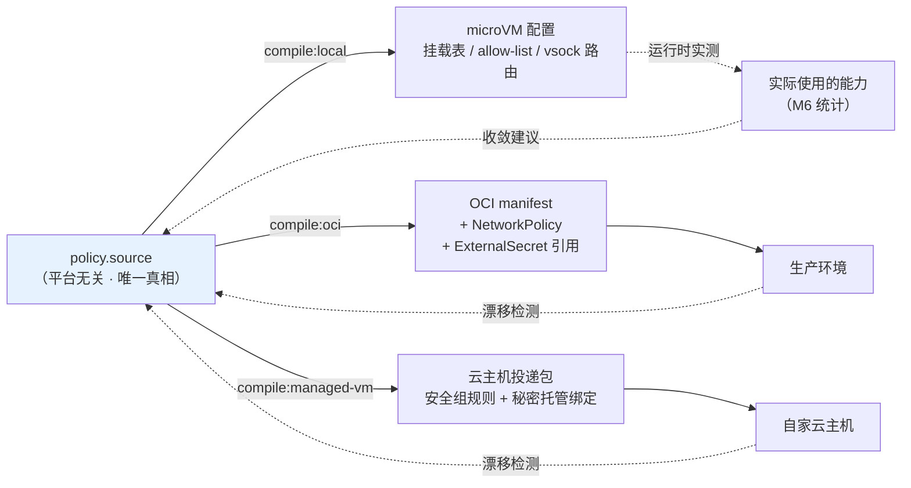
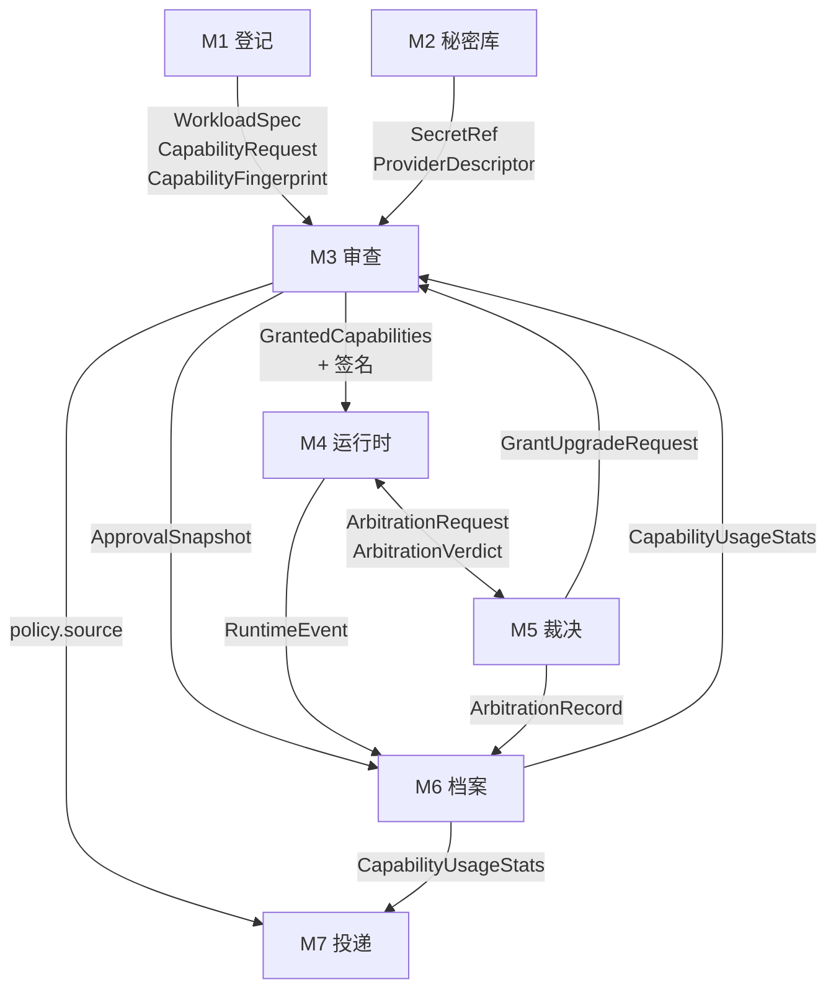

# 桌面级安全沙箱 — 产品设计文档（三）接口契约

> 本批内容：三类接口的完整契约。A 用户可见接口（配置与命令）/ B 系统间接口（模块契约）/ C 外部协议接口（MCP、Workload spec、policy schema）。
> 前置依赖：[01-产品定位与设计锚点.md](./01-产品定位与设计锚点.md) 的 D1–D8、[02-模块设计.md](./02-模块设计.md) 的 M1–M7。
> 后续批次：04 界面信息架构 / 05 计量计费与评审验收。

---

## 0. 接口设计的三条总则

1. **schema 层面拒绝明文**（D1 的执行点）。不是靠校验逻辑拦截，而是**让明文字段在 schema 中不存在**。用户想写明文都找不到地方写。
2. **策略是源，不是导出**（D6）。`policy.source` 是唯一真相，本地配置与生产产物都是它的编译结果。不存在"从运行时反向生成策略"的路径。
3. **接口措辞与界面措辞分离**。接口用技术术语（工程师读），界面用用户语言（02 §4.3 的对照表）。两者的映射关系由**措辞表**显式维护，不是散落在代码里的字符串。

---

# A. 用户可见的接口

## A.1 配置文件：Workload Spec

用户**通常不需要手写**这个文件——它由 M1 的登记流程生成。但它必须可读、可 diff、可版本控制、可分享。这是开发者用户的基本期待。

### A.1.1 完整示例（claude code）

```yaml
# ~/Library/Application Support/<App>/workloads/claude-code-myrepo.yaml
apiVersion: sandbox/v1
kind: Workload

metadata:
  name: claude-code-myrepo
  displayName: "Claude Code · 我的代码/myrepo"
  type: agent                      # agent | mcp-server | plain-code
  template: claude-code            # 来源模板，用于能力推断的依据追溯
  createdAt: "2026-10-23T14:30:00+08:00"

runtime:
  command: ["claude"]
  args: ["--project", "/workspace"]
  workdir: /workspace
  lifecycle: ephemeral             # ephemeral | session | persistent（D5，默认 ephemeral）

capabilities:
  # ── 文件系统 ──
  filesystem:
    - hostPath: ~/code/myrepo      # 实际存储为 Security-Scoped Bookmark，此处仅为可读展示
      guestPath: /workspace
      mode: rw                     # ro | rw
      copyOnWrite: true            # rw 时默认 true：改动先落沙箱，确认后才同步回宿主
      exclude:                     # 即使在挂载范围内也不可见
        - ".env*"
        - "**/id_rsa*"
        - ".git/config"

  # ── 网络 ──
  network:
    egress:
      default: deny                # 🚫 不可改为 allow（schema 层面 enum 仅含 deny）
      allow:
        - host: api.anthropic.com
          port: 443
          via: proxy               # proxy | direct；direct 仅用于无需凭据注入的场景
          reason: "template:claude-code"   # 推断依据

  # ── 秘密（D1：只有引用，没有值）──
  secrets:
    - ref: anthropic-personal      # 指向 Secret Vault 中的条目
      mode: proxy-inject           # proxy-inject | memory-inject
      # ⚠️ schema 中不存在 value / env / file 字段

  # ── 进程 ──
  process:
    spawn: allow                   # allow | deny
    maxProcesses: 256

  # ── 资源 ──
  resources:
    cpu: 2
    memory: 2Gi
    diskEphemeral: 8Gi

  # ── 缓存层（D5 的摩擦缓解，01 R3 的风险点）──
  cache:
    - kind: npm
      mode: ro                     # 🚫 schema 层面仅允许 ro
      verify: checksum             # 必填，无默认值——强迫显式声明校验方式

# 审查状态（由 M3 写入，用户不手填）
review:
  fingerprint: "sha256:7f3a...b219"
  approvedAt: "2026-10-23T14:31:12+08:00"
  approvedBy: local-user
  mode: minimal                    # recommended | custom | minimal
```

### A.1.2 schema 层面的否决性约束

这些不是"校验规则"，是**字段的不存在**或 **enum 的单值**。设计上的区别很重要：校验规则可以被绕过或放宽，字段不存在则无从绕过。

| 约束 | 实现方式 | 对应决策 |
|---|---|---|
| 秘密不得有明文 | `secrets[]` 项只有 `ref` / `mode`，**无 value/env/file 字段** | D1 |
| 出站不得默认放行 | `network.egress.default` 的 enum 仅含 `deny` 一个值 | D2 |
| 不得通配主机 | `host` 的 pattern 拒绝 `*`、空值、裸 IP 段 | D2 |
| 缓存层不得可写 | `cache[].mode` enum 仅含 `ro` | 01 R3 |
| 缓存层必须声明校验 | `cache[].verify` 必填无默认 | 01 R3 |
| 持久模式不得为默认 | `lifecycle` 的 default 为 `ephemeral` | D5 |
| 审查状态不可由用户伪造 | `review` 块由 M3 签名；签名不符视为未审查 | D3 |

**`network.egress.default` 只有一个合法值是故意的**。保留这个字段而不是删掉它，是为了让读 YAML 的人**看见**"默认拒绝"这件事——它是一句写给人看的声明，不是一个可调的开关。

`⚖️ 取舍`：把约束做进 schema 意味着某些真实场景无法表达（例如"我就是要访问任意主机的爬虫"）。我接受——这类场景应该走"明确标记为高风险的特殊工作负载类型"，而不是放宽通用 schema。给通用 schema 开口子，等于给所有工作负载开口子。

### A.1.3 MCP 工作负载的差异（D4）

```yaml
apiVersion: sandbox/v1
kind: Workload
metadata:
  name: github-mcp
  type: mcp-server

runtime:
  command: ["npx", "-y", "@modelcontextprotocol/server-github"]
  lifecycle: ephemeral

capabilities:
  filesystem: []                   # 默认空
  network:
    egress:
      default: deny
      allow:
        - host: api.github.com
          port: 443
          via: proxy
          reason: "probe:config-declared"
  secrets:
    - ref: github-personal
      mode: proxy-inject

# ── MCP 专属：工具级开关（D4 的差异点）──
mcp:
  probedAt: "2026-10-23T14:20:00+08:00"
  toolPolicy:
    default: deny                  # 🚫 enum 仅含 deny
    allow:
      - name: get_issue
        risk: low
      - name: list_repos
        risk: low
      - name: create_pull_request
        risk: high
        confirmEachCall: false     # true 时每次调用都要确认
    # search_code、delete_* 等未列出的工具 → 默认拒绝
  exposedTools:                    # 探查结果，只读，用于检测"工具集变化"
    - get_issue
    - list_repos
    - create_pull_request
    - search_code
    - create_issue
  toolsetFingerprint: "sha256:2a91...ff03"

# 哪些 Agent 可以调用这个 MCP（D4：Agent 与 MCP 互不默认可见）
consumers:
  - workload: claude-code-myrepo
```

**`exposedTools` 与 `toolPolicy.allow` 分离**是有意设计：前者是"它声称能做什么"（探查所得），后者是"我允许它做什么"（用户批准）。两者的差集就是审查界面要展示的"被你拒绝的功能"。`toolsetFingerprint` 变化 → MCP 更新后新增了工具 → 强制重新审查。

---

## A.2 策略源文件：policy.source（D6 的核心）

工作负载描述回答"跑什么"，策略源回答"允许什么"。**分离的理由**：同一份策略可应用于多个工作负载，且策略是要带到生产的那一份。

```yaml
# policies/agent-baseline.policy.yaml
apiVersion: sandbox/v1
kind: Policy
metadata:
  name: agent-baseline
  displayName: "Agent 基线策略"
  portable: true                   # 声明本策略不含平台特定内容

spec:
  filesystem:
    defaultMode: none
    rules:
      - selector: { label: workspace }
        mode: rw
        copyOnWrite: true
        denyPatterns: [".env*", "**/*_rsa", "**/.aws/**", "**/.kube/**"]

  network:
    defaultEgress: deny
    rules:
      - selector: { label: llm-api }
        allow:
          - { host: api.anthropic.com, port: 443, via: proxy }

  secrets:
    injectionMode: proxy-preferred  # proxy-preferred | memory-only
    denyPlaintextInEnv: true        # 恒为 true，列出是为了可读

  mcp:
    toolPolicy: { default: deny }
    requireProbeBeforeRun: true

  audit:
    retentionDays: 90
    failClosed: true                # 审计不可用时拒绝新沙箱（02 §7.5）

# ── 编译目标声明（D6 双轨）──
targets:
  local:
    engine: macos-virtualization
  oci:
    networkPolicyFormat: kubernetes-v1
    secretBackend: external-secrets
  managed-vm:
    productLine: ecs
    securityGroupMode: strict
```

### A.2.1 编译关系



**两条虚线是本设计的关键**，也是 D6 从口号变成机制的地方：
- **收敛回路**：M6 的实际使用统计反馈给策略源，生成"可以收紧"的建议（02 §8.3）
- **漂移检测**：生产侧手工改动能被检出并提示三方差异

### A.2.2 编译的"不可表达"处理

| 本地能力 | OCI 轨 | 云主机轨 | 不可表达时的行为 |
|---|---|---|---|
| 文件 copy-on-write | ⚠️ 无等价 | ⚠️ 无等价 | 产物中标注"此限制生产不保证"，**不静默丢弃** |
| 主机级 allow-list | ✅ NetworkPolicy + egress FQDN | ✅ 安全组 + 域名解析 | — |
| 秘密代理注入 | ⚠️ 需 sidecar | ✅ 托管服务直通 | OCI 轨降级为 memory-inject 并告知 |
| MCP 工具级开关 | ⚠️ 需本产品 sidecar | ⚠️ 同左 | 明确标注"生产侧无 MCP 工具过滤" |
| 一次性沙箱 | ✅ Pod restartPolicy | ✅ 实例回收策略 | — |

**🚫 否决条件**：编译器遇到不可表达的限制时，不得静默降级。必须在产物与报告中显式列出"这些保护在生产环境不生效"。静默降级是"本地到生产"承诺最容易崩塌的地方。

---

## A.3 命令行接口

GUI 是主界面，CLI 是**给已经信任产品的用户的加速器**，不是平行入口。设计原则：**CLI 不得绕过审查**。

```bash
# 工作负载
sandbox run <workload>              # 启动；未审查或指纹变更时自动唤起 GUI 审查
sandbox run <workload> --minimal    # 以最小权限试运行（M3 主推路径）
sandbox ls                          # 列出工作负载及审查状态
sandbox inspect <workload>          # 查看能力清单 + 推断依据
sandbox stop <workload>

# 登记
sandbox init --template claude-code --workdir ./myrepo
sandbox import <file.sandboxpkg>    # 签名无效时拒绝

# MCP
sandbox mcp probe <command>         # 零权限试探，输出工具清单
sandbox mcp tools <workload>        # 查看工具开关状态

# 秘密（🚫 没有任何接受明文值的参数）
sandbox secret ls                   # 仅列出引用名 + 末四位
sandbox secret connect <provider>   # 唤起 GUI 完成 OAuth/导入
sandbox secret rm <ref>
# ❌ 不存在：sandbox secret set <name> <value>

# 档案
sandbox log <workload> [--since 24h] [--redact]
sandbox usage <workload>            # 能力实际使用统计

# 投递
sandbox policy compile <policy> --target oci|managed-vm
sandbox policy diff <policy> --against production
sandbox handoff <workload> --target managed-vm --dry-run
```

### A.3.1 CLI 的三条硬约束

| 约束 | 理由 |
|---|---|
| **无 `secret set <value>`** | 明文会进 shell history、进 CI 日志、进 `ps` 输出。D1 的否决条件在 CLI 上的体现 |
| **无 `--yes` / `--force` 批准审查** | 高风险能力的批准必须经 GUI 原生界面（02 §6.6：信任决策 UI 必须宿主渲染）。CLI 自动化可以跳过**已审查**的工作负载，不能跳过**审查本身** |
| **无 `--no-sandbox`** | 02 §5.6 的产品底线，CLI 侧同样不提供逃生舱 |

`⚖️ 取舍`：没有 `--yes` 会让 CI 场景无法全自动。解法是"**预先在 GUI 审查并导出已签名的策略**，CI 中引用该策略"——审查动作前置到人的时间，而不是取消。这是我认为正确的权衡：自动化的是执行，不是信任。

---

# B. 系统间接口（模块契约）

## B.1 契约总览



## B.2 核心数据契约

### B.2.1 `CapabilityRequest`（M1 → M3）

```typescript
interface CapabilityRequest {
  id: string;
  kind: 'filesystem' | 'network' | 'secret' | 'process' | 'mcp-tool' | 'clipboard';
  spec: FilesystemSpec | NetworkSpec | SecretRefSpec | ProcessSpec | McpToolSpec | ClipboardSpec;

  // ── 以下三项缺一不可，缺失则该条目不得进入审查界面 ──
  risk: 'low' | 'medium' | 'high';
  evidence: Evidence;        // 推断依据（02 §2.3）
  phrasing: Phrasing;        // 用户语言措辞（02 §4.3）
}

interface Evidence {
  source: 'template' | 'static-analysis' | 'probe' | 'user-declared' | 'prior-approval';
  detail: string;            // "来自 claude-code 官方模板" | "在 .mcp.json 第 12 行声明"
  locator?: { file: string; line?: number };
}

interface Phrasing {
  capability: string;        // "能读取并修改「代码/myrepo」文件夹里的所有内容"
  consequence: string;       // "如果它出错或被动过手脚，这些文件可能被改坏或删掉"
  version: string;           // 措辞表版本，写入 ApprovalSnapshot 用于事后追溯
}
```

**契约级强制**：`evidence` 与 `phrasing` 为**必填且不可为空字符串**。这把 02 §2.3 和 §4.3 两条设计规则变成了类型系统强制的约束——工程实现想绕过就得先改接口定义，而改接口定义会触发设计评审。

### B.2.2 `SecretRef`（M2 → 所有模块）

```typescript
interface SecretRef {
  name: string;
  provider: string;                              // "anthropic" | "github" | "custom:..."
  mode: 'proxy-inject' | 'memory-inject';
  lastFour: string;                              // 展示用，如 "a1b2"
  status: 'valid' | 'expired' | 'revoked' | 'unverified';
  origin: 'oauth' | 'keychain-import' | '1password' | 'secrets-manager' | 'manual';
  createdAt: string;
  // 🚫 本接口及其任何版本中不存在 value / plaintext / env 字段
}
```

**`origin` 字段的产品用途**：驱动 §1.2 的验收指标"用户输入的明文敏感字符数 = 0"。统计 `origin === 'manual'` 的占比，就是这个指标的度量。目标是让它趋近于零——这是产品健康度指标，不只是技术字段。

### B.2.3 `GrantedCapabilities`（M3 → M4）

```typescript
interface GrantedCapabilities {
  workloadId: string;
  fingerprint: string;              // 必须与 M1 产出的能力指纹一致
  grants: Grant[];
  mode: 'recommended' | 'custom' | 'minimal';
  issuedAt: string;
  expiresAt?: string;               // session/ephemeral 模式下的有效期
  signature: string;                // M3 签名；M4 必须校验
}

interface Grant {
  requestId: string;                // 回指 CapabilityRequest
  decision: 'granted' | 'denied';
  phrasingVersion: string;          // 用户当时看到的措辞版本
  constraints?: Record<string, unknown>;  // 用户裁剪后的收窄条件
}
```

**M4 的强制校验**：
1. `signature` 有效，否则拒绝启动
2. `fingerprint` 与当前 WorkloadSpec 推导出的一致，否则拒绝启动
3. 执行任何能力前，在 `grants` 中查到对应 `decision === 'granted'`，否则交 M5

这三条实现了全局不变式 #1（未经审查不得执行）。

### B.2.4 `ArbitrationRequest` / `ArbitrationVerdict`（M4 ↔ M5）

```typescript
interface ArbitrationRequest {
  workloadId: string;
  attempt: {
    kind: CapabilityRequest['kind'];
    target: string;                 // "example.com:443" | "/host/~/.ssh/id_rsa" | "github.delete_repo"
    timestamp: string;
  };
  risk: 'low' | 'medium' | 'high';
  // 疑似外发敏感数据时的摘要（02 §6.5）——摘要本身不得含明文秘密
  payloadDigest?: { size: number; sensitiveHints: string[] };
  repeatCount: number;              // 聚合计数，用于抑制重复弹窗
}

interface ArbitrationVerdict {
  decision: 'allow' | 'deny';
  reason: 'pre-granted' | 'silent-allow-low-risk' | 'silent-deny'
        | 'user-approved' | 'user-denied' | 'timeout-denied' | 'fail-closed';
  upgradeGrantId?: string;          // 用户选择补授时，指向 M3 产出的新授权
  protocolError?: McpError;         // MCP 工具调用被拒时返回给 Agent 的协议层错误
}
```

**`protocolError` 是 D4 可用性的关键**（02 §6.4）：被拒绝的 MCP 工具调用必须返回 Agent 能理解的错误，而不是超时。

### B.2.5 `ApprovalSnapshot`（M3 → M6）

```typescript
interface ApprovalSnapshot {
  readonly id: string;
  readonly workloadId: string;
  readonly fingerprint: string;
  readonly decidedAt: string;
  readonly mode: 'recommended' | 'custom' | 'minimal';
  readonly grants: ReadonlyArray<{
    kind: string;
    target: string;
    decision: 'granted' | 'denied';
    riskAtTime: 'low' | 'medium' | 'high';
    phrasingShown: { capability: string; consequence: string; version: string };  // ← 关键
  }>;
  readonly uiContext: { appVersion: string; phrasingTableVersion: string };
}
```

**`phrasingShown` 存的是措辞的内容快照，不是指针**。文案日后改版，旧快照仍能回答"用户当时究竟看到了什么"（02 §4.4）。这是安全事件追溯的必需品，也是对产品自身的约束——不能靠改文案来掩盖过去的设计缺陷。

### B.2.6 `CapabilityUsageStats`（M6 → M7/M3）

```typescript
interface CapabilityUsageStats {
  workloadId: string;
  window: { from: string; to: string; runCount: number };
  perGrant: Array<{
    requestId: string;
    kind: string;
    grantedScope: string;           // "~/code/myrepo rw"
    observedScope: string;          // "~/code/myrepo ro（未发生写入）"
    useCount: number;
    lastUsedAt?: string;
  }>;
  unusedGrants: string[];           // 驱动"3 项权限从未用过，要收回吗"
  convergenceSuggestions: Array<{
    requestId: string;
    from: string;
    to: string;
    rationale: string;
  }>;
}
```

这是 02 §8.3「从已授予收敛到实际用到」的数据载体，同时回流给 M3 驱动 02 §7.4 的异常模式告警。

## B.3 Broker 内部接口（宿主 ↔ guest）

**唯一通道是 vsock**。guest 无网络栈直连、无共享内存、无宿主文件系统直接访问。

| 通道 | 方向 | 内容 | 约束 |
|---|---|---|---|
| `ctrl` | 双向 | 生命周期控制、健康检查 | 定长消息，拒绝变长攻击面 |
| `fs` | guest → host | 文件操作代理 | 仅已挂载视图内；越界在挂载层失败，不到达 Broker |
| `net` | guest → host | 出站请求 | 全部经代理；未 allow-list 直接拒绝 |
| `secret` | host → guest | 秘密注入 | **单向**，仅 memory-inject 模式，仅进程启动时 |
| `mcp` | 双向 | Agent ↔ MCP 的 JSON-RPC | 经 Broker 过滤 `tools/list`、拦截 `tools/call` |
| `event` | guest → host | 运行事件上报 | 仅数据，不含控制语义 |

**`secret` 通道单向是硬设计**：guest 无法通过该通道请求任意秘密，只能被动接收启动时注入的那一份。这避免了"guest 内被注入的代码主动索要更多秘密"的攻击路径。

---

# C. 外部协议接口

## C.1 MCP 协议的拦截契约（D4）

### C.1.1 `tools/list` 过滤

```
Agent ──tools/list──▶ Broker ──转发──▶ MCP 工作负载
                        ◀──完整工具清单──┘
                        │
                        ├─ 比对 toolsetFingerprint
                        │    └─ 变化 → 🔴 暂停 + 强制重新审查
                        ├─ 按 toolPolicy.allow 过滤
                        └─ 返回过滤后清单给 Agent
```

**关键决策：返回过滤后的清单，而不是完整清单 + 调用时拒绝。**

`⚖️ 取舍`：
- **过滤清单**的优点是 Agent 根本不知道被禁的工具存在，不会浪费推理尝试，也不会在 prompt 中暴露"有个 delete_repo 但你不能用"这种诱导信息。缺点是 Agent 可能无法向用户解释"为什么做不到"。
- **完整清单 + 调用拒绝**的优点是透明，缺点是 Agent 会反复尝试，且把被禁工具的存在告诉了可能被 prompt 注入的模型。

我选择**过滤清单**，并通过在宿主侧状态面板显示"已为你隐藏 3 个高风险功能"来补偿透明度——**透明度给用户，不给 Agent**。这与 02 §6.6（信任 UI 不由 guest 渲染）同源。

### C.1.2 `tools/call` 拦截

```typescript
// Broker 对每次 tools/call 的处理
interface ToolCallGate {
  toolName: string;
  // 1. 不在 allow 列表 → 返回协议错误（不是超时）
  // 2. 在 allow 列表但标记 confirmEachCall → 唤起宿主确认
  // 3. 参数触发敏感模式（如路径穿越、批量操作）→ 提升风险等级后重判
  // 4. 通过 → 转发
}
```

被拒时返回的协议错误：

```json
{
  "jsonrpc": "2.0",
  "id": 42,
  "error": {
    "code": -32000,
    "message": "Tool 'create_pull_request' is not permitted by the sandbox policy",
    "data": {
      "reason": "not-in-allow-list",
      "userActionHint": "The user can grant this capability in the sandbox app"
    }
  }
}
```

**`userActionHint` 是给 Agent 看的**，让它能告诉用户"我需要一个权限"，而不是反复重试或凭空失败。这一句话决定了 D4 是"好用的隔离"还是"碍事的隔离"。

### C.1.3 MCP 探查协议（M1 的试探性启动）

| 阶段 | 行为 | 约束 |
|---|---|---|
| 1. 创建探查沙箱 | 零权限、无网络、无挂载、无秘密 | 违反任一则探查无效 |
| 2. 启动 MCP | 仅 `initialize` + `tools/list` | 不发送任何其他请求 |
| 3. 观测越界 | 记录该进程的任何网络/文件尝试 | **这是探查最有价值的产物** |
| 4. 销毁 | 一次性，仅保留 JSON 结果与越界记录 | 不保留任何文件系统状态 |
| 超时 | 10s | 超时则工具清单标记 `unknown` |

探查输出：

```typescript
interface ProbeResult {
  status: 'ok' | 'timeout' | 'crashed';
  exposedTools: ToolDescriptor[];
  toolsetFingerprint: string;
  // 零权限下的越界尝试 —— 高风险信号，审查界面置顶
  violationsDuringProbe: Array<{
    kind: 'network' | 'filesystem' | 'process';
    target: string;
    interpretation: string;   // "它在没有任何权限时就尝试访问网络"
  }>;
  declaredHosts: string[];    // 从配置文件静态解析出的主机
}
```

## C.2 Provider 目录接口（D1 的路由依据）

内置 Provider 目录决定了"用户选服务 → 系统选机制"的自动路由。

```yaml
# providers/anthropic.yaml
apiVersion: sandbox/v1
kind: Provider
metadata:
  id: anthropic
  displayName: "Claude 官方服务"

auth:
  preferredFlow: oauth            # oauth > keychain-import > manual
  oauth: { authorizeUrl: "...", scopes: ["api"] }
  injection:
    mode: proxy-inject            # 决定走代理注入
    header: "x-api-key"
    format: "{{secret}}"

network:
  requiredHosts:
    - { host: api.anthropic.com, port: 443 }

validation:
  probeEndpoint: "/v1/models"     # 用于校验凭据有效性
  expectedStatus: [200]

phrasing:
  capability: "能以你的身份调用 Claude"
  consequence: "它可以用你的账号发起对话，产生费用；你的密钥不会交给它"
```

**Provider 目录是产品的持续运营资产**：它决定了多少用户能走 OAuth/导入路径（`origin !== 'manual'`），直接影响 §1.2 的核心验收指标。目录的覆盖率应作为产品 KPI 跟踪。

**自定义 Provider**：用户可添加，但默认降级为 `memory-inject`，且在审查界面标注"自定义服务，保护级别低于内置服务"。

## C.3 分享包格式：`.sandboxpkg`

```
myagent.sandboxpkg/
├── manifest.json          # 包元数据 + 签名
├── workload.yaml          # WorkloadSpec（🚫 已剥离所有 hostPath 与 secretRef 的具体值）
├── policy.yaml            # policy.source
├── phrasing.json          # 措辞表快照，保证接收方看到的描述与分享方一致
└── provenance.json        # 来源、签名者、构建时间
```

**导入时的处理**：

| 字段 | 处理 |
|---|---|
| `hostPath` | 全部置空，强制接收方自己通过系统 Picker 选择 |
| `secretRef` | 仅保留"需要哪个 Provider 的账号"，不保留引用名；接收方需自行连接 |
| `review` | 全部清除——**分享包不携带审查结果**，接收方必须自己审查 |
| 签名无效 | 默认拒绝；强制导入时永久标记"来源不明"并提升所有能力风险等级 |

**"分享包不携带审查结果"是否决性的**。否则"信任"就会随文件传播，一个人的批准变成所有人的批准——这是供应链攻击最省力的入口。

---

## D. 接口层的否决条件汇总

供评审时逐条核对：

| # | 否决条件 | 落点 | 决策 |
|---|---|---|---|
| I1 | Workload spec 的 schema 中不存在任何明文秘密字段 | A.1.2 | D1 |
| I2 | CLI 不存在接受明文秘密值的参数 | A.3.1 | D1 |
| I3 | `SecretRef` 接口任何版本都不含 value 字段 | B.2.2 | D1 |
| I4 | `network.egress.default` 的 enum 仅含 `deny` | A.1.2 | D2 |
| I5 | `cache[].mode` 的 enum 仅含 `ro`，`verify` 必填 | A.1.2 | 01 R3 |
| I6 | `CapabilityRequest` 的 `evidence`/`phrasing` 必填非空 | B.2.1 | D3 |
| I7 | CLI 不存在跳过审查的 `--yes`/`--force` | A.3.1 | D3 |
| I8 | `ApprovalSnapshot` 存措辞内容快照而非指针 | B.2.5 | D3 |
| I9 | `mcp.toolPolicy.default` 的 enum 仅含 `deny` | A.1.3 | D4 |
| I10 | MCP 被拒调用返回协议层错误而非超时 | C.1.2 | D4 |
| I11 | `secret` vsock 通道单向 | B.3 | D1/D2 |
| I12 | `lifecycle` 默认值为 `ephemeral` | A.1.2 | D5 |
| I13 | 编译器不得静默降级不可表达的限制 | A.2.2 | D6 |
| I14 | `.sandboxpkg` 不携带审查结果 | C.3 | D3 |
| I15 | 无任何形式的 `--no-sandbox` 逃生舱 | A.3.1 | 02 §5.6 |

---

**下一批（04）**：界面设计——信息架构、主要功能的界面线框与交互流程、措辞表完整版。
